# Application Flow

# AP Production

**Project Name:** AP Production  
**Package Name:** `com.buildstack.approduction`

---

# 1. Complete Application Flow

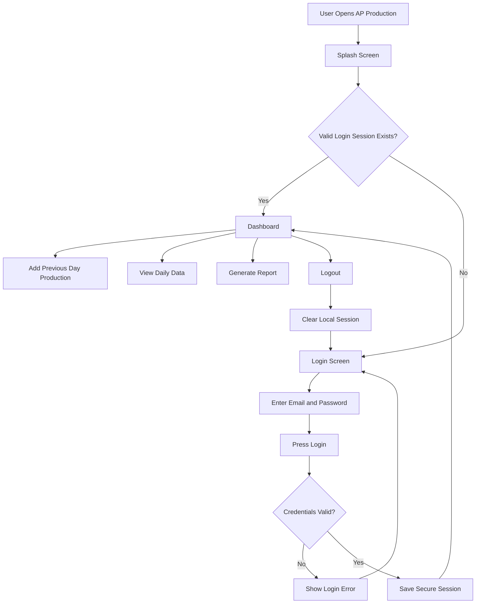

---

# 2. Authentication Flow

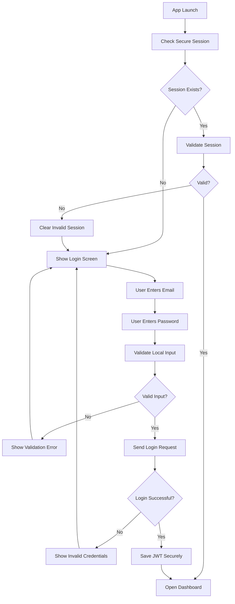

---

# 3. Dashboard Flow

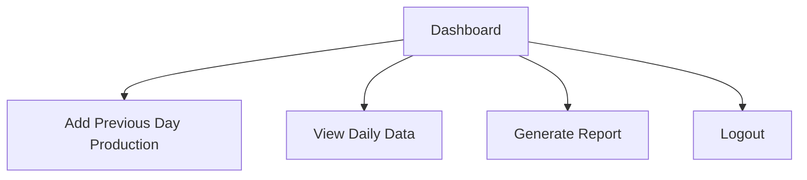

---

# 4. Add Production Data Flow

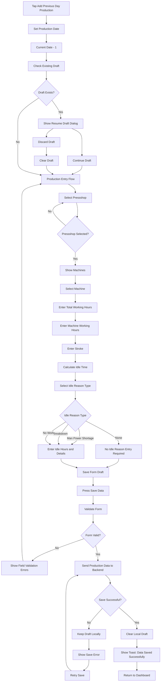

---

# 5. Pressshop and Machine Flow

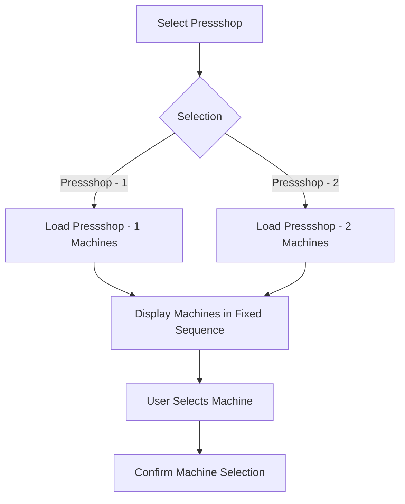

---

# 6. Machine Sequence Flow

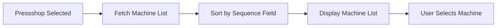

The application must always use the predefined sequence value.

Machines must never be automatically reordered alphabetically.

---

# 7. Idle Time Flow

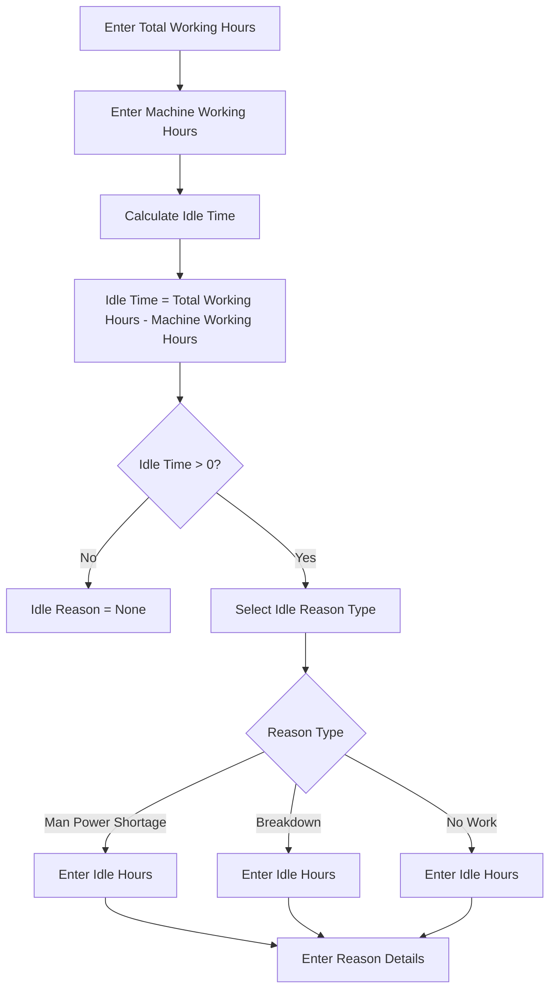

---

# 8. Save Production Data Flow

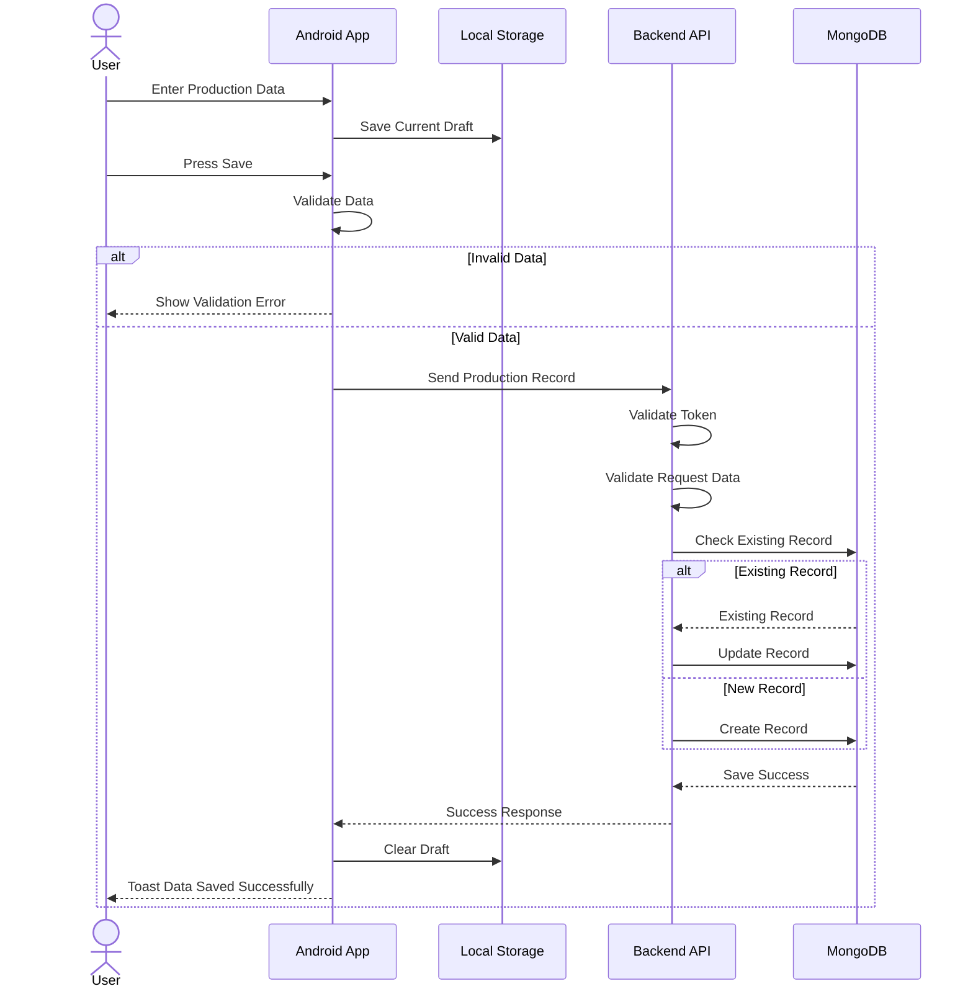

---

# 9. Daily Data Viewing Flow

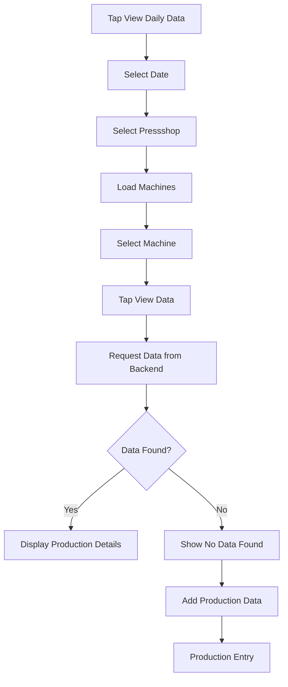

---

# 10. Report Generation Flow

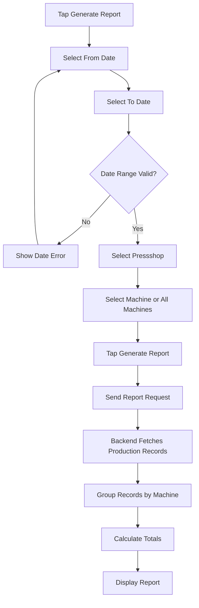

---

# 11. Report Calculation Flow

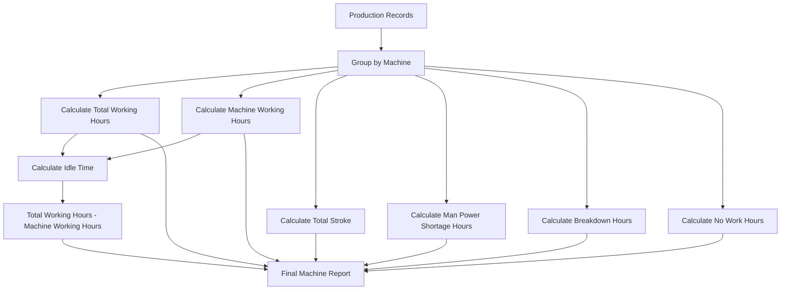

---

# 12. CSV Export Flow

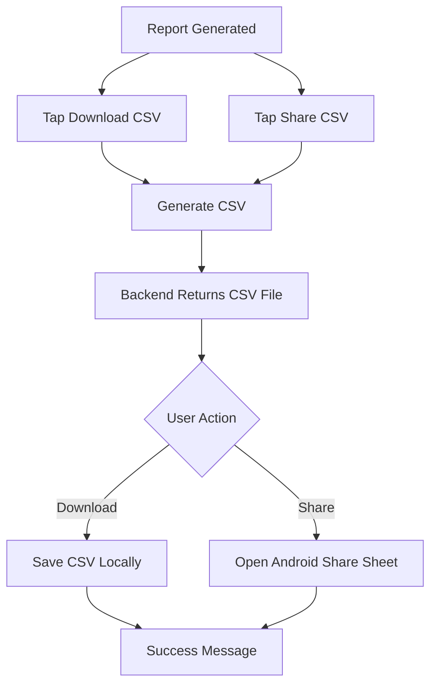

---

# 13. Draft Persistence Flow

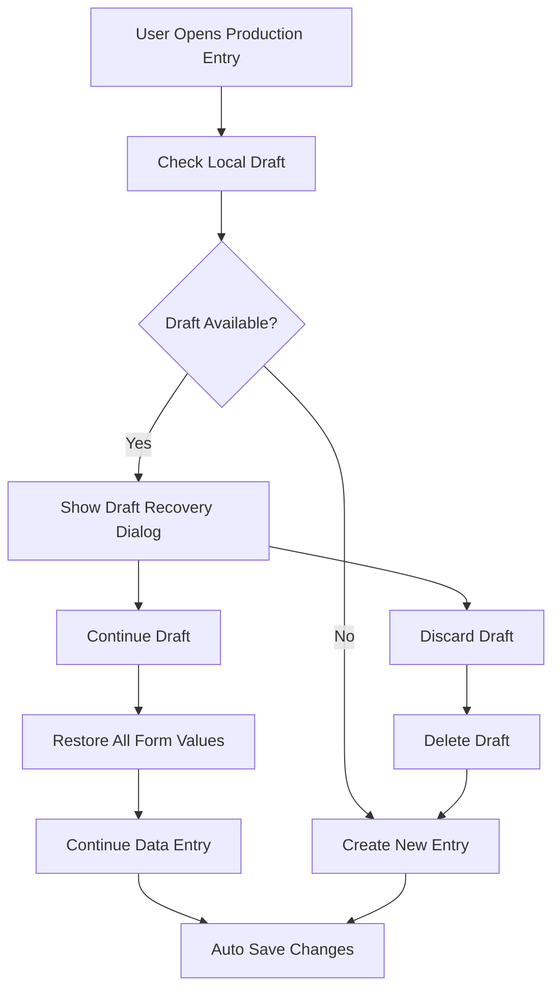

---

# 14. Logout Flow

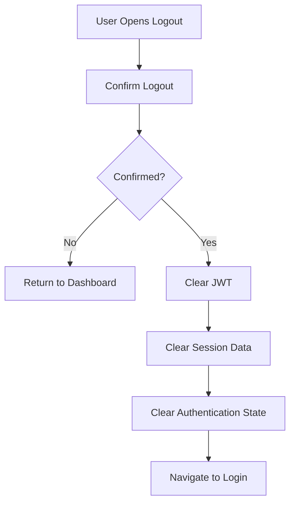

---

# 15. Error Handling Flow

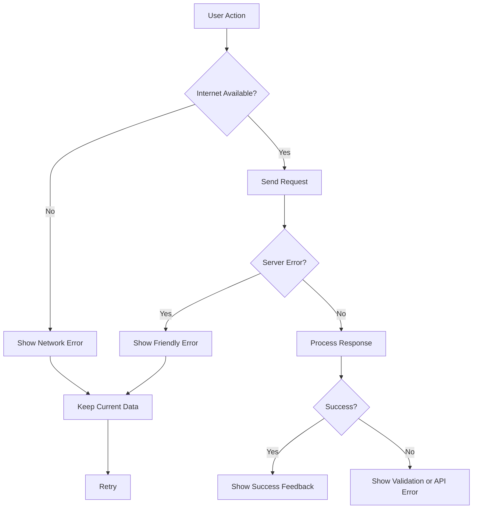

---

# 16. Complete User Journey

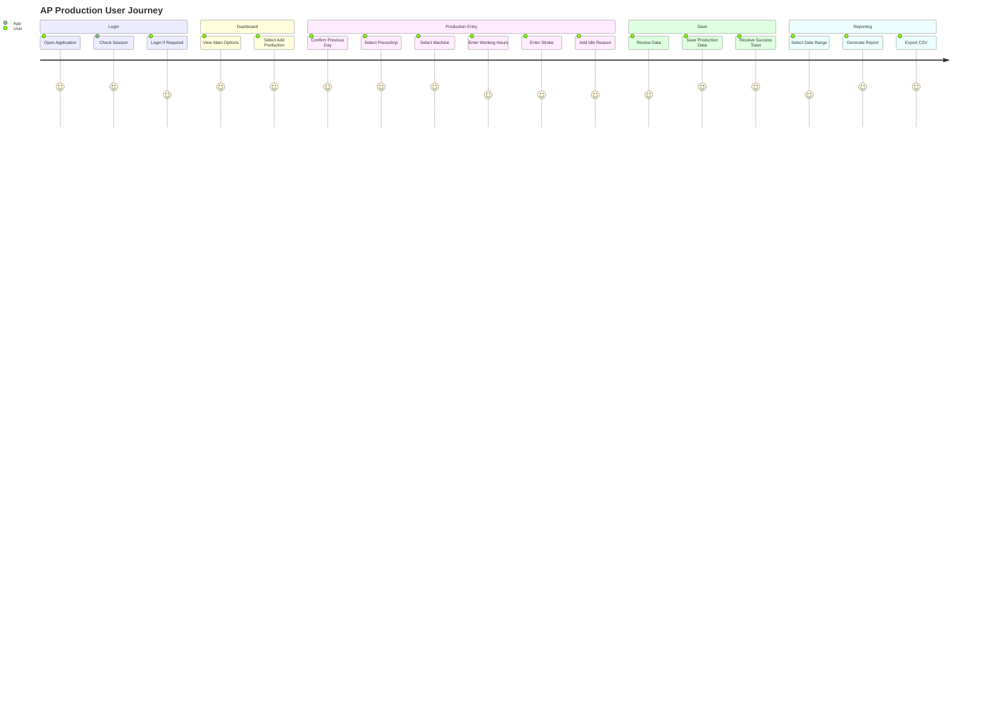

---

# 17. Application Navigation Summary

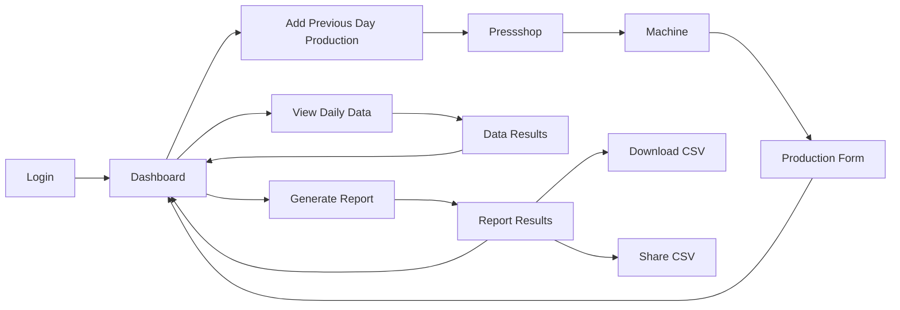

---

# 18. Primary Application Rules

```text
1. Default production date must be Current Date - 1.

2. Users must select a Pressshop before selecting a machine.

3. Machine order must remain exactly as defined.

4. Machine Working Hours cannot exceed Total Working Hours.

5. Idle Time must be calculated automatically.

6. Idle Time = Total Working Hours - Machine Working Hours.

7. Draft data must persist if the user leaves the application.

8. Drafts must only be cleared after successful save or user confirmation.

9. Production data must be available for any saved date.

10. Reports must support a From Date and To Date.

11. CSV reports must contain machine-wise totals.

12. Users must authenticate before accessing protected application features.

13. Valid login sessions must support automatic login.

14. Logout must clear the stored authentication session.
```

---

# 19. Final Application Flow

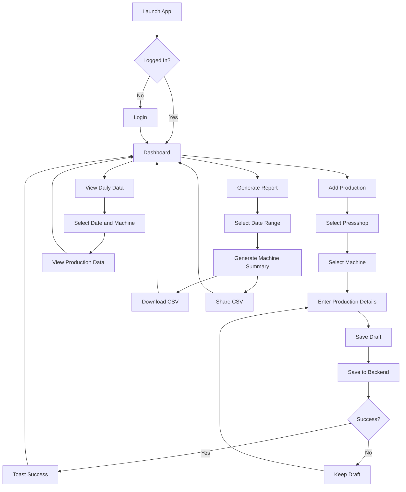