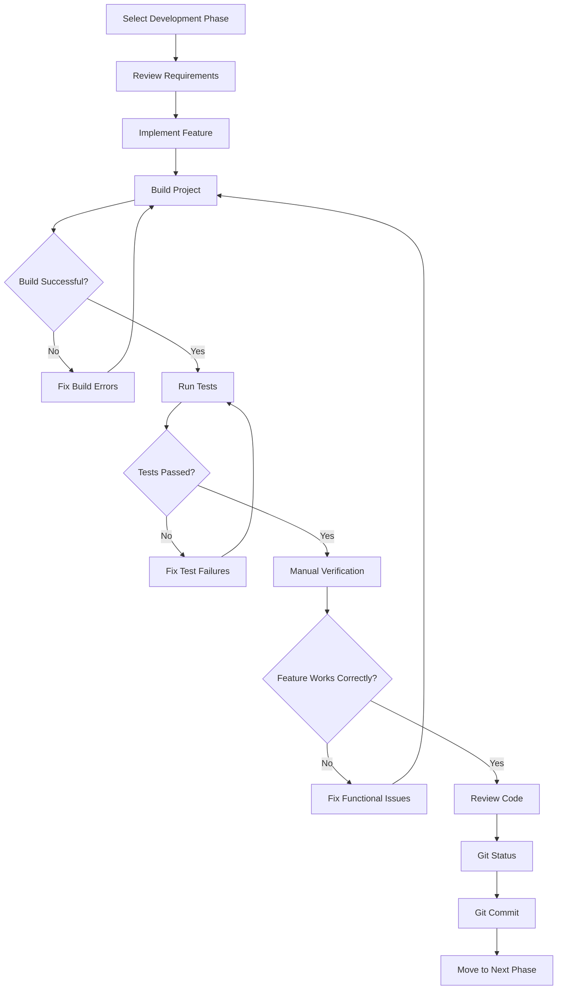
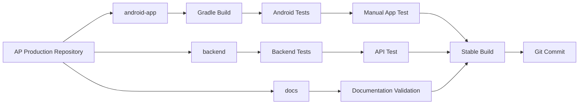
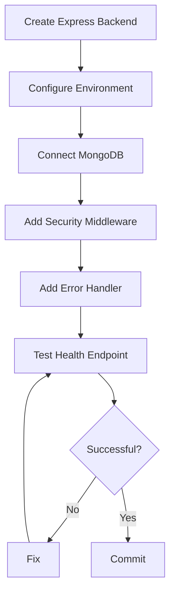
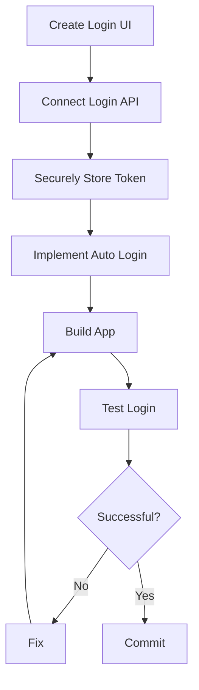
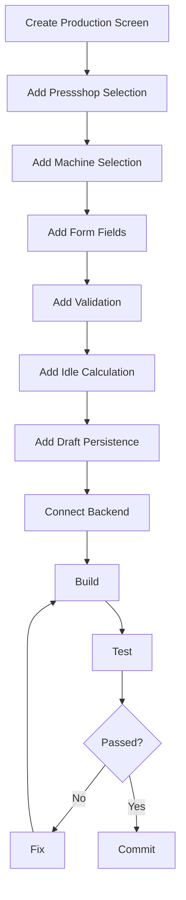
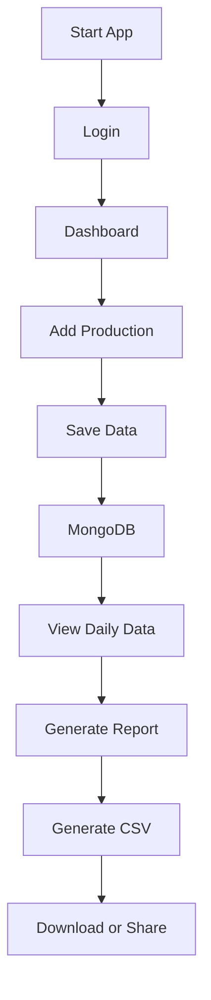
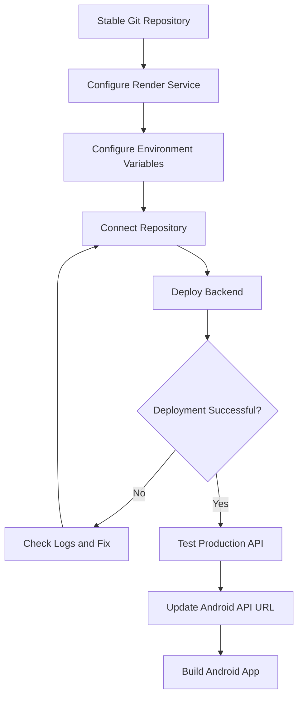
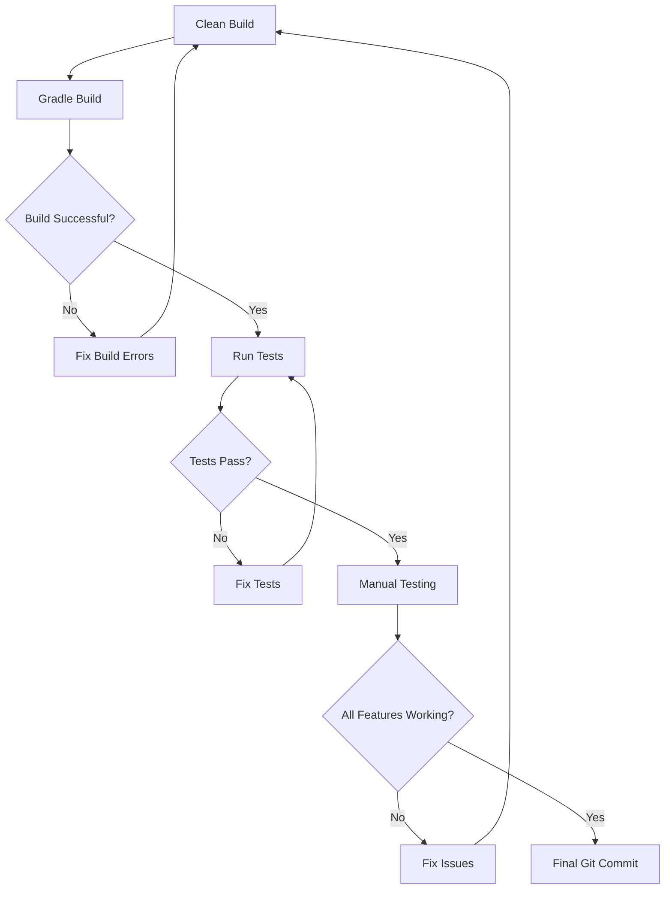

# Build Flow

# AP Production

**Project Name:** AP Production  
**Package Name:** `com.buildstack.approduction`  
**Repository Structure:** Monorepo

---

# 1. Build Principles

Every development phase must follow the same strict process:

```text
Plan
↓
Build
↓
Run Build
↓
Test
↓
Fix
↓
Test Again
↓
Commit to Git
```

No feature should be considered stable until:

1. The build succeeds.
2. Relevant tests pass.
3. Known errors are fixed.
4. The feature is manually verified where required.
5. The stable state is committed to Git.

---

# 2. Global Development Flow



---

# 3. Monorepo Build Flow



---

# 4. Phase 1 — Project Initialization

## Objectives

Create the initial project structure.

### Tasks

1. Create Git repository.
2. Create monorepo structure.
3. Initialize Android project.
4. Set Android package name.
5. Initialize Node.js backend.
6. Configure environment variable structure.
7. Create documentation directory.
8. Configure `.gitignore`.

### Required Structure

```text
AP-Production/
├── android-app/
├── backend/
├── docs/
├── .env.example
├── .gitignore
└── README.md
```

### Android Package

```text
com.buildstack.approduction
```

### Build and Test

```bash
cd android-app
./gradlew build
```

Backend:

```bash
cd backend
npm install
npm test
```

### Stable Commit

```text
chore: initialize AP Production monorepo
```

---

# 5. Phase 2 — Backend Foundation

## Objectives

Create the backend foundation.

### Tasks

1. Configure Express.js.
2. Configure environment variables.
3. Configure MongoDB connection.
4. Add centralized error handling.
5. Add logging.
6. Add security middleware.
7. Add request validation structure.
8. Create health check endpoint.

### Required Endpoint

```http
GET /health
```

Expected response:

```json
{
  "success": true,
  "message": "Server is running"
}
```

### Build Flow



### Stable Commit

```text
feat: add backend foundation and database connection
```

---

# 6. Phase 3 — Authentication

## Objectives

Implement secure user authentication.

### Tasks

1. Create authentication model.
2. Configure user credentials.
3. Hash passwords.
4. Create login API.
5. Generate JWT.
6. Create authentication middleware.
7. Create current user API.
8. Add login rate limiting.

### Testing

Test:

- Valid credentials.
- Invalid email.
- Invalid password.
- Missing fields.
- Invalid token.
- Expired token.
- Unauthorized API access.

### Stable Commit

```text
feat: implement secure authentication
```

---

# 7. Phase 4 — Pressshop and Machine Master Data

## Objectives

Add master data.

### Tasks

1. Create Pressshop model.
2. Create Machine model.
3. Add sequence field.
4. Create seed script.
5. Seed Pressshop - 1.
6. Seed Pressshop - 2.
7. Verify machine order.

### Critical Test

Verify that machines are returned in this exact order:

```text
Pressshop - 1
1. Break Press 300 Ton
2. Break Press 400 Ton
3. 1200 Ton
4. 1000 Ton F
5. 3000 Ton
6. 1100 Ton
7. 800 Ton
8. 400 Ton
9. 600 Ton
10. 315 Ton
11. 500 Ton
12. 1000 Ton USI
13. Schuller
14. Muller
15. 1250 Ton
16. 2000 Ton
17. 350 Ton
```

```text
Pressshop - 2
1. 1000 Ton ISG
2. 400 Ton
3. 1500 Ton
4. 1000 Ton 2
5. 1000 Ton 1
6. 800 Ton 1
7. 800 Ton 2
8. 300 Ton 1
9. 300 Ton 2
```

### Stable Commit

```text
feat: add pressshop and machine master data
```

---

# 8. Phase 5 — Production Backend

## Objectives

Create production data APIs.

### Tasks

1. Create production schema.
2. Add validation.
3. Create production record API.
4. Create production data retrieval API.
5. Create update API.
6. Prevent duplicate machine/date records.
7. Validate working hours.
8. Validate idle reasons.

### Validation Rules

```text
Machine Working Hours <= Total Working Hours
```

```text
Idle Time = Total Working Hours - Machine Working Hours
```

### Testing

Test:

- Valid production record.
- Invalid hours.
- Negative values.
- Invalid machine.
- Invalid date.
- Duplicate records.
- Unauthorized access.

### Stable Commit

```text
feat: add production management APIs
```

---

# 9. Phase 6 — Report and CSV Backend

## Objectives

Create reporting system.

### Tasks

1. Create date-range report API.
2. Create MongoDB aggregation.
3. Calculate machine totals.
4. Calculate idle time.
5. Calculate idle reason totals.
6. Generate CSV.
7. Test CSV output.

### Required Calculations

```text
Total Working Hours
Machine Working Hours
Total Stroke
Idle Time
Man Power Shortage Hours
Breakdown Hours
No Work Hours
```

### Stable Commit

```text
feat: add production reporting and CSV export
```

---

# 10. Phase 7 — Android Project Foundation

## Objectives

Create the Android application structure.

### Tasks

1. Create Kotlin Android project.
2. Configure Jetpack Compose.
3. Configure Hilt.
4. Configure Navigation.
5. Configure Retrofit.
6. Configure Room.
7. Configure secure storage.
8. Configure DataStore.

### Required Build

```bash
./gradlew build
```

### Stable Commit

```text
feat: initialize Android application architecture
```

---

# 11. Phase 8 — Android Authentication

## Objectives

Implement login functionality.

### Tasks

1. Create Splash screen.
2. Create Login screen.
3. Connect login API.
4. Store token securely.
5. Implement auto login.
6. Implement logout.
7. Handle authentication errors.

### Build Flow



### Stable Commit

```text
feat: add Android authentication flow
```

---

# 12. Phase 9 — Production Entry

## Objectives

Create the main production entry system.

### Tasks

1. Create Dashboard.
2. Add Previous Day Production action.
3. Calculate default previous date.
4. Add Pressshop selection.
5. Add machine selection.
6. Add production form.
7. Add validation.
8. Calculate idle time.
9. Add idle reason fields.
10. Save drafts locally.
11. Connect save API.
12. Add toast notifications.

### Build Flow



### Stable Commit

```text
feat: add production data entry and draft persistence
```

---

# 13. Phase 10 — Daily Data Viewing

## Objectives

Allow users to view saved production data.

### Tasks

1. Create date picker.
2. Add Pressshop filter.
3. Add machine filter.
4. Fetch data from backend.
5. Display production details.
6. Add empty state.
7. Add loading state.
8. Add error state.

### Stable Commit

```text
feat: add daily production data viewer
```

---

# 14. Phase 11 — Report UI

## Objectives

Create report generation functionality.

### Tasks

1. Create date range selection.
2. Add Pressshop filter.
3. Add machine filter.
4. Generate report.
5. Display report.
6. Download CSV.
7. Share CSV.

### Stable Commit

```text
feat: add production report generation
```

---

# 15. Phase 12 — Integration Testing

## Objectives

Test the complete application.

### Integration Flow



### Required Tests

- Complete login flow.
- Auto login.
- Logout.
- Production data entry.
- Draft recovery.
- Daily data viewing.
- Date-range reports.
- CSV generation.
- Unauthorized API access.
- Network failure handling.

### Stable Commit

```text
test: complete end to end application testing
```

---

# 16. Phase 13 — Deployment

## Backend Deployment Flow



### Required Environment Variables

```text
NODE_ENV
PORT
MONGODB_URI
JWT_SECRET
JWT_EXPIRES_IN
BCRYPT_SALT_ROUNDS
USER_EMAIL
USER_PASSWORD_HASH
```

---

# 17. Final Android Build

Before final delivery:

```bash
cd android-app
./gradlew clean
./gradlew build
```

Required process:



---

# 18. Commit Rules

Every stable feature must be committed.

Required sequence:

```text
Build
→ Test
→ Fix
→ Test Again
→ Commit
```

Do not commit a feature before its stable build is verified.

---

# 19. Final Build Checklist

```text
[ ] Android Gradle build passes
[ ] Android tests pass
[ ] Backend tests pass
[ ] MongoDB connection works
[ ] Login works
[ ] Auto login works
[ ] Logout works
[ ] Machine sequence is correct
[ ] Production save works
[ ] Duplicate handling works
[ ] Draft persistence works
[ ] Daily data view works
[ ] Report generation works
[ ] Idle calculations are correct
[ ] CSV export works
[ ] Unauthorized requests are rejected
[ ] Backend deployed successfully
[ ] Production API tested
[ ] Final stable Git commit created
```