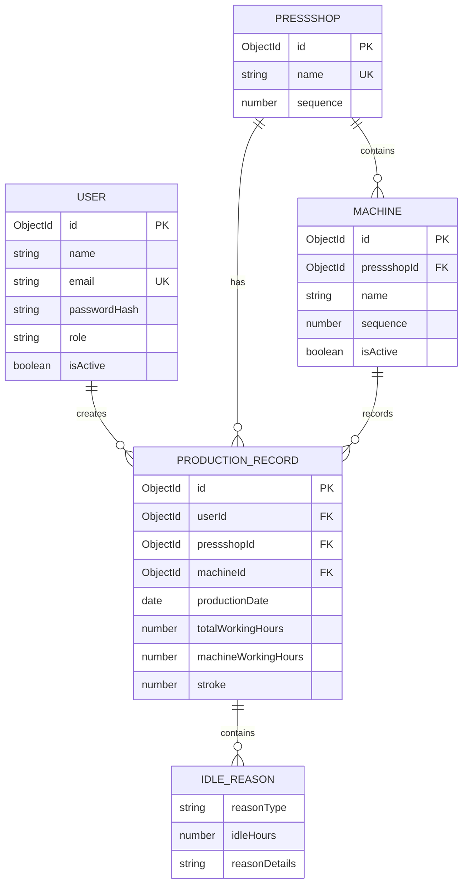
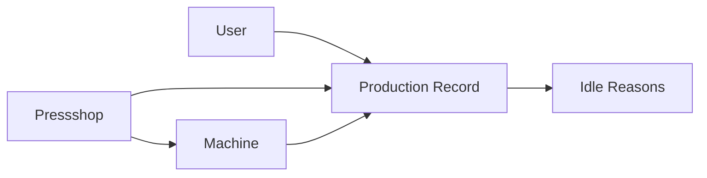
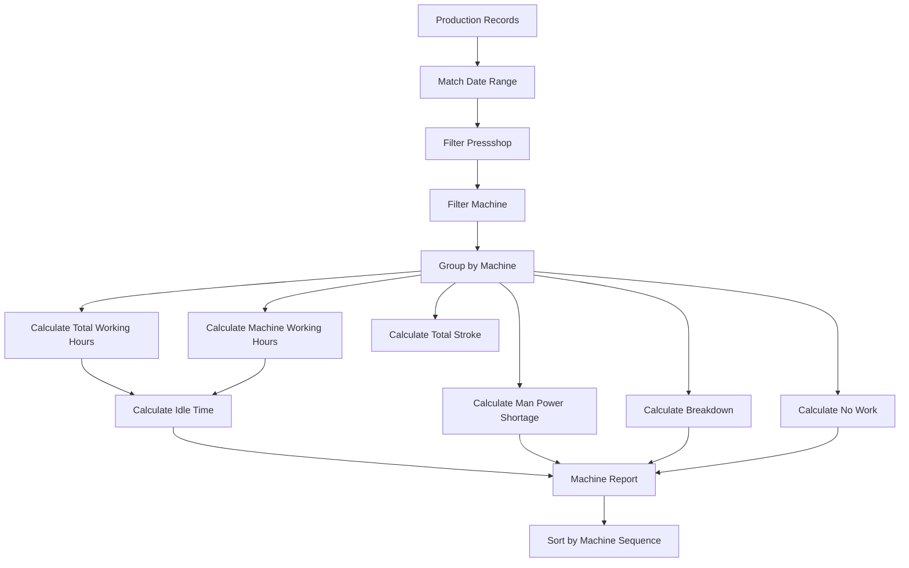
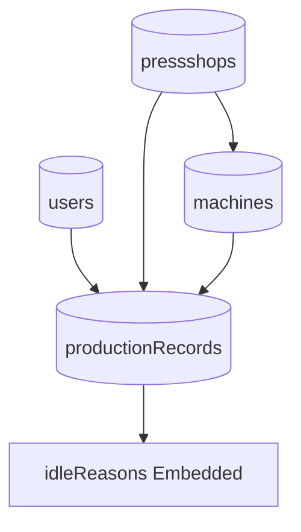

# Database Design

# AP Production

**Database:** MongoDB  
**ODM:** Mongoose  
**Database Purpose:** Store users, Pressshops, machines, production records, and idle reasons.

---

# 1. Database Overview

The AP Production database contains the following primary collections:

```text
users
pressshops
machines
productionRecords
```

Idle reasons are embedded within the production record.

This design is preferred because idle reasons belong directly to a single production record and are normally retrieved together with that record.

---

# 2. Database Relationship Overview



---

# 3. Users Collection

## Collection Name

```text
users
```

## Schema

```javascript
{
  _id: ObjectId,

  name: String,

  email: String,

  passwordHash: String,

  role: String,

  isActive: Boolean,

  createdAt: Date,

  updatedAt: Date
}
```

---

## Field Definitions

| Field | Type | Required | Description |
|---|---|---|---|
| `_id` | ObjectId | Yes | Unique MongoDB identifier |
| `name` | String | Yes | User display name |
| `email` | String | Yes | User login email |
| `passwordHash` | String | Yes | bcrypt password hash |
| `role` | String | Yes | User role |
| `isActive` | Boolean | Yes | Account access status |
| `createdAt` | Date | Yes | Creation time |
| `updatedAt` | Date | Yes | Last update time |

---

## User Index

```javascript
{
  email: 1
}
```

Constraint:

```text
unique: true
```

---

# 4. Pressshops Collection

## Collection Name

```text
pressshops
```

## Schema

```javascript
{
  _id: ObjectId,

  name: String,

  sequence: Number,

  isActive: Boolean,

  createdAt: Date,

  updatedAt: Date
}
```

---

## Pressshop Records

### Pressshop - 1

```json
{
  "name": "Pressshop - 1",
  "sequence": 1,
  "isActive": true
}
```

### Pressshop - 2

```json
{
  "name": "Pressshop - 2",
  "sequence": 2,
  "isActive": true
}
```

---

# 5. Machines Collection

## Collection Name

```text
machines
```

## Schema

```javascript
{
  _id: ObjectId,

  pressshopId: ObjectId,

  name: String,

  sequence: Number,

  isActive: Boolean,

  createdAt: Date,

  updatedAt: Date
}
```

---

## Field Definitions

| Field | Type | Required | Description |
|---|---|---|---|
| `_id` | ObjectId | Yes | Machine ID |
| `pressshopId` | ObjectId | Yes | Parent Pressshop |
| `name` | String | Yes | Machine name |
| `sequence` | Number | Yes | Fixed display sequence |
| `isActive` | Boolean | Yes | Active status |
| `createdAt` | Date | Yes | Creation time |
| `updatedAt` | Date | Yes | Last update |

---

# 6. Critical Machine Sequence Rule

The machine sequence is business-critical.

The database must use:

```text
sequence: Number
```

The API must retrieve machines using:

```javascript
.sort({
  sequence: 1
})
```

Do not use alphabetical sorting.

---

# 7. Pressshop - 1 Machine Seed Data

The exact sequence is:

```javascript
[
  {
    name: "Break Press 300 Ton",
    sequence: 1
  },
  {
    name: "Break Press 400 Ton",
    sequence: 2
  },
  {
    name: "1200 Ton",
    sequence: 3
  },
  {
    name: "1000 Ton F",
    sequence: 4
  },
  {
    name: "3000 Ton",
    sequence: 5
  },
  {
    name: "1100 Ton",
    sequence: 6
  },
  {
    name: "800 Ton",
    sequence: 7
  },
  {
    name: "400 Ton",
    sequence: 8
  },
  {
    name: "600 Ton",
    sequence: 9
  },
  {
    name: "315 Ton",
    sequence: 10
  },
  {
    name: "500 Ton",
    sequence: 11
  },
  {
    name: "1000 Ton USI",
    sequence: 12
  },
  {
    name: "Schuller",
    sequence: 13
  },
  {
    name: "Muller",
    sequence: 14
  },
  {
    name: "1250 Ton",
    sequence: 15
  },
  {
    name: "2000 Ton",
    sequence: 16
  },
  {
    name: "350 Ton",
    sequence: 17
  }
]
```

This sequence must never change.

---

# 8. Pressshop - 2 Machine Seed Data

The exact sequence is:

```javascript
[
  {
    name: "1000 Ton ISG",
    sequence: 1
  },
  {
    name: "400 Ton",
    sequence: 2
  },
  {
    name: "1500 Ton",
    sequence: 3
  },
  {
    name: "1000 Ton 2",
    sequence: 4
  },
  {
    name: "1000 Ton 1",
    sequence: 5
  },
  {
    name: "800 Ton 1",
    sequence: 6
  },
  {
    name: "800 Ton 2",
    sequence: 7
  },
  {
    name: "300 Ton 1",
    sequence: 8
  },
  {
    name: "300 Ton 2",
    sequence: 9
  }
]
```

This sequence must never change.

---

# 9. Production Records Collection

## Collection Name

```text
productionRecords
```

## Schema

```javascript
{
  _id: ObjectId,

  userId: ObjectId,

  productionDate: Date,

  pressshopId: ObjectId,

  machineId: ObjectId,

  totalWorkingHours: Number,

  machineWorkingHours: Number,

  stroke: Number,

  idleReasons: [
    {
      reasonType: String,

      idleHours: Number,

      reasonDetails: String
    }
  ],

  createdAt: Date,

  updatedAt: Date
}
```

---

# 10. Production Record Example

```json
{
  "_id": "ObjectId",

  "userId": "ObjectId",

  "productionDate": "2026-08-27",

  "pressshopId": "ObjectId",

  "machineId": "ObjectId",

  "totalWorkingHours": 24,

  "machineWorkingHours": 20,

  "stroke": 10000,

  "idleReasons": [
    {
      "reasonType": "BREAKDOWN",
      "idleHours": 4,
      "reasonDetails": "Mechanical issue"
    }
  ],

  "createdAt": "2026-08-28T10:00:00.000Z",

  "updatedAt": "2026-08-28T10:00:00.000Z"
}
```

---

# 11. Production Record Relationships



---

# 12. Idle Reasons

Idle reasons are embedded inside each production record.

## Valid Reason Types

```text
NONE
MAN_POWER_SHORTAGE
BREAKDOWN
NO_WORK
```

---

# 13. Idle Reason Structure

```javascript
{
  reasonType: "BREAKDOWN",

  idleHours: 4,

  reasonDetails: "Mechanical issue"
}
```

---

# 14. Idle Reason Validation

If:

```text
reasonType = NONE
```

Then:

```text
idleHours should be 0
reasonDetails is optional
```

For:

```text
MAN_POWER_SHORTAGE
BREAKDOWN
NO_WORK
```

The following are required:

```text
idleHours
```

`reasonDetails` is required when the final validation rules require a textual explanation.

---

# 15. Unique Production Record Index

The database must prevent duplicate records for the same machine and production date.

Create a unique compound index:

```javascript
{
  machineId: 1,
  productionDate: 1
}
```

With:

```text
unique: true
```

This prevents:

```text
Machine: 1200 Ton
Date: 27 August 2026
```

from being entered twice.

---

# 16. Recommended Database Indexes

## Users

```javascript
{ email: 1 }
```

Unique.

---

## Pressshops

```javascript
{ sequence: 1 }
```

---

## Machines

```javascript
{
  pressshopId: 1,
  sequence: 1
}
```

This supports fast ordered machine retrieval.

---

## Production Records

```javascript
{
  machineId: 1,
  productionDate: 1
}
```

Unique.

Recommended report index:

```javascript
{
  productionDate: 1,
  pressshopId: 1,
  machineId: 1
}
```

---

# 17. Production Date Storage Rule

Production date should represent the production day rather than an exact time.

Recommended format:

```text
YYYY-MM-DD
```

Example:

```text
2026-08-27
```

The backend must consistently normalize dates to avoid timezone-related duplicate records.

---

# 18. Report Data Query

For a date range:

```text
From Date
To Date
```

MongoDB should:

1. Match records within the selected date range.
2. Optionally filter by Pressshop.
3. Optionally filter by machine.
4. Group by machine.
5. Calculate totals.
6. Sort using machine sequence.

---

# 19. Report Aggregation Flow



---

# 20. Report Calculation Rules

## Total Working Hours

```text
SUM(totalWorkingHours)
```

---

## Machine Working Hours

```text
SUM(machineWorkingHours)
```

---

## Total Stroke

```text
SUM(stroke)
```

---

## Idle Time

```text
SUM(totalWorkingHours - machineWorkingHours)
```

---

## Man Power Shortage Hours

```text
SUM(idleHours where reasonType = MAN_POWER_SHORTAGE)
```

---

## Breakdown Hours

```text
SUM(idleHours where reasonType = BREAKDOWN)
```

---

## No Work Hours

```text
SUM(idleHours where reasonType = NO_WORK)
```

---

# 21. MongoDB Collection Summary



---

# 22. Data Integrity Rules

The database must enforce or validate:

```text
User exists
Pressshop exists
Machine exists
Machine belongs to selected Pressshop
Working hours are valid
Stroke is valid
Idle reason type is valid
Production date is valid
Duplicate production records are prevented
```

---

# 23. Database Security

The database must:

- Use authenticated access.
- Use a strong database password.
- Restrict network access.
- Avoid exposing database credentials.
- Store credentials only in environment variables.
- Use least-privilege database access where possible.

Never place the following inside source code:

```text
MongoDB connection string
MongoDB password
JWT secret
Production credentials
```

---

# 24. Backup Considerations

Production data should be protected against accidental loss.

Recommended MongoDB configuration:

```text
Automated backups enabled
```

Before major database schema changes:

```text
Backup database
```

---

# 25. Database Migration Rule

If a schema change is required:

```text
1. Review existing data.
2. Create migration strategy.
3. Back up affected data.
4. Test migration.
5. Apply migration.
6. Verify data integrity.
```

Do not directly make destructive schema changes in production.

---

# 26. Database Acceptance Checklist

```text
[ ] MongoDB connection works

[ ] User collection works

[ ] Pressshop collection is seeded

[ ] Machine collection is seeded

[ ] Pressshop - 1 machine order is exact

[ ] Pressshop - 2 machine order is exact

[ ] Production records can be created

[ ] Duplicate production records are prevented

[ ] Idle reasons validate correctly

[ ] Date-range queries work

[ ] Report aggregation works

[ ] CSV report data is correct

[ ] Required indexes are created

[ ] Database credentials are secured

[ ] Production backups are configured
```