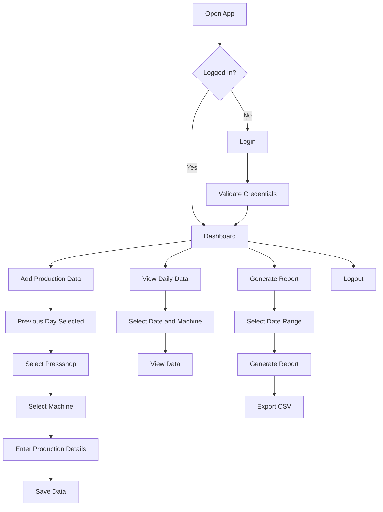

# Product Requirements Document (PRD)

# AP Production

**Project Name:** AP Production  
**Package Name:** `com.buildstack.approduction`  
**Platform:** Android  
**Primary Purpose:** Daily production data entry, historical data tracking, and production reporting for Pressshop machines.

---

## 1. Product Overview

AP Production is an Android mobile application designed to simplify the collection and reporting of daily production data from Pressshop machines.

The application will allow an authorized user to enter production details for the previous day, select a machine from a predefined list, record machine working information, specify idle reasons, and later view historical production records.

Users will also be able to generate date-range reports containing machine-wise production totals. The report will be exportable in CSV format so it can be shared with board members or opened in spreadsheet software.

The application is designed for ease of use, including for users with limited experience using smartphones or mobile applications.

---

# 2. Problem Statement

Production information is often collected manually and may be difficult to consolidate when reporting is required.

The application solves the following problems:

- Manual tracking of machine production data.
- Difficulty calculating machine-wise production totals.
- Difficulty tracking idle time and idle reasons.
- Difficulty generating reports for a specific date range.
- Difficulty maintaining historical production data.
- Lack of a simple system for exporting production information to CSV.
- Risk of losing partially entered production data if the application is closed unexpectedly.

---

# 3. Product Goals

The primary goals of AP Production are:

1. Allow users to quickly enter production data for the previous day.
2. Automatically set the default production date to `Current Date - 1`.
3. Allow selection of Pressshop and machine.
4. Record production and machine working information.
5. Record machine idle reasons.
6. Allow users to view production data for any date and machine.
7. Generate reports for a selected date range.
8. Export machine-wise production summaries as CSV.
9. Provide persistent application state and draft recovery.
10. Provide secure authentication and backend access.
11. Maintain a simple and user-friendly interface.
12. Preserve the exact predefined machine sequence.

---

# 4. Target Users

The primary users are:

- Production supervisors
- Pressshop operators
- Production managers
- Plant management personnel
- Users responsible for preparing production reports

The application must be simple enough for users who have limited mobile application experience.

---

# 5. Core User Flow



---

# 6. Functional Requirements

## 6.1 Authentication

The application must provide:

- Email and password login.
- Secure authentication using the backend API.
- Automatic login if a valid session already exists.
- Manual logout functionality.
- Secure session storage on the device.
- Access only for authorized users.

### Login Fields

| Field | Type | Required |
|---|---|---|
| Email | Email | Yes |
| Password | Password | Yes |

### Authentication Flow

1. User opens the application.
2. The application checks whether a valid login session exists.
3. If valid, the user is automatically redirected to the Dashboard.
4. If no valid session exists, the Login screen is displayed.
5. The user enters email and password.
6. Credentials are sent securely to the backend.
7. The backend validates the credentials.
8. On success, the user receives an authentication token.
9. The token is securely stored on the Android device.
10. On logout, the token is removed.

---

# 7. Dashboard

The Dashboard must provide clear access to the main application functions.

### Dashboard Actions

1. Add Previous Day Production
2. View Daily Data
3. Generate Report
4. Logout

The dashboard must use clear labels and simple navigation.

---

# 8. Add Production Data

## 8.1 Default Date

The application must automatically select:

```text
Production Date = Current Date - 1
```

Example:

```text
Current Date: 28 August 2026
Default Production Date: 27 August 2026
```

The date should be visible to the user before data is saved.

---

## 8.2 Pressshop Selection

The user must first select one of the following:

```text
Pressshop - 1
Pressshop - 2
```

---

## 8.3 Machine Selection

After selecting the Pressshop, only machines belonging to that Pressshop should be displayed.

### Pressshop - 1

The following sequence must be maintained exactly.

1. Break Press 300 Ton
2. Break Press 400 Ton
3. 1200 Ton
4. 1000 Ton F
5. 3000 Ton
6. 1100 Ton
7. 800 Ton
8. 400 Ton
9. 600 Ton
10. 315 Ton
11. 500 Ton
12. 1000 Ton USI
13. Schuller
14. Muller
15. 1250 Ton
16. 2000 Ton
17. 350 Ton

### Pressshop - 2

The following sequence must be maintained exactly.

1. 1000 Ton ISG
2. 400 Ton
3. 1500 Ton
4. 1000 Ton 2
5. 1000 Ton 1
6. 800 Ton 1
7. 800 Ton 2
8. 300 Ton 1
9. 300 Ton 2

**Important:** The machine sequence must not be changed.

---

# 9. Production Data Entry

The user must enter the following production information.

| Field | Required | Description |
|---|---|---|
| Total Working Hours | Yes | Total scheduled/working hours for the machine |
| Machine Working Hours | Yes | Actual machine working hours |
| Stroke | Yes | Total machine stroke count |
| Idle Reason Type | Yes | Reason for machine idle time |
| Idle Reason Details | Conditional | Description of the idle reason |
| Idle Hours | Conditional | Hours assigned to the selected idle reason |

---

## 9.1 Idle Reason Types

The following options must be available:

```text
None
Man Power Shortage
Breakdown
No Work
```

If the user selects `None`, idle reason details and idle hours should not be required.

If the user selects another reason, the application must allow the user to enter:

- Idle hours
- Idle reason description

---

# 10. Data Validation

The application must validate all production data before saving.

## Required Validations

### Total Working Hours

```text
Must be greater than or equal to 0.
```

### Machine Working Hours

```text
Must be greater than or equal to 0.
Must not be greater than Total Working Hours.
```

### Stroke

```text
Must be greater than or equal to 0.
```

### Idle Hours

```text
Must be greater than or equal to 0.
```

### Idle Reason

If:

```text
Idle Reason Type != None
```

Then:

```text
Idle Hours must be provided.
```

---

# 11. Idle Time Calculation

The system must calculate:

```text
Idle Time = Total Working Hours - Machine Working Hours
```

Example:

```text
Total Working Hours = 24
Machine Working Hours = 20

Idle Time = 4 hours
```

---

# 12. Draft and State Persistence

The application must preserve the user's current work.

The following must be saved locally while the user is entering data:

- Selected production date
- Selected Pressshop
- Selected machine
- Total working hours
- Machine working hours
- Stroke
- Idle reason type
- Idle reason details
- Idle hours

If the user:

- Closes the app
- Switches applications
- Minimizes the application
- Navigates away accidentally

The application must allow them to continue from the previous state.

The draft should only be cleared after successful data saving or explicit user cancellation.

---

# 13. Toast Notifications

The application must display toast notifications for important actions.

Examples:

```text
Data Saved Successfully
Production Data Updated Successfully
Please Enter Required Details
Login Successful
Invalid Email or Password
```

---

# 14. View Daily Data

Users must be able to view production information for any previous date.

The user should be able to:

1. Select a date.
2. Select a Pressshop.
3. Select a machine.
4. View the saved production data.

The displayed data must include:

- Production date
- Pressshop
- Machine
- Total working hours
- Machine working hours
- Total stroke
- Idle time
- Idle reason type
- Idle reason details
- Idle hours

---

# 15. Date Range Report

The user must be able to generate reports using:

```text
From Date
To Date
```

The user can generate a report for:

- A specific machine.
- Multiple machines.
- All machines in a Pressshop.

---

# 16. Report Calculations

For every machine, the report must calculate:

## Total Working Hours

```text
SUM(Total Working Hours)
```

## Machine Working Hours

```text
SUM(Machine Working Hours)
```

## Total Stroke

```text
SUM(Stroke)
```

## Total Idle Time

```text
SUM(Total Working Hours - Machine Working Hours)
```

## Man Power Shortage Hours

```text
SUM(Idle Hours where Idle Reason Type = Man Power Shortage)
```

## Breakdown Hours

```text
SUM(Idle Hours where Idle Reason Type = Breakdown)
```

## No Work Hours

```text
SUM(Idle Hours where Idle Reason Type = No Work)
```

---

# 17. CSV Export

The generated report must be exportable as CSV.

The CSV must contain machine-wise information.

Example:

```text
Machine,
Total Working Hours,
Machine Working Hours,
Total Stroke,
Idle Time,
Man Power Shortage Hours,
Breakdown Hours,
No Work Hours
```

Example row:

```text
1200 Ton,
720,
650,
150000,
70,
20,
30,
20
```

The user must be able to:

- Download the CSV.
- Share the CSV.
- Open the CSV using compatible applications.

---

# 18. Offline and Error Handling

The application should handle network failures gracefully.

If production data cannot be saved because of a network problem:

1. The entered data must remain available locally.
2. The user must not lose the draft.
3. A clear error message must be shown.
4. The user should be able to retry saving.

---

# 19. Security Requirements

The application must:

- Use HTTPS for backend communication.
- Never store plain-text passwords on the device.
- Securely store authentication tokens.
- Validate all input on both mobile and backend.
- Prevent unauthorized access to production APIs.
- Restrict users to authenticated actions.
- Protect against invalid or malformed requests.

---

# 20. UI/UX Requirements

The application must not look like a generic AI-generated demo application.

The UI should:

- Be professional.
- Be clean and modern.
- Use consistent spacing.
- Use large and readable text.
- Use large touch targets.
- Use clear labels.
- Avoid unnecessary complexity.
- Minimize the number of steps required.
- Provide clear validation messages.
- Be easy to understand without technical knowledge.

The application should prioritize:

```text
Speed
Clarity
Accessibility
Simplicity
Reliability
```

---

# 21. Success Criteria

The project will be considered successful when:

1. An authorized user can log in successfully.
2. The app automatically opens the Dashboard for existing valid sessions.
3. The user can enter production data for the previous day.
4. The correct Pressshop and machine list is available.
5. Machine order remains unchanged.
6. Production data is validated correctly.
7. Data is saved securely in MongoDB.
8. Daily data can be viewed for any date.
9. Date-range reports can be generated.
10. All required totals are calculated correctly.
11. CSV reports can be generated.
12. The app preserves unsaved production data.
13. Toast messages are displayed for successful saves.
14. Logout works correctly.
15. The backend is deployed on Render.
16. The application is tested successfully before each stable build.

---

# 22. Development Process

Development must follow a phase-wise approach.

For every stable implementation:

```text
Build
    ↓
Test
    ↓
Fix
    ↓
Test Again
    ↓
Git Commit
```

Every stable build must be tested before committing.

Android builds must use Gradle.

---

# 23. Project Structure

The project must use a monorepo structure.

```text
ap-production/
│
├── android-app/
│
├── backend/
│
├── docs/
│
├── .env.example
│
├── README.md
└── package configuration files
```

---

# 24. Deployment

The backend will primarily be deployed using:

```text
Render
```

The database will use:

```text
MongoDB
```

The Android application will communicate with the deployed backend using secure HTTPS APIs.