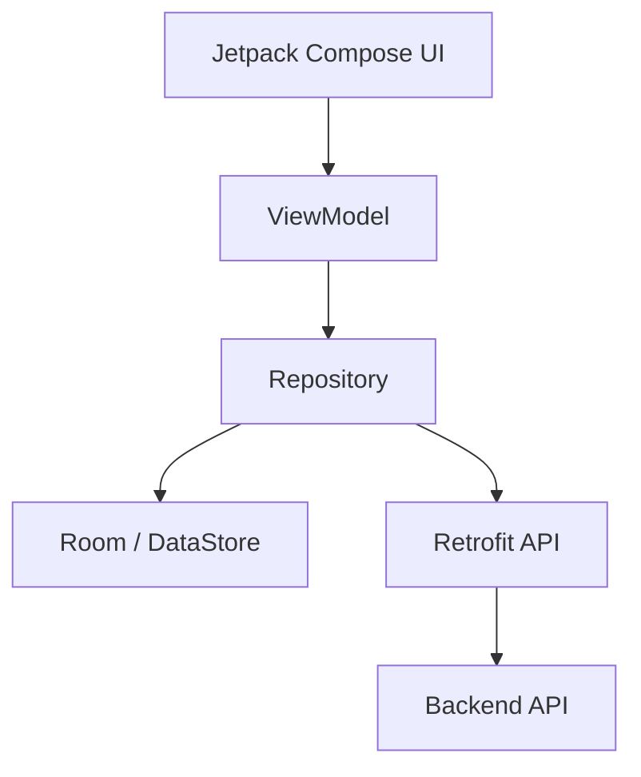
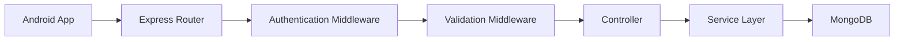
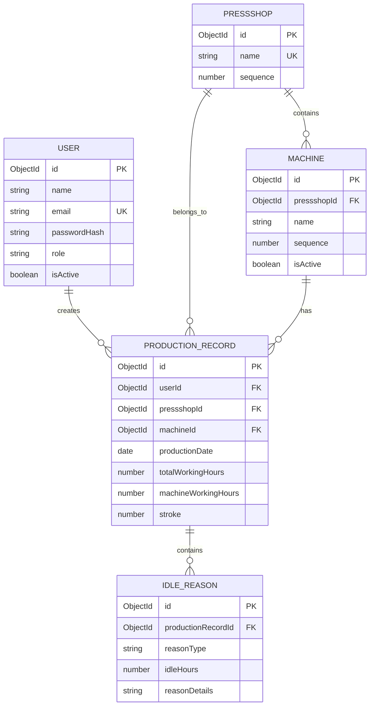
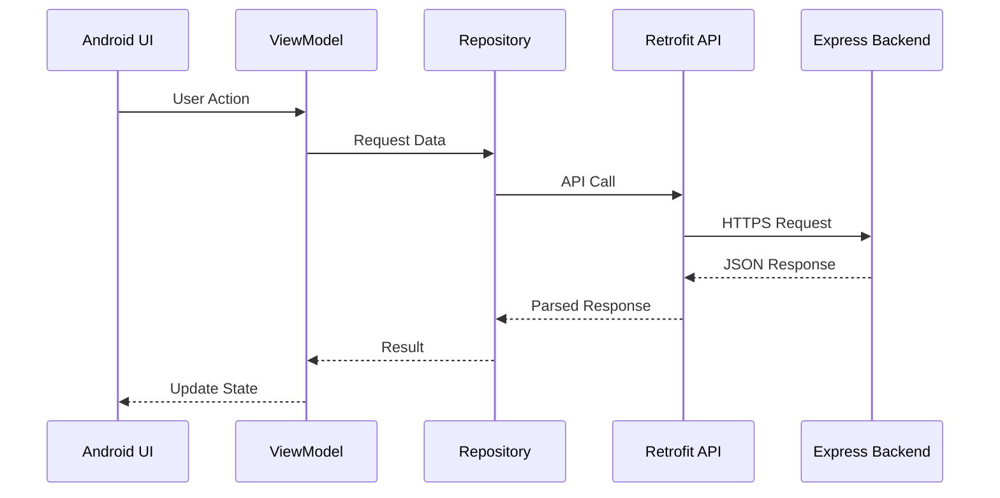
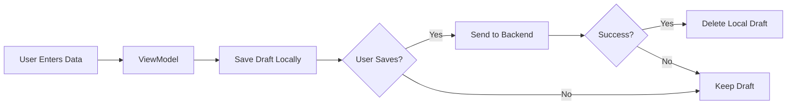

# Technical Requirements Document (TRD)

# AP Production

**Project Name:** AP Production  
**Android Package Name:** `com.buildstack.approduction`  
**Architecture:** Monorepo  
**Mobile Platform:** Android  
**Mobile Language:** Kotlin  
**Backend:** Node.js + Express.js  
**Database:** MongoDB  
**Backend Deployment:** Render

---

# 1. System Overview

AP Production is a client-server production data management application.

The Android application is responsible for:

- User authentication.
- Production data entry.
- Local state persistence.
- Viewing historical data.
- Requesting date-range reports.
- Downloading and sharing CSV reports.

The backend is responsible for:

- Authentication.
- Authorization.
- Input validation.
- Production data management.
- Database operations.
- Report aggregation.
- CSV generation.
- Security controls.

MongoDB is responsible for:

- User data.
- Pressshop and machine master data.
- Production records.
- Idle reason records.

---

# 2. Technology Stack

## 2.1 Android Application

```text
Language: Kotlin
UI: Jetpack Compose
Architecture: MVVM
Networking: Retrofit + OkHttp
JSON Parsing: Kotlin Serialization or Gson
Local Database: Room
Session Storage: Jetpack Security / EncryptedSharedPreferences
Preferences: DataStore
Navigation: Navigation Compose
Dependency Injection: Hilt
Background Tasks: WorkManager where required
```

---

## 2.2 Backend

```text
Runtime: Node.js
Framework: Express.js
Language: JavaScript or TypeScript
Database: MongoDB
ODM: Mongoose
Authentication: JWT
Password Hashing: bcrypt
Validation: Zod or Joi
Security Headers: Helmet
Rate Limiting: express-rate-limit
CORS: Configured Allowed Origins
Logging: Winston or Pino
CSV Generation: csv-writer or fast-csv
```

---

## 2.3 Deployment

```text
Backend: Render
Database: MongoDB Atlas
Environment Configuration: Render Environment Variables
Transport Security: HTTPS
```

---

# 3. Monorepo Structure

```text
AP-Production/
│
├── android-app/
│   ├── app/
│   ├── gradle/
│   ├── build.gradle.kts
│   ├── settings.gradle.kts
│   └── gradle.properties
│
├── backend/
│   ├── src/
│   │   ├── config/
│   │   ├── controllers/
│   │   ├── middleware/
│   │   ├── models/
│   │   ├── routes/
│   │   ├── services/
│   │   ├── utils/
│   │   ├── validators/
│   │   └── app.js
│   │
│   ├── package.json
│   └── server.js
│
├── docs/
│   ├── PRD.md
│   ├── TRD.md
│   └── API.md
│
├── .gitignore
├── .env.example
├── README.md
└── package.json
```

---

# 4. Android Architecture

The Android application will follow MVVM architecture.



---

# 5. Android Modules

The application should initially use a single app module with clear package separation.

```text
com.buildstack.approduction
│
├── data
│   ├── local
│   ├── remote
│   ├── repository
│   └── model
│
├── domain
│   ├── model
│   └── usecase
│
├── presentation
│   ├── auth
│   ├── dashboard
│   ├── production
│   ├── history
│   ├── report
│   └── components
│
├── navigation
│
├── di
│
└── utils
```

---

# 6. Android Screens

The application will include the following screens.

## 6.1 Splash Screen

Responsibilities:

- Check saved authentication state.
- Validate existing token if required.
- Navigate to Login or Dashboard.

---

## 6.2 Login Screen

Components:

```text
Email Input
Password Input
Login Button
Loading Indicator
Error Message
```

---

## 6.3 Dashboard Screen

Components:

```text
Add Previous Day Production
View Daily Data
Generate Report
Logout
```

---

## 6.4 Production Entry Screen

Components:

```text
Production Date
Pressshop Selection
Machine Selection
Total Working Hours
Machine Working Hours
Stroke
Idle Reason Type
Idle Hours
Idle Reason Details
Save Button
```

---

## 6.5 Daily Data Screen

Components:

```text
Date Picker
Pressshop Selection
Machine Selection
Search Button
Production Details
```

---

## 6.6 Report Screen

Components:

```text
From Date
To Date
Pressshop Filter
Machine Filter
Generate Report Button
Report Preview
Download CSV Button
Share CSV Button
```

---

# 7. State Persistence

The application must preserve unsaved production forms.

Recommended implementation:

```text
Room Database
```

The local draft entity may contain:

```text
draftId
productionDate
pressshopId
machineId
totalWorkingHours
machineWorkingHours
stroke
idleReasonType
idleHours
idleReasonDetails
lastUpdatedAt
```

The ViewModel should save draft changes when important form fields change.

The application must restore the latest draft when the production entry screen is reopened.

---

# 8. Authentication Design

## Login Request

```http
POST /api/auth/login
```

Request:

```json
{
  "email": "user@example.com",
  "password": "password"
}
```

Response:

```json
{
  "success": true,
  "message": "Login successful",
  "token": "JWT_TOKEN",
  "user": {
    "id": "USER_ID",
    "email": "user@example.com",
    "name": "User Name"
  }
}
```

---

# 9. Authentication Token Storage

JWT tokens must not be stored in plain SharedPreferences.

Recommended:

```text
EncryptedSharedPreferences
```

or:

```text
Android Keystore-backed storage
```

The token must be removed during logout.

---

# 10. User Password Configuration

Backend credentials and sensitive configuration must never be committed to Git.

Environment variables must be stored in:

```text
.env
```

Example:

```env
PORT=5000

MONGODB_URI=mongodb+srv://...

JWT_SECRET=replace_with_secure_secret

USER_EMAIL=production@example.com
USER_PASSWORD_HASH=generated_bcrypt_hash

NODE_ENV=production
```

The `.env` file must be included in:

```text
.gitignore
```

Only `.env.example` should be committed.

---

# 11. API Architecture



---

# 12. API Endpoints

## 12.1 Authentication

### Login

```http
POST /api/auth/login
```

### Logout

```http
POST /api/auth/logout
```

Logout may optionally support server-side token invalidation.

### Current User

```http
GET /api/auth/me
```

---

# 13. Pressshop and Machine APIs

### Get Pressshops

```http
GET /api/pressshops
```

### Get Machines

```http
GET /api/machines
```

### Get Machines by Pressshop

```http
GET /api/machines?pressshopId=PRESSSHOP_ID
```

The backend must always return machines ordered by the predefined `sequence` field.

---

# 14. Production APIs

## Create Production Record

```http
POST /api/production
```

Request:

```json
{
  "productionDate": "2026-08-27",
  "pressshopId": "PRESSSHOP_ID",
  "machineId": "MACHINE_ID",
  "totalWorkingHours": 24,
  "machineWorkingHours": 20,
  "stroke": 10000,
  "idleReasons": [
    {
      "reasonType": "BREAKDOWN",
      "idleHours": 4,
      "reasonDetails": "Mechanical issue"
    }
  ]
}
```

---

## Get Production by Date

```http
GET /api/production?date=2026-08-27
```

Optional filters:

```text
pressshopId
machineId
```

---

## Get Production Record

```http
GET /api/production/:id
```

---

## Update Production Record

```http
PUT /api/production/:id
```

---

## Delete Production Record

```http
DELETE /api/production/:id
```

Deletion should require explicit user confirmation.

---

# 15. Report API

## Generate Report

```http
GET /api/reports
```

Query parameters:

```text
fromDate
toDate
pressshopId
machineId
```

Example:

```http
GET /api/reports?fromDate=2026-08-01&toDate=2026-08-31
```

---

## CSV Report

```http
GET /api/reports/csv
```

Example:

```http
GET /api/reports/csv?fromDate=2026-08-01&toDate=2026-08-31
```

Response:

```text
Content-Type: text/csv
Content-Disposition: attachment
```

---

# 16. MongoDB Database Design

## 16.1 Users Collection

```javascript
{
  _id: ObjectId,

  name: String,

  email: String,

  passwordHash: String,

  role: String,

  isActive: Boolean,

  createdAt: Date,

  updatedAt: Date
}
```

Index:

```text
email: unique
```

---

# 17. Pressshops Collection

```javascript
{
  _id: ObjectId,

  name: String,

  sequence: Number,

  isActive: Boolean
}
```

Example:

```javascript
{
  name: "Pressshop - 1",
  sequence: 1
}
```

---

# 18. Machines Collection

```javascript
{
  _id: ObjectId,

  pressshopId: ObjectId,

  name: String,

  sequence: Number,

  isActive: Boolean,

  createdAt: Date,

  updatedAt: Date
}
```

The `sequence` field is mandatory and must preserve the specified machine order.

---

# 19. Production Records Collection

```javascript
{
  _id: ObjectId,

  userId: ObjectId,

  productionDate: Date,

  pressshopId: ObjectId,

  machineId: ObjectId,

  totalWorkingHours: Number,

  machineWorkingHours: Number,

  stroke: Number,

  idleReasons: [
    {
      reasonType: String,

      idleHours: Number,

      reasonDetails: String
    }
  ],

  createdAt: Date,

  updatedAt: Date
}
```

Recommended unique index:

```text
machineId + productionDate
```

This prevents duplicate production records for the same machine and date.

---

# 20. Idle Reason Enum

```text
NONE
MAN_POWER_SHORTAGE
BREAKDOWN
NO_WORK
```

---

# 21. Database ER Diagram



---

# 22. Machine Master Data

The machine data must be seeded in the exact order below.

## Pressshop - 1

```text
1. Break Press 300 Ton
2. Break Press 400 Ton
3. 1200 Ton
4. 1000 Ton F
5. 3000 Ton
6. 1100 Ton
7. 800 Ton
8. 400 Ton
9. 600 Ton
10. 315 Ton
11. 500 Ton
12. 1000 Ton USI
13. Schuller
14. Muller
15. 1250 Ton
16. 2000 Ton
17. 350 Ton
```

## Pressshop - 2

```text
1. 1000 Ton ISG
2. 400 Ton
3. 1500 Ton
4. 1000 Ton 2
5. 1000 Ton 1
6. 800 Ton 1
7. 800 Ton 2
8. 300 Ton 1
9. 300 Ton 2
```

The machine order must be maintained using the database sequence field.

---

# 23. Report Aggregation

The backend should use MongoDB aggregation pipelines.

Example aggregation stages:

```text
$match
↓
$lookup
↓
$group
↓
$project
↓
$sort
```

The report must calculate machine-wise totals.

---

# 24. Report Calculations

## Total Working Hours

```text
SUM(totalWorkingHours)
```

## Machine Working Hours

```text
SUM(machineWorkingHours)
```

## Total Stroke

```text
SUM(stroke)
```

## Idle Time

```text
SUM(totalWorkingHours - machineWorkingHours)
```

## Man Power Shortage

```text
SUM(idleHours where reasonType = MAN_POWER_SHORTAGE)
```

## Breakdown

```text
SUM(idleHours where reasonType = BREAKDOWN)
```

## No Work

```text
SUM(idleHours where reasonType = NO_WORK)
```

---

# 25. CSV Structure

```csv
Machine,Total Working Hours,Machine Working Hours,Total Stroke,Idle Time,Man Power Shortage Hours,Breakdown Hours,No Work Hours
```

Example:

```csv
1200 Ton,720,650,150000,70,20,30,20
```

---

# 26. Backend Security Requirements

The backend must implement the following.

## 26.1 Authentication

- JWT authentication.
- Token verification middleware.
- Secure password hashing using bcrypt.
- Token expiration.

---

## 26.2 Input Validation

All incoming request bodies must be validated.

The backend must reject:

- Missing required fields.
- Unexpected data types.
- Negative working hours.
- Negative stroke values.
- Machine working hours greater than total working hours.
- Invalid dates.
- Invalid ObjectIds.
- Invalid idle reason types.
- Unknown fields where strict validation is enabled.

---

## 26.3 Request Size Limits

Express request body limits must be configured.

Example:

```javascript
express.json({
  limit: "100kb"
})
```

The application does not require general file uploads.

Therefore:

```text
File upload endpoints should not be implemented.
```

The backend must reject unsupported file upload requests.

---

## 26.4 Security Middleware

Use:

```text
Helmet
Rate Limiting
CORS
Input Validation
Authentication Middleware
Request Size Limits
```

---

# 27. Rate Limiting

Authentication endpoints must use stricter rate limiting.

Example:

```text
Login Endpoint:
Maximum 5-10 attempts per configured time window.
```

Production and report APIs should also have reasonable limits.

---

# 28. CORS Configuration

The backend should only allow configured application origins.

Wildcard production CORS should be avoided.

---

# 29. Environment Variables

Example `.env.example`:

```env
NODE_ENV=development

PORT=5000

MONGODB_URI=

JWT_SECRET=

JWT_EXPIRES_IN=7d

BCRYPT_SALT_ROUNDS=12

CORS_ORIGINS=

USER_EMAIL=

USER_PASSWORD_HASH=
```

Production secrets must be configured through Render environment variables.

---

# 30. Logging

The backend should log:

- Application startup.
- Database connection failures.
- Authentication failures.
- Validation errors.
- API errors.
- Unexpected server errors.

Sensitive information must never be logged.

Do not log:

```text
Passwords
JWT tokens
Password hashes
Database credentials
Environment variables
```

---

# 31. Error Response Format

All backend errors should follow a consistent structure.

```json
{
  "success": false,
  "message": "Human readable error message",
  "errors": []
}
```

Successful responses should follow:

```json
{
  "success": true,
  "message": "Operation successful",
  "data": {}
}
```

---

# 32. Android Networking

Retrofit will communicate with the backend.



---

# 33. Offline Draft Strategy

Draft data must be stored locally.

Recommended approach:

```text
Room Database
```

Flow:



---

# 34. Android Build Requirements

All Android builds must use Gradle.

Primary command:

```bash
./gradlew build
```

Before each stable commit:

```text
Build
↓
Test
↓
Fix Issues
↓
Test Again
↓
Git Commit
```

---

# 35. Testing Requirements

## Android Tests

Required test areas:

- Login validation.
- Production form validation.
- Idle time calculations.
- Date handling.
- Draft persistence.
- API response handling.
- Navigation.
- CSV download handling.

---

## Backend Tests

Required test areas:

- Authentication.
- JWT verification.
- Input validation.
- Production record creation.
- Duplicate record prevention.
- Production record updates.
- Report aggregation.
- CSV generation.
- Unauthorized access.

---

# 36. Git Workflow

Each stable phase must follow:

```text
1. Implement Feature
2. Build
3. Test
4. Fix
5. Test Again
6. Commit
```

Example commits:

```text
chore: initialize AP Production monorepo

feat: add backend authentication

feat: add production data API

feat: add machine master data

feat: add Android login flow

feat: add production entry screen

feat: add report generation

test: add backend API tests

fix: resolve production report calculation
```

---

# 37. Phase-Wise Development Plan

## Phase 1 — Project Initialization

```text
Create monorepo
Initialize Android application
Configure package name
Initialize Node.js backend
Configure MongoDB
Configure Git
```

---

## Phase 2 — Backend Foundation

```text
Create Express application
Connect MongoDB
Add security middleware
Add environment configuration
Create API structure
```

---

## Phase 3 — Authentication

```text
Create user authentication
Implement bcrypt password validation
Implement JWT
Create login API
Create protected routes
```

---

## Phase 4 — Master Data

```text
Create Pressshop collection
Create Machine collection
Create database seed
Verify exact machine order
```

---

## Phase 5 — Production API

```text
Create production model
Create validation
Create CRUD APIs
Prevent duplicate records
```

---

## Phase 6 — Android Authentication

```text
Create login UI
Connect login API
Store token securely
Implement auto login
Implement logout
```

---

## Phase 7 — Production Entry

```text
Create production form
Add Pressshop selection
Add machine selection
Add validations
Implement draft persistence
Connect save API
Add toast notifications
```

---

## Phase 8 — Historical Data

```text
Create daily data screen
Add date filter
Add Pressshop filter
Add machine filter
Display saved data
```

---

## Phase 9 — Reports

```text
Create report API
Implement MongoDB aggregation
Create report UI
Generate CSV
Implement download
Implement sharing
```

---

## Phase 10 — Testing and Deployment

```text
Run Android Gradle build
Run Android tests
Run backend tests
Fix issues
Retest
Commit stable version
Deploy backend to Render
Configure production environment variables
Perform production API testing
```

---

# 38. Final Technical Acceptance Criteria

The application is technically complete when:

- Android package name is `com.buildstack.approduction`.
- Monorepo structure is implemented.
- MongoDB is connected securely.
- Backend is deployed on Render.
- Authentication is implemented.
- Auto-login works.
- Logout works.
- Machine sequence is exact.
- Production data validation works.
- Draft persistence works.
- Production records are stored correctly.
- Daily historical data can be retrieved.
- Date-range reports are calculated correctly.
- CSV generation works.
- Backend security controls are active.
- File uploads are rejected or unavailable.
- Gradle build completes successfully.
- Tests pass.
- Stable changes are committed to Git.