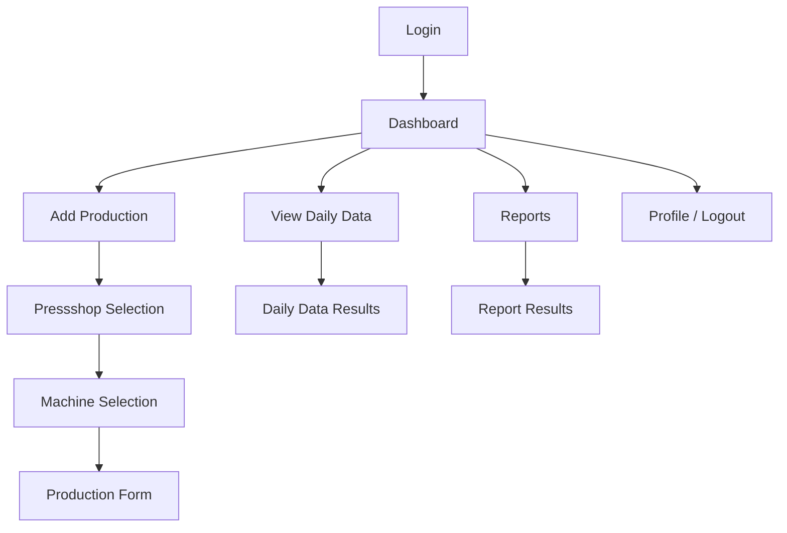

# UI/UX Brief

# AP Production

**Project Name:** AP Production  
**Package Name:** `com.buildstack.approduction`  
**Platform:** Android Mobile Application

---

## 1. Design Objective

The AP Production application is designed for fast, simple, and reliable daily production data entry.

The target users may include people with limited mobile application experience. Therefore, the UI/UX must prioritize:

- Simplicity
- Large touch targets
- Clear language
- Minimal steps
- Easy navigation
- Strong visual hierarchy
- Error prevention
- Clear feedback

The application must feel like a professional production management application, not a generic AI-generated demo.

---

## 2. Core UX Principles

### 2.1 One Task at a Time

Each screen should focus on one primary action.

Avoid showing too many options simultaneously.

---

### 2.2 Large Touch Targets

Buttons, cards, dropdowns, and form controls must be large enough to be comfortably used.

Minimum recommended touch target:

```text
48dp
```

---

### 2.3 Clear Labels

Avoid technical language where possible.

Use:

```text
Save Production Data
```

Instead of:

```text
Submit
```

Use:

```text
View Previous Data
```

Instead of:

```text
History
```

---

### 2.4 Visible Progress

During production data entry, users should always understand:

- What they have selected
- What information is required
- Whether the data is saved

---

### 2.5 Error Prevention

The UI should prevent invalid data rather than only showing errors afterward.

Examples:

- Machine Working Hours cannot exceed Total Working Hours.
- Negative values are not allowed.
- Invalid dates are blocked.
- Idle hours should be checked against total calculated idle time.

---

## 3. Design Style

The application should use a professional industrial operations aesthetic.

### Visual Characteristics

```text
Professional
Clean
Modern
Practical
Minimal
Structured
Reliable
```

Avoid:

```text
Excessive gradients
Overuse of rounded cards
Too many icons
Unnecessary animations
Excessive shadows
Decorative graphics
Bright distracting colors
```

---

## 4. Recommended Color Direction

The primary visual style should use neutral and professional colors.

Suggested direction:

```text
Primary: Deep industrial blue
Secondary: Neutral slate
Background: Soft off-white
Surface: White
Success: Green
Warning: Amber
Error: Red
```

Colors must be accessible and provide sufficient contrast.

---

## 5. Typography

Typography should prioritize readability.

Recommended hierarchy:

### Screen Title

```text
24sp - 28sp
Bold
```

### Section Title

```text
18sp - 20sp
Semi Bold
```

### Field Label

```text
14sp - 16sp
Medium
```

### Body Text

```text
14sp - 16sp
Regular
```

### Large Numeric Data

```text
24sp - 32sp
Semi Bold or Bold
```

---

# 6. Navigation Structure

The application should use a simple navigation hierarchy.



The user should always have a clear way to return to the Dashboard.

---

# 7. Screen-by-Screen UX Requirements

## 7.1 Splash Screen

### Purpose

Check application authentication state.

### Behavior

1. Application opens.
2. Check secure session.
3. Validate existing login state.
4. Navigate automatically.

### Navigation

```text
Valid Session → Dashboard
No Session → Login
```

The splash screen should remain minimal.

---

# 8. Login Screen

## Layout

```text
┌──────────────────────────────┐
│                              │
│        AP Production         │
│                              │
│  Production Management       │
│                              │
│  Email                       │
│  [_______________________]   │
│                              │
│  Password                    │
│  [_______________________]   │
│                              │
│  [       LOGIN            ]  │
│                              │
└──────────────────────────────┘
```

## Requirements

- Clear application branding.
- Email keyboard for email field.
- Password visibility toggle.
- Login button loading state.
- Clear invalid login messages.
- Login button disabled while processing.

---

# 9. Dashboard

The Dashboard is the primary home screen.

It must provide immediate access to the three main actions.

## Layout

```text
┌──────────────────────────────┐
│ AP Production                │
│ Welcome                      │
│                              │
│ ┌──────────────────────────┐ │
│ │ Add Previous Day Data    │ │
│ │ Enter daily production   │ │
│ └──────────────────────────┘ │
│                              │
│ ┌──────────────────────────┐ │
│ │ View Daily Data          │ │
│ │ Check any saved date     │ │
│ └──────────────────────────┘ │
│                              │
│ ┌──────────────────────────┐ │
│ │ Generate Report          │ │
│ │ Create date range report │ │
│ └──────────────────────────┘ │
│                              │
└──────────────────────────────┘
```

## UX Requirements

- Large action cards.
- Clear labels.
- Short descriptions.
- Entire card must be clickable.
- Logout available from the top-right menu.

---

# 10. Add Previous Day Production

The application should automatically calculate:

```text
Production Date = Current Date - 1
```

Example:

```text
Today: 28 August 2026

Production Date:
27 August 2026
```

The date should be prominently displayed.

---

# 11. Pressshop Selection

The user selects the Pressshop first.

## Layout

```text
Select Pressshop

┌──────────────────────────────┐
│ Pressshop - 1              › │
└──────────────────────────────┘

┌──────────────────────────────┐
│ Pressshop - 2              › │
└──────────────────────────────┘
```

### UX Requirement

Do not show all machines before a Pressshop is selected.

This reduces complexity.

---

# 12. Machine Selection

Machines must appear in the exact predefined sequence.

The sequence must not be sorted alphabetically.

## Pressshop - 1

```text
1. Break Press 300 Ton
2. Break Press 400 Ton
3. 1200 Ton
4. 1000 Ton F
5. 3000 Ton
6. 1100 Ton
7. 800 Ton
8. 400 Ton
9. 600 Ton
10. 315 Ton
11. 500 Ton
12. 1000 Ton USI
13. Schuller
14. Muller
15. 1250 Ton
16. 2000 Ton
17. 350 Ton
```

## Pressshop - 2

```text
1. 1000 Ton ISG
2. 400 Ton
3. 1500 Ton
4. 1000 Ton 2
5. 1000 Ton 1
6. 800 Ton 1
7. 800 Ton 2
8. 300 Ton 1
9. 300 Ton 2
```

### Recommended UX

- Search bar at the top.
- Preserve sequence even when search is cleared.
- Large list rows.
- Selected machine clearly highlighted.

---

# 13. Production Entry Form

The production form should be organized into logical sections.

## Section 1: Selected Machine

```text
Production Date
27 August 2026

Pressshop
Pressshop - 1

Machine
1200 Ton
```

---

## Section 2: Production Details

```text
Total Working Hours
[        24        ]

Machine Working Hours
[        20        ]

Stroke
[      10,000      ]
```

---

## Section 3: Idle Information

The application should automatically calculate:

```text
Idle Time

4 Hours
```

Formula:

```text
Total Working Hours - Machine Working Hours
```

---

## Idle Reason

```text
Select Idle Reason

[ None                    ▼ ]
```

Available options:

```text
None
Man Power Shortage
Breakdown
No Work
```

When a reason is selected:

```text
Idle Hours
[         4         ]

Reason Details
[________________________]
```

---

# 14. Production Form UX Rules

## Save Button

The primary action should remain easy to access.

Recommended:

```text
Bottom fixed action area
```

```text
[       SAVE DATA        ]
```

---

## Save Feedback

On successful save:

```text
✓ Data Saved Successfully
```

Use a Toast notification.

---

## Loading State

While saving:

```text
Saving Data...
```

The Save button should be disabled.

---

## Validation

Show errors close to the related field.

Example:

```text
Machine Working Hours
[        28        ]

Machine Working Hours cannot be greater
than Total Working Hours.
```

Avoid showing only generic errors at the top of the screen.

---

# 15. Draft Recovery UX

If the user leaves the application while entering data, the draft must remain saved.

When returning:

```text
You have an unfinished production entry.

[ CONTINUE ]
[ DISCARD ]
```

Default recommended action:

```text
Continue
```

The user should never lose data without confirmation.

---

# 16. View Daily Data

## Layout

```text
View Daily Data

Date
[ 27 Aug 2026       📅 ]

Pressshop
[ Pressshop - 1     ▼ ]

Machine
[ 1200 Ton          ▼ ]

[     VIEW DATA     ]
```

After loading:

```text
┌──────────────────────────────┐
│ 1200 Ton                     │
│ 27 August 2026               │
├──────────────────────────────┤
│ Total Working Hours      24  │
│ Machine Working Hours    20  │
│ Stroke               10,000  │
│ Idle Time                4h  │
└──────────────────────────────┘
```

---

# 17. Report Screen

The report screen should use a simple top-to-bottom workflow.

```text
Generate Production Report

From Date
[ 01 Aug 2026      📅 ]

To Date
[ 31 Aug 2026      📅 ]

Pressshop
[ All Pressshops     ▼ ]

Machine
[ All Machines       ▼ ]

[ GENERATE REPORT ]
```

---

# 18. Report Results

After generation:

```text
Report Summary

Date Range
01 Aug 2026 - 31 Aug 2026

┌──────────────────────────────┐
│ Machine: 1200 Ton            │
│                              │
│ Total Working Hours      720 │
│ Machine Working Hours    650 │
│ Total Stroke         150,000 │
│ Idle Time               70h │
│                              │
│ Man Power Shortage       20h │
│ Breakdown                30h │
│ No Work                  20h │
└──────────────────────────────┘
```

---

# 19. CSV Export UX

The report screen should provide:

```text
[ DOWNLOAD CSV ]

[ SHARE CSV ]
```

The actions should be clearly separated.

The user should receive confirmation when the report is successfully generated.

---

# 20. Empty States

The application must handle missing data clearly.

Example:

```text
No Production Data Found

There is no saved production data
for the selected date and machine.
```

Provide a useful action:

```text
[ ADD PRODUCTION DATA ]
```

---

# 21. Error States

Network error:

```text
Unable to connect.

Please check your internet connection
and try again.
```

Actions:

```text
[ RETRY ]
```

Do not use technical error messages for normal users.

---

# 22. Loading States

Loading states must clearly indicate progress.

Examples:

```text
Logging in...
Saving production data...
Loading production data...
Generating report...
Preparing CSV...
```

Use progress indicators when the waiting time is more than a brief moment.

---

# 23. Accessibility Requirements

The application must provide:

- Readable font sizes.
- High color contrast.
- Large touch targets.
- Clear focus states.
- Screen reader labels.
- Error messages that do not rely only on color.
- Simple language.

---

# 24. Responsive Design

The application must support:

- Small Android phones.
- Standard Android phones.
- Large Android phones.
- Portrait orientation as the primary layout.

The interface must not depend on a fixed screen size.

---

# 25. UX Acceptance Criteria

The UI/UX is accepted when:

- A new user can understand the Dashboard immediately.
- Production data can be entered without technical knowledge.
- Machine selection preserves the exact required order.
- Required information is visually clear.
- Validation errors are easy to understand.
- Save status is clearly communicated.
- Drafts can be resumed.
- Historical data is easy to find.
- Reports are easy to generate.
- CSV export is easy to access.
- No important action is hidden or difficult to discover.
- The application feels like a professional production operations tool.