# BookWala — Application Flow

**Project:** BookWala  
**Android Package:** `com.buildstack.bookwala`  
**Document:** Application Flow Specification  
**Version:** 1.0

---

# 1. Purpose

This document defines the complete user flow, screen navigation, state transitions, and major interaction flows for the BookWala Android application.

BookWala is a second-hand book marketplace where users can:

- Discover books.
- Search and filter books.
- View book details.
- Sell their own books.
- Contact sellers.
- Chat in real time.
- See online/offline/last-seen status.
- Use an AI assistant to discover books based on natural-language requirements.
- Manage their listings and profile.

This document is the behavioral source of truth for application navigation.

The visual source of truth is the approved Stitch design.

---

# 2. Application Architecture Flow

At a high level:

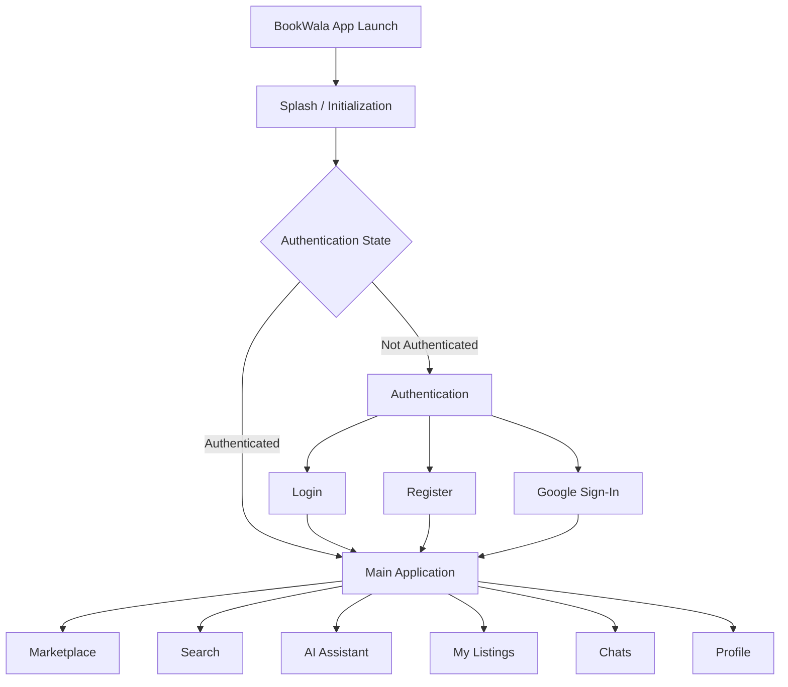

---

# 3. Application Entry Flow

## 3.1 Launch

When the user opens BookWala:

```text
App Launch
    ↓
Initialize Application
    ↓
Initialize Required Services
    ↓
Check Authentication State
    ↓
Determine Destination
```

The application must not display the main marketplace until the required initialization/authentication state is known.

---

# 4. Splash Flow

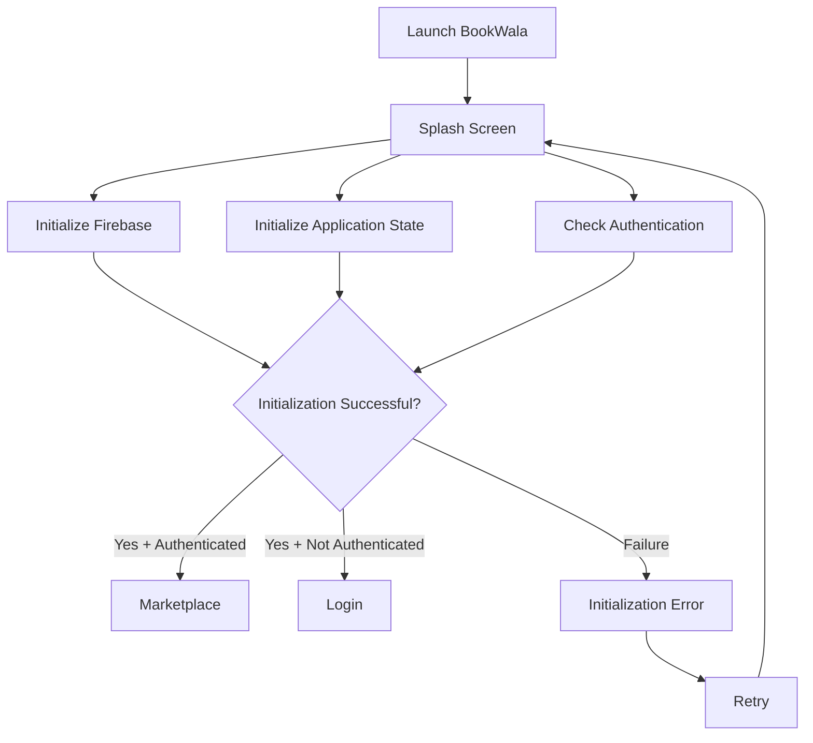

The splash screen should be brief and should not become a permanent loading screen.

---

# 5. Authentication Flow

## 5.1 Authentication Navigation

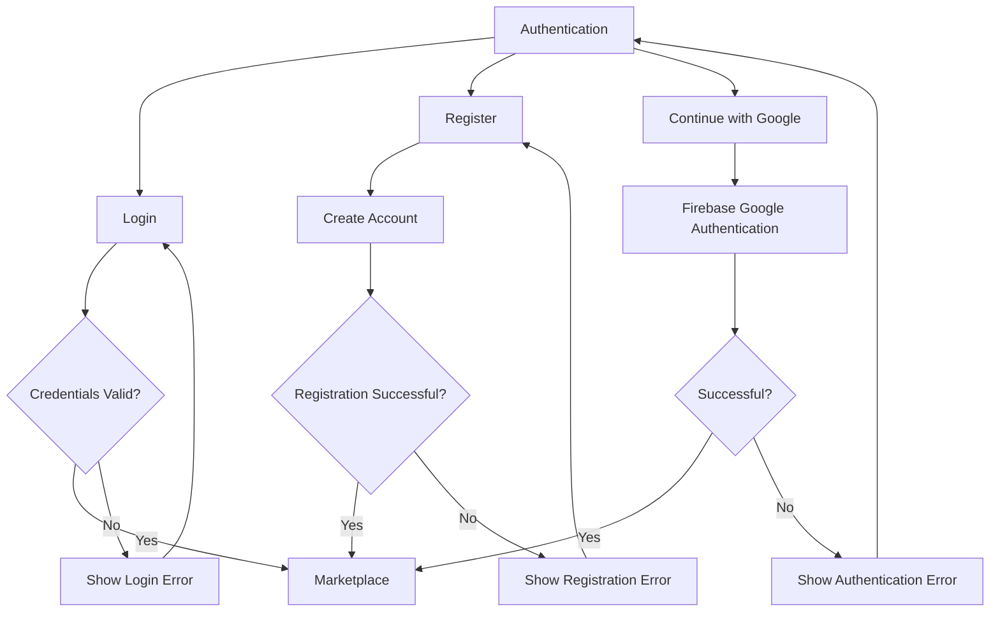

---

# 6. Login Screen

The Login screen should provide:

- Email input
- Password input
- Login button
- Google Sign-In button
- Register navigation
- Password visibility control where appropriate
- Loading state
- Error state

Flow:

```text
Login
 ↓
Enter Email
 ↓
Enter Password
 ↓
Login
 ↓
Authenticate
 ↓
Success → Marketplace
```

If authentication fails:

```text
Authentication Failure
 ↓
Show Error
 ↓
User Corrects Credentials
 ↓
Retry
```

---

# 7. Registration Flow

Registration should allow the user to create a BookWala account.

```text
Register
 ↓
Enter Required Information
 ↓
Create Account
 ↓
Firebase Authentication
 ↓
Create / Update User Profile
 ↓
Marketplace
```

Validation errors must remain on the registration flow and must not send the user to the marketplace.

---

# 8. Google Sign-In Flow

```text
Login / Register
      ↓
Continue with Google
      ↓
Google Account Selection
      ↓
Firebase Authentication
      ↓
Authentication Success
      ↓
Create / Retrieve BookWala User
      ↓
Marketplace
```

If Google authentication fails:

```text
Google Authentication Failed
        ↓
Display Error
        ↓
Remain on Authentication Screen
```

---

# 9. Main Application Navigation

After authentication, the user enters the main application.

The primary application areas are:

```text
Marketplace
Search
AI Assistant
My Listings
Chats
Profile
```

A bottom navigation or equivalent navigation pattern may be used based on the approved Stitch design.

The navigation implementation must follow the approved UI design rather than introducing a separate navigation pattern.

---

# 10. Main Navigation Flow

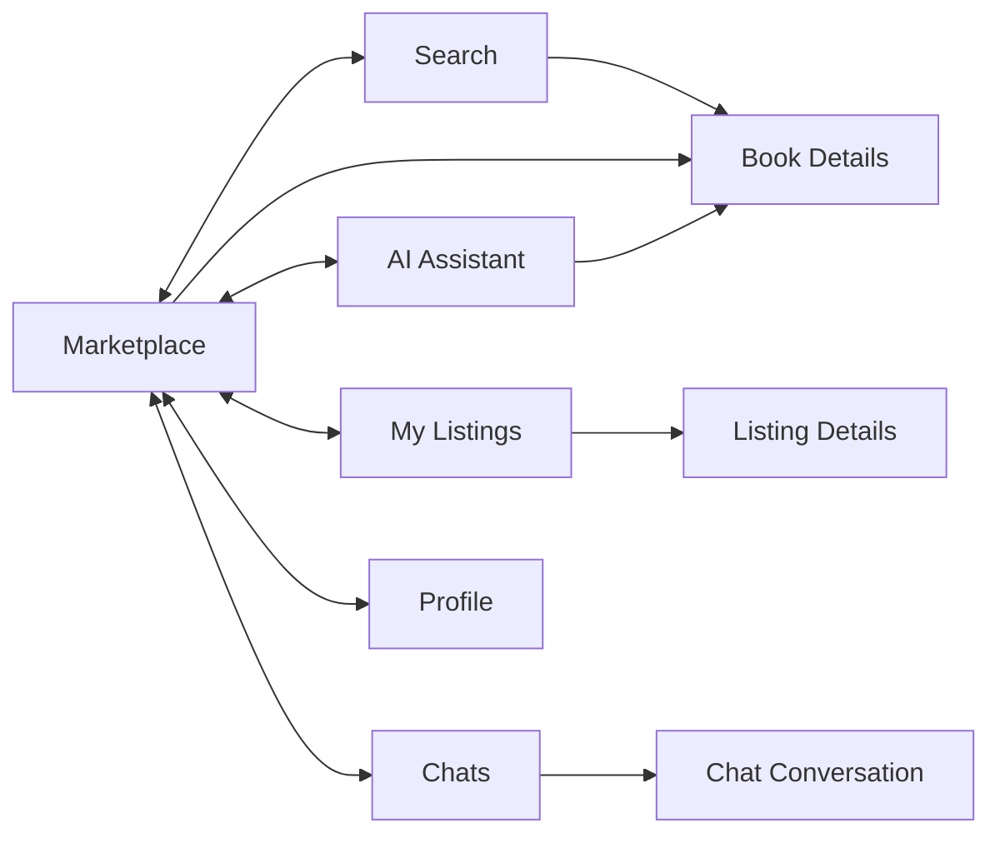

---

# 11. Marketplace Flow

The Marketplace is the primary home experience.

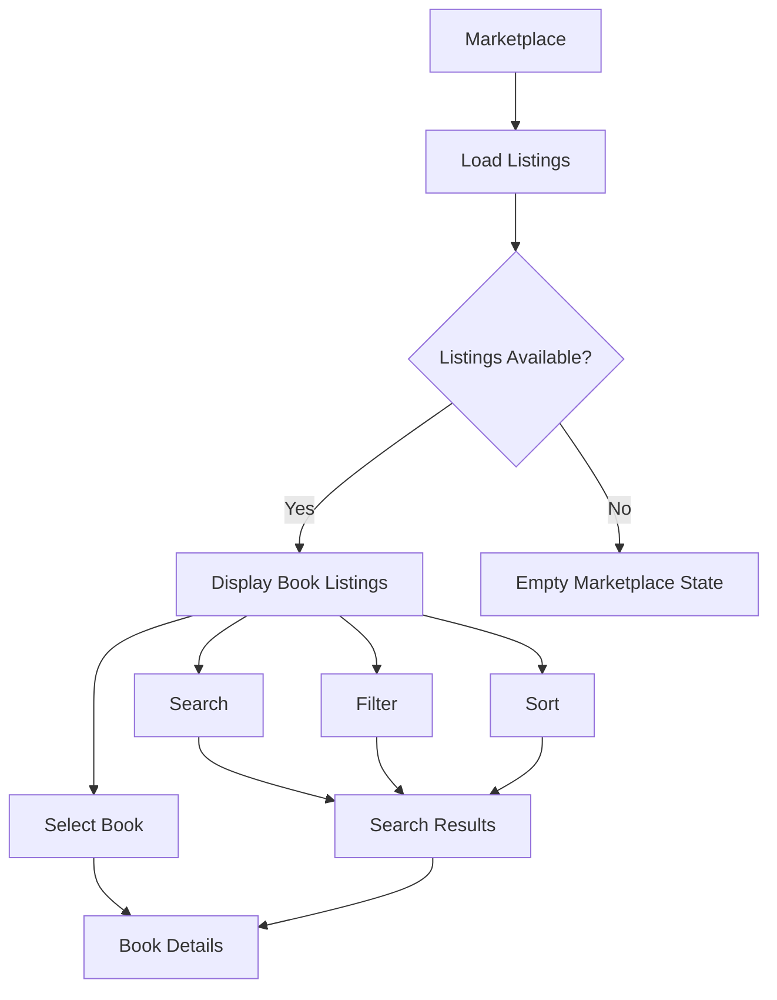

---

# 12. Marketplace Home

The Marketplace should allow users to quickly:

- Browse books.
- Search.
- Filter.
- Sort.
- Open book details.
- Access AI discovery.
- Navigate to selling and chat functionality.

Each listing card should provide enough information to make discovery efficient.

Typical listing information:

```text
Book Image
Book Name
Author
Edition
Price
```

Additional information can be displayed based on the approved Stitch design.

---

# 13. Marketplace Loading State

When listings are being loaded:

```text
Marketplace
 ↓
Loading State
 ↓
Fetch Listings
 ↓
Success → Display Listings
```

The loading UI must be intentionally designed and should not simply display a default system spinner if the Stitch design specifies another pattern.

---

# 14. Marketplace Empty State

If there are no listings:

```text
Marketplace
 ↓
No Listings
 ↓
Empty State
```

The empty state should explain that there are currently no available books and provide an appropriate next action where useful.

---

# 15. Marketplace Error State

If the backend cannot be reached:

```text
Marketplace
 ↓
Request Failed
 ↓
Error State
 ↓
Retry
 ↓
Fetch Listings Again
```

The user should not be left with a blank screen.

---

# 16. Search Flow

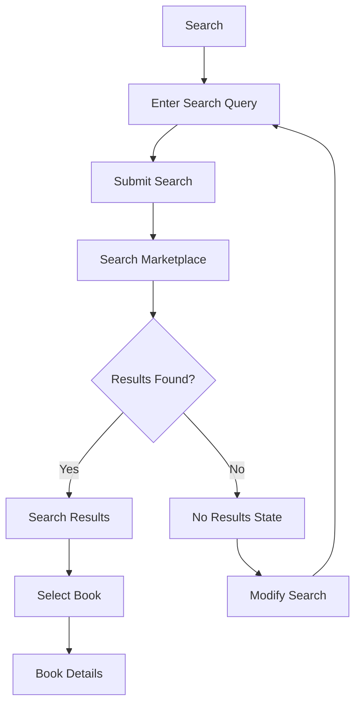

---

# 17. Search Behavior

Search should operate against actual BookWala marketplace listings.

Possible searchable information:

- Book name
- Author
- Edition
- Category/genre
- Relevant keywords

Search must not return fabricated listings.

---

# 18. Filter Flow

```text
Marketplace / Search
       ↓
Filter
       ↓
Select Filters
       ↓
Apply
       ↓
Filtered Marketplace Results
```

Possible filters:

```text
Price
Author
Edition
Genre / Category
Book Type
Availability
```

Only filters backed by actual data should be displayed.

---

# 19. Sort Flow

```text
Marketplace
    ↓
Sort
    ↓
Select Sort Option
    ↓
Apply
    ↓
Updated Results
```

Possible options:

- Price: Low to High
- Price: High to Low
- Newest Listings

---

# 20. Book Details Flow

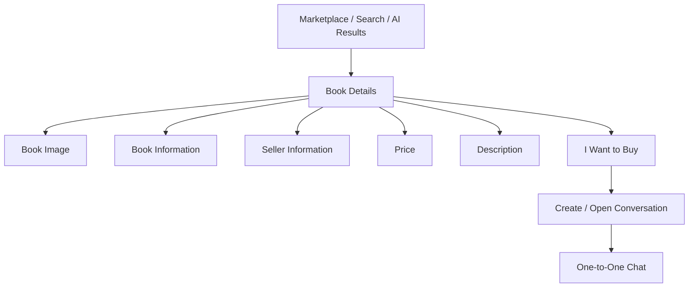

---

# 21. Book Details Screen

Book Details must display:

```text
Book Image
Book Name
Author
Edition
Price
Description
Seller
I Want to Buy
```

The user should have a clear primary action to contact the seller.

---

# 22. Buyer Flow

The complete buyer journey is:

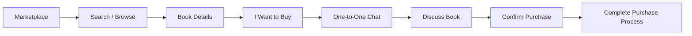

BookWala's initial MVP does not include integrated payments unless added later.

---

# 23. "I Want to Buy" Flow

When the buyer taps:

**I Want to Buy**

the application should:

1. Verify that the user is authenticated.
2. Verify that the book listing exists.
3. Verify that the seller exists.
4. Create or retrieve the appropriate conversation.
5. Associate the conversation with the book.
6. Open the chat screen.

```text
I Want to Buy
      ↓
Validate User
      ↓
Validate Listing
      ↓
Validate Seller
      ↓
Find Existing Chat
      ↓
OR
Create Chat
      ↓
Open Chat
```

The application should avoid creating duplicate conversations unnecessarily.

---

# 24. Seller Flow

The seller journey is:

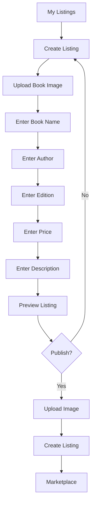

---

# 25. Create Listing Flow

Required fields:

```text
Book Image
Book Name
Author
Edition
Price
Description
```

Before publishing:

```text
Validate Fields
 ↓
Validate Image
 ↓
Upload Image
 ↓
Create Listing
 ↓
Success
```

---

# 26. Create Listing Validation

Examples of invalid states:

```text
Missing book name
Missing author
Missing edition
Invalid price
Missing required image
Network failure
Image upload failure
```

Validation errors should be displayed close to the relevant field where appropriate.

---

# 27. Listing Preview

Before publishing, the seller should be able to review the listing.

The preview should represent how the listing will appear to marketplace users.

Flow:

```text
Listing Form
 ↓
Preview
 ↓
Edit
OR
Publish
```

---

# 28. Cloudinary Image Flow

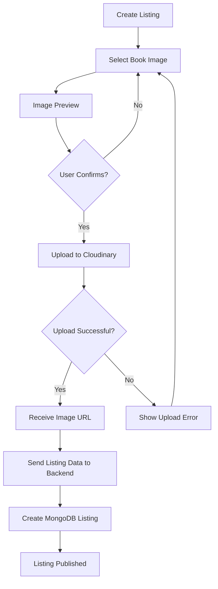

---

# 29. My Listings

My Listings should provide:

- All books listed by the current user.
- Listing details.
- Edit.
- Delete.
- Create new listing.

Flow:

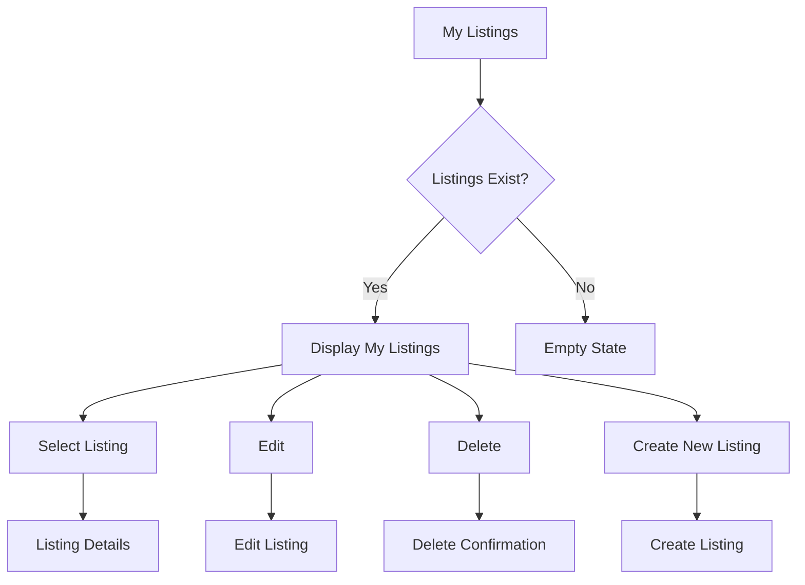

---

# 30. Edit Listing

```text
My Listings
 ↓
Select Listing
 ↓
Edit
 ↓
Modify Information
 ↓
Save Changes
 ↓
Validate
 ↓
Update Backend
 ↓
Updated Listing
```

Only the listing owner may edit the listing.

---

# 31. Delete Listing

```text
My Listings
 ↓
Delete
 ↓
Confirmation
 ↓
User Confirms
 ↓
Delete Backend Record
 ↓
Refresh Listings
```

If deletion fails, the listing should remain visible and an error should be shown.

---

# 32. Chat Flow

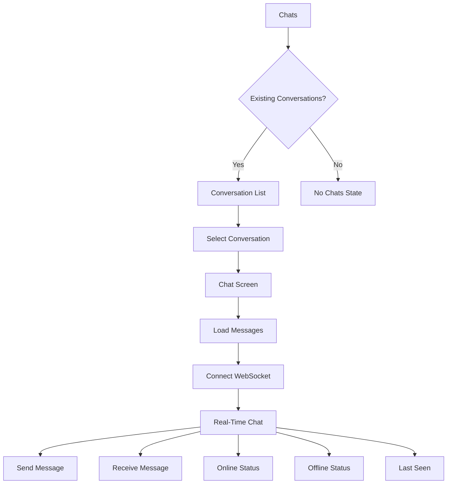

---

# 33. Conversation List

The Chats area should display relevant conversations.

A conversation may show:

```text
Other User
Book / Listing Context
Latest Message
Message Time
Online Status where applicable
Unread State where implemented
```

Selecting a conversation opens the chat.

---

# 34. Chat Screen

The chat screen should contain:

```text
Header
 ├── Seller/Buyer Name
 ├── Online / Offline
 └── Last Seen

Message Area

Message Composer
 ├── Text Input
 └── Send
```

The exact visual layout must follow Stitch.

---

# 35. WebSocket Chat Lifecycle

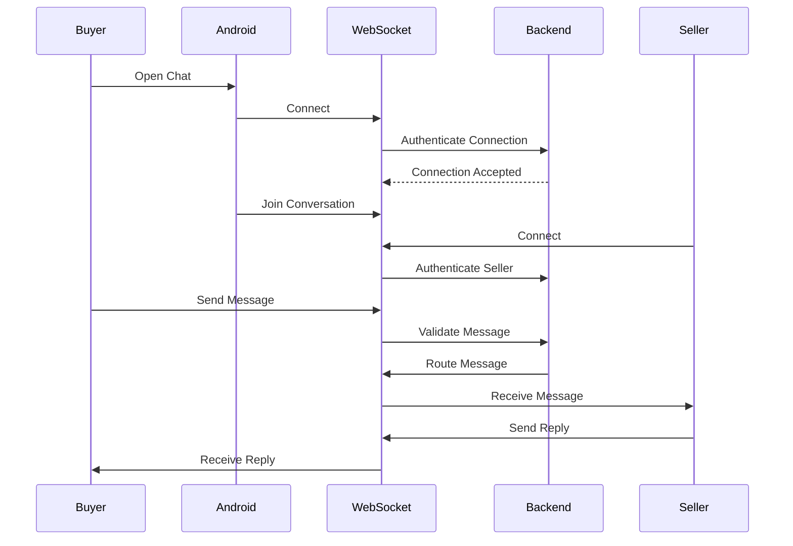

---

# 36. Online / Offline Flow

```text
User Connects
 ↓
WebSocket Connection Established
 ↓
Set Online
 ↓
User Remains Connected
 ↓
Connection Lost / Disconnect
 ↓
Set Offline
 ↓
Update Last Seen
```

Presence information must be based on actual connection state.

---

# 37. Reconnection Flow

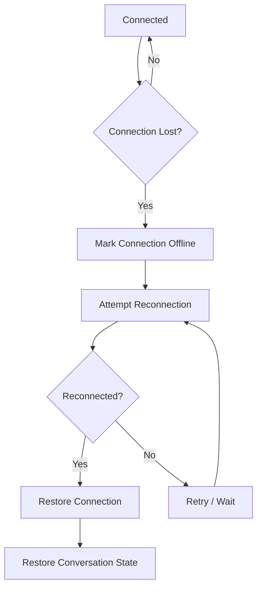

The implementation should avoid aggressive reconnection loops that waste battery or network resources.

---

# 38. Message Sending Flow

```text
User Types Message
       ↓
Tap Send
       ↓
Validate Message
       ↓
Send Through WebSocket
       ↓
Backend Validates
       ↓
Recipient Receives
       ↓
Message State Updated
```

If sending fails:

```text
Send Failed
 ↓
Show Failure State
 ↓
Allow Retry
```

---

# 39. AI Assistant Flow

The AI assistant is a major discovery feature.

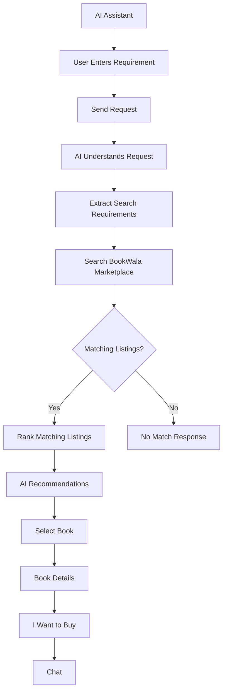

---

# 40. AI Assistant Input

The user can use natural language.

Examples:

```text
"I need a Java book for beginners."

"Find me a second-hand Python book under ₹500."

"I need a programming book for college."

"Looking for a database book, preferably the latest edition."
```

The user should not need to fill out a complicated search form.

---

# 41. AI Requirement Extraction

The AI may extract:

```text
Subject
Genre
Book Type
Author
Edition
Skill Level
Price Preference
Other Requirements
```

Example:

```text
User:
"Find a beginner Java book under ₹500."

Extracted:
Subject = Java
Level = Beginner
Price <= ₹500
```

---

# 42. AI Marketplace Search

The AI must use actual marketplace data.

Flow:

```text
Natural Language
      ↓
AI Interpretation
      ↓
Structured Search Criteria
      ↓
Backend Marketplace Search
      ↓
Matching Listings
      ↓
AI Ranking / Explanation
      ↓
Results
```

The AI must never independently invent marketplace data.

---

# 43. AI Result Flow

Each result should provide access to the actual BookWala listing.

```text
AI Results
   ↓
Recommended Book
   ↓
View Book
   ↓
Book Details
   ↓
I Want to Buy
   ↓
Chat
```

---

# 44. AI No-Result Flow

If no exact match exists:

```text
AI Search
 ↓
No Exact Match
 ↓
Explain No Match
 ↓
Optionally Show Close Matches
```

Example behavior:

```text
No exact match found.

Here are books that are close to your requirements.
```

If there are no relevant alternatives:

```text
No matching books are currently available.
Try changing your requirements or search again later.
```

---

# 45. AI Failure Flow

If the AI service fails:

```text
User Query
 ↓
AI Request
 ↓
AI Failure
 ↓
Show Error
 ↓
Retry
```

The application must not display fabricated results as a fallback.

---

# 46. Profile Flow

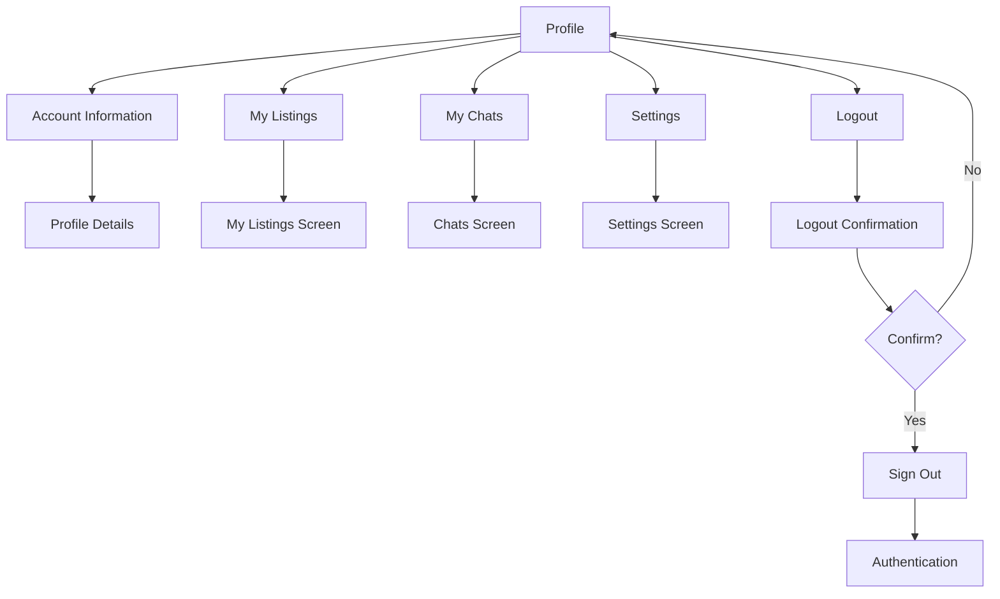

---

# 47. Logout Flow

```text
Profile
 ↓
Logout
 ↓
Confirmation
 ↓
Confirm
 ↓
Firebase Sign Out
 ↓
Clear Appropriate Local Session State
 ↓
Authentication Screen
```

---

# 48. Back Navigation Rules

Back navigation must follow normal Android navigation behavior.

Examples:

```text
Book Details
 ↓ Back
Marketplace / Previous Search Results

Chat
 ↓ Back
Conversation List

Create Listing
 ↓ Back
My Listings
```

If a form contains unsaved changes, the application should appropriately warn the user before discarding them.

---

# 49. Deep Navigation Through AI

AI results should open the same canonical Book Details screen used by normal marketplace navigation.

```text
AI Result
 ↓
Book ID
 ↓
Book Details
```

Do not create a separate duplicate Book Details implementation for AI.

---

# 50. Deep Navigation Through Search

Search results should also use the canonical Book Details screen.

```text
Search Result
 ↓
Book ID
 ↓
Book Details
```

This ensures consistent behavior across the application.

---

# 51. Canonical Book Listing Flow

All entry points should converge on the same book details experience:

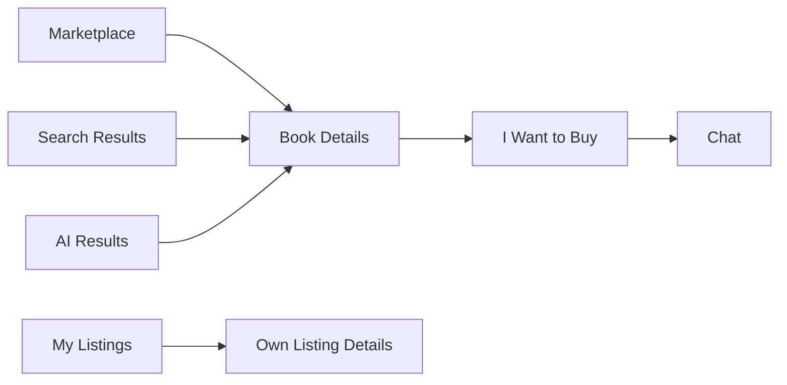

---

# 52. Authentication Guard

Protected screens/actions must require authentication.

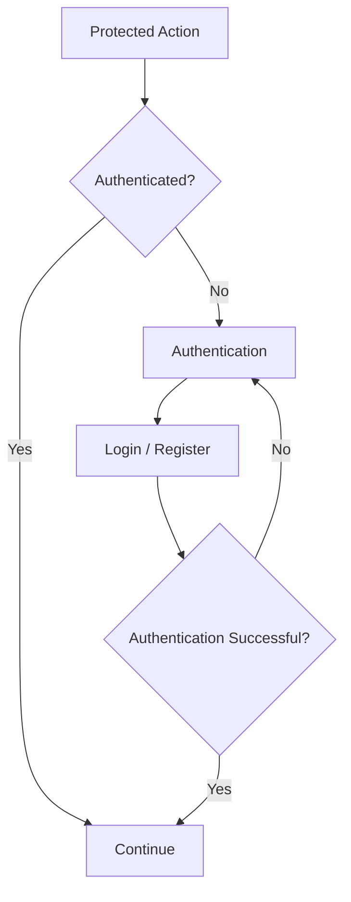

Examples of protected actions:

- Create listing
- Edit listing
- Delete listing
- Start buyer-seller chat
- Send messages
- Profile operations

Browsing may be allowed without authentication if the final product decision permits it, but actions that modify data or initiate communication must be authenticated.

---

# 53. Listing Ownership Guard

```text
Edit Listing
 ↓
Verify Authenticated User
 ↓
Verify Listing Owner
 ↓
Allowed → Edit
OR
Denied → Authorization Error
```

The same principle applies to deletion.

---

# 54. Chat Authorization Flow

```text
Open Chat
 ↓
Authenticate User
 ↓
Verify Conversation Participant
 ↓
Verify Conversation
 ↓
Open Chat
```

A user must not be able to access another user's private conversation.

---

# 55. Global Error Flow

All major application operations should follow:

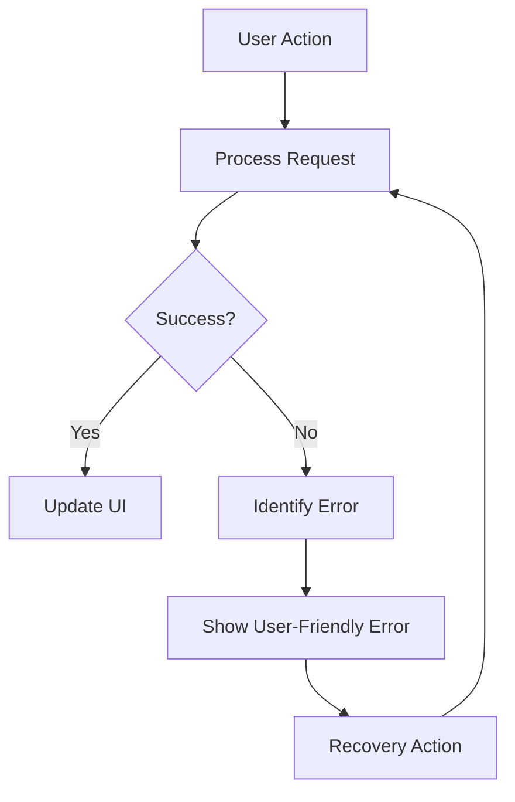

Errors should not expose internal stack traces, database errors, API secrets, or implementation details.

---

# 56. Network Failure Flow

```text
User Action
 ↓
Network Request
 ↓
Network Unavailable
 ↓
Show Offline / Connection Error
 ↓
Retry
```

The UI should remain usable where possible.

---

# 57. Global Loading Behavior

Long-running operations should have clear loading states.

Examples:

```text
Login
Listing Fetch
Book Details Fetch
Image Upload
Create Listing
Edit Listing
Delete Listing
AI Search
Chat Connection
```

The user should receive feedback that the action is processing.

---

# 58. Global Empty States

Important empty states include:

```text
No Marketplace Listings
No Search Results
No AI Matches
No My Listings
No Chats
No Messages
```

Each empty state should explain the situation and provide a sensible next action when possible.

---

# 59. Complete Buy Flow

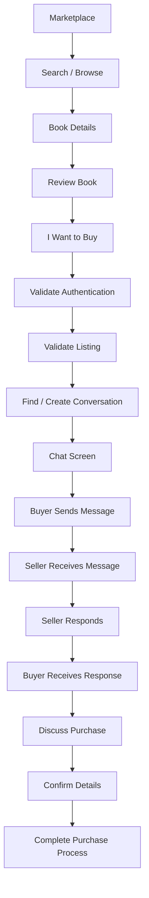

---

# 60. Complete Sell Flow

```mermaid
flowchart TD

    A[My Listings] --> B[Create Listing]
    B --> C[Select Image]
    C --> D[Enter Book Name]
    D --> E[Enter Author]
    E --> F[Enter Edition]
    F --> G[Enter Price]
    G --> H[Enter Description]

    H --> I[Validate]
    I --> J[Preview]

    J --> K{Publish?}

    K -->|Edit| B
    K -->|Publish| L[Upload Image]
    L --> M[Create Listing]
    M --> N[Marketplace]

    N --> O[Buyer Finds Book]
    O --> P[Buyer Starts Chat]
    P --> Q[Seller Responds]
```

---

# 61. Complete AI Discovery Flow

```mermaid
flowchart TD

    A[AI Assistant] --> B[User Query]

    B --> C[AI Processing]

    C --> D[Extract Requirements]

    D --> E[Marketplace Search]

    E --> F[Retrieve Listings]

    F --> G[Rank Results]

    G --> H{Results Available?}

    H -->|Yes| I[Display Recommendations]
    H -->|No| J[No Results]

    I --> K[Select Listing]
    K --> L[Book Details]
    L --> M[I Want to Buy]
    M --> N[Chat]

    J --> O[Modify Requirement]
    O --> B
```

---

# 62. Complete Application Flow

```mermaid
flowchart TD

    START([Open BookWala]) --> SPLASH[Splash]

    SPLASH --> AUTHCHECK{Authenticated?}

    AUTHCHECK -->|No| AUTH[Authentication]
    AUTHCHECK -->|Yes| HOME[Marketplace]

    AUTH --> LOGIN[Login]
    AUTH --> REGISTER[Register]
    AUTH --> GOOGLE[Google Sign-In]

    LOGIN --> AUTHRESULT{Success?}
    REGISTER --> AUTHRESULT
    GOOGLE --> AUTHRESULT

    AUTHRESULT -->|No| AUTH
    AUTHRESULT -->|Yes| HOME

    HOME --> MARKET[Browse Marketplace]
    HOME --> SEARCH[Search]
    HOME --> AI[AI Assistant]
    HOME --> SELL[My Listings]
    HOME --> CHATS[Chats]
    HOME --> PROFILE[Profile]

    MARKET --> DETAILS[Book Details]
    SEARCH --> RESULTS[Search Results]
    RESULTS --> DETAILS

    AI --> AIINPUT[Describe Required Book]
    AIINPUT --> AISEARCH[AI Marketplace Search]
    AISEARCH --> AIRESULTS[AI Recommendations]
    AIRESULTS --> DETAILS

    DETAILS --> BUY[I Want to Buy]
    BUY --> CHAT[Buyer ↔ Seller Chat]

    SELL --> MYLISTINGS[My Listings]
    MYLISTINGS --> CREATE[Create Listing]
    MYLISTINGS --> EDIT[Edit Listing]
    MYLISTINGS --> DELETE[Delete Listing]

    CREATE --> IMAGE[Upload Book Image]
    IMAGE --> FORM[Book Information]
    FORM --> PREVIEW[Preview]
    PREVIEW --> PUBLISH[Publish]
    PUBLISH --> MARKET

    CHATS --> CONVERSATIONS[Conversation List]
    CONVERSATIONS --> CHAT

    CHAT --> MESSAGE[Real-Time Messages]
    MESSAGE --> PRESENCE[Online / Offline / Last Seen]

    PROFILE --> ACCOUNT[Account]
    PROFILE --> SETTINGS[Settings]
    PROFILE --> LOGOUT[Logout]

    LOGOUT --> AUTH
```

---

# 63. Screen Inventory

The application should contain, at minimum, the following logical screens:

```text
01. Splash
02. Login
03. Register
04. Marketplace
05. Search
06. Search Results
07. Filter
08. Book Details
09. Create Listing
10. Listing Preview
11. My Listings
12. Edit Listing
13. Delete Listing Confirmation
14. Chats
15. Chat Conversation
16. AI Assistant
17. AI Results
18. Profile
19. Settings
20. Logout Confirmation
```

Additional screens may be introduced if required by the approved design or technical implementation.

---

# 64. Navigation Principles

1. Every screen must have a clear entry point.
2. Every major screen must have a clear way to leave it.
3. Avoid unnecessary navigation depth.
4. Do not duplicate screens unnecessarily.
5. Reuse canonical Book Details and Chat experiences.
6. Preserve user context when navigating back.
7. Do not lose unsaved listing information unexpectedly.
8. Protected actions must enforce authentication.
9. Authorization must be enforced by the backend.
10. UI navigation must follow the approved Stitch design.

---

# 65. State Management Principles

Application state should distinguish between:

```text
Loading
Success
Empty
Error
Offline
Authenticated
Unauthenticated
Connected
Disconnected
```

Do not represent every state using a simple boolean.

For example, marketplace loading should conceptually support:

```text
Initial
Loading
Loaded
Empty
Error
Refreshing
```

The exact implementation may vary according to the chosen Android architecture.

---

# 66. Data Flow Principle

The general Android data flow should be:

```text
User Interaction
      ↓
Compose UI
      ↓
ViewModel / State
      ↓
Use Case / Repository
      ↓
Backend API / WebSocket
      ↓
MongoDB / Firebase / Cloudinary / AI
      ↓
Response
      ↓
Repository
      ↓
ViewModel
      ↓
Compose UI
```

The UI should not directly contain backend business logic.

---

# 67. Marketplace Data Flow

```mermaid
flowchart LR

    A[Compose Marketplace] --> B[ViewModel]
    B --> C[Repository]
    C --> D[Express API]
    D --> E[MongoDB]

    E --> D
    D --> C
    C --> B
    B --> A
```

---

# 68. Listing Creation Data Flow

```mermaid
flowchart LR

    A[Create Listing UI] --> B[ViewModel]
    B --> C[Image Upload]
    C --> D[Cloudinary]

    D --> E[Image URL]
    E --> F[Backend API]

    F --> G[MongoDB]
    G --> H[Listing Created]

    H --> B
    B --> A
```

---

# 69. AI Data Flow

```mermaid
flowchart LR

    A[AI Assistant UI] --> B[User Query]
    B --> C[Backend AI Service]

    C --> D[AI Model]
    D --> E[Structured Requirements]

    E --> F[Marketplace Search]
    F --> G[MongoDB]

    G --> H[Matching Listings]
    H --> C
    C --> I[AI Results]
    I --> A
```

---

# 70. Chat Data Flow

```mermaid
flowchart LR

    A[Chat UI] <--> B[WebSocket Client]
    B <--> C[WebSocket Server]
    C <--> D[Chat Service]
    D <--> E[Message Storage]

    C --> F[Presence Service]

    F --> G[Online]
    F --> H[Offline]
    F --> I[Last Seen]
```

---

# 71. Feature Dependency Flow

```mermaid
flowchart TD

    A[Authentication] --> B[User Identity]

    B --> C[Marketplace]
    B --> D[Create Listing]
    B --> E[Chat]
    B --> F[Profile]

    C --> G[Book Details]
    D --> G

    G --> E

    C --> H[Search]
    C --> I[AI Assistant]

    I --> G
```

---

# 72. MVP Critical Path

The most important user journey that must always remain functional is:

```text
Authentication
      ↓
Marketplace
      ↓
Book Details
      ↓
I Want to Buy
      ↓
Chat
```

The primary seller journey is:

```text
Authentication
      ↓
My Listings
      ↓
Create Listing
      ↓
Upload Image
      ↓
Publish
      ↓
Marketplace
```

The primary AI journey is:

```text
Authentication
      ↓
AI Assistant
      ↓
Natural Language Query
      ↓
Marketplace Search
      ↓
AI Results
      ↓
Book Details
      ↓
Chat
```

---

# 73. Failure Recovery Principle

Every major flow must have a recovery path.

```text
Failure
 ↓
Explain
 ↓
Provide Recovery Action
 ↓
Retry / Go Back / Modify Input
```

The application must never intentionally leave users trapped on a broken screen.

---

# 74. UX Consistency Rules

Across all flows:

- Buttons must behave consistently.
- Loading behavior must be consistent.
- Error presentation must be consistent.
- Back navigation must be predictable.
- Empty states must be intentional.
- Book information must use consistent terminology.
- Seller information must be presented consistently.
- Chat status must use consistent terminology.
- AI recommendations must visually match marketplace listings where appropriate.

---

# 75. Design Implementation Rule

The flow defined here describes **behavior and navigation**.

It does not override the visual design.

The implementation sequence is:

```text
APP_FLOW.md
      ↓
Stitch MCP
      ↓
Approved UI Design
      ↓
Jetpack Compose Implementation
```

The approved Stitch design is the visual source of truth.

This document is the navigation and interaction source of truth.

`PROJECT_REQUIREMENTS.md` is the product requirements source of truth.

---

# 76. Development Rule

Each flow should be implemented incrementally.

For every phase:

```text
Plan
 ↓
Build
 ↓
Test
 ↓
Find Errors
 ↓
Fix
 ↓
Retest
 ↓
Android Gradle Build
 ↓
Review
 ↓
Approve
 ↓
Git Commit
 ↓
Next Phase
```

Never knowingly proceed to the next phase with unresolved blocking errors.

---

# 77. Final Application Flow

The complete BookWala experience can be summarized as:

```text
                         BOOKWALA
                            │
                            ▼
                          SPLASH
                            │
                            ▼
                    AUTHENTICATION CHECK
                       /            \
                      /              \
               NOT AUTHENTICATED   AUTHENTICATED
                    │                   │
                    ▼                   ▼
              LOGIN / REGISTER      MARKETPLACE
                    │                   │
                    └────────┬──────────┤
                             │          │
                             │          ├── Search
                             │          │      ↓
                             │          │   Results
                             │          │      ↓
                             │          │   Book Details
                             │          │
                             │          ├── Browse
                             │          │      ↓
                             │          │   Book Details
                             │          │
                             │          ├── AI Assistant
                             │          │      ↓
                             │          │   User Requirement
                             │          │      ↓
                             │          │   AI Search
                             │          │      ↓
                             │          │   Recommendations
                             │          │      ↓
                             │          │   Book Details
                             │          │
                             │          ├── My Listings
                             │          │      ↓
                             │          │   Create Listing
                             │          │      ↓
                             │          │   Upload Image
                             │          │      ↓
                             │          │   Publish
                             │          │
                             │          ├── Chats
                             │          │      ↓
                             │          │   Conversation
                             │          │      ↓
                             │          │   Real-Time Chat
                             │          │      ↓
                             │          │   Online / Offline
                             │          │   Last Seen
                             │          │
                             │          └── Profile
                             │                 ↓
                             │              Settings
                             │
                             ▼
                       BOOK DETAILS
                             │
                             ▼
                      I WANT TO BUY
                             │
                             ▼
                    BUYER ↔ SELLER CHAT
                             │
                             ▼
                    DISCUSS / CONFIRM
                             │
                             ▼
                  COMPLETE PURCHASE PROCESS
```

---

# 78. Source-of-Truth Hierarchy

When implementing BookWala, use the following hierarchy:

```text
1. Explicit User Decisions
          ↓
2. PROJECT_REQUIREMENTS.md
          ↓
3. APP_FLOW.md
          ↓
4. Approved Stitch Design
          ↓
5. Technical Specifications
          ↓
6. Implementation Details
```

If an implementation detail conflicts with an explicit product requirement, the product requirement takes precedence.

If a UI implementation conflicts with an approved Stitch design, the approved design should be reviewed and corrected rather than silently replaced.

If an important requirement is ambiguous, stop and ask for clarification before implementing.

---

# 79. Final Implementation Objective

BookWala must provide a coherent experience where:

```text
Users can discover books
        +
Users can sell books
        +
Users can search efficiently
        +
Users can use AI to discover relevant books
        +
Buyers can contact sellers
        +
Buyers and sellers can communicate in real time
        +
Users can manage their listings and account
```

The final application should feel like a **complete, production-oriented second-hand book marketplace**, not a collection of disconnected screens.