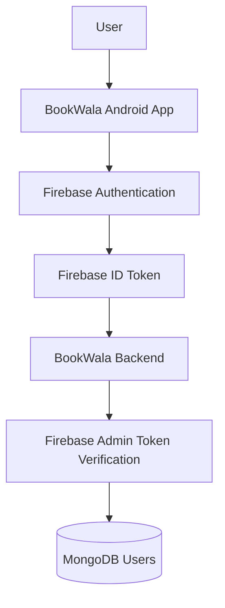
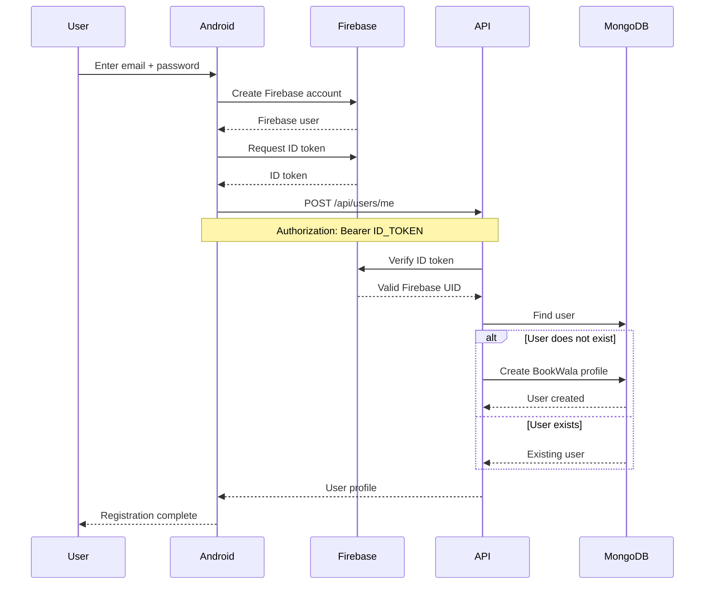
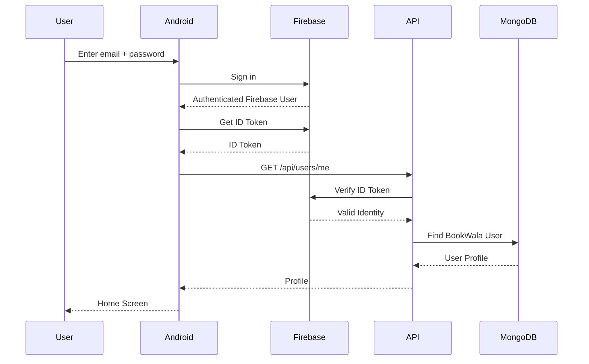
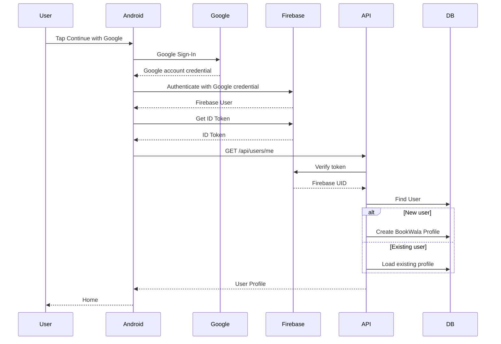
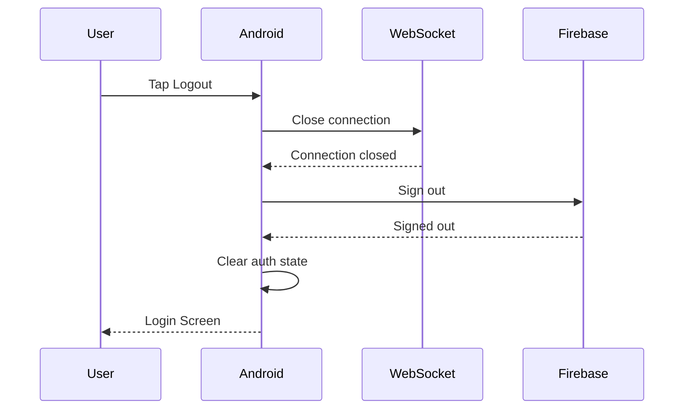
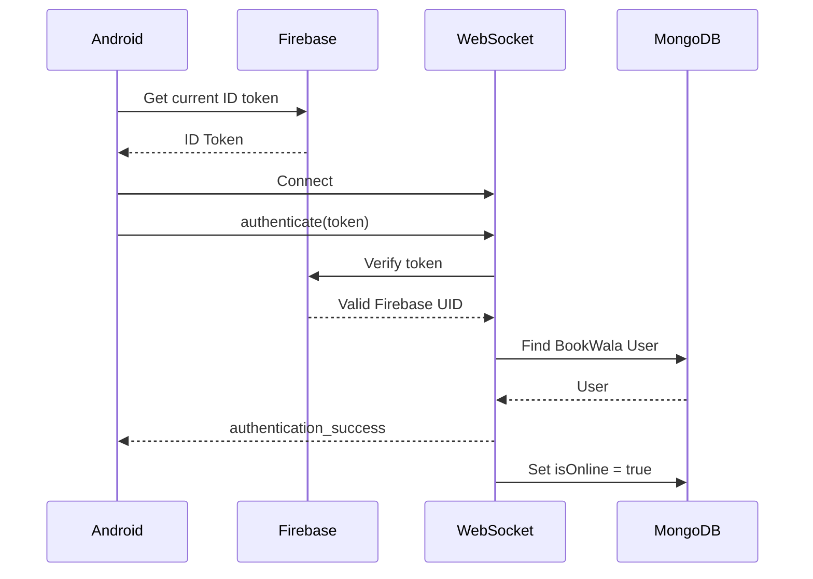
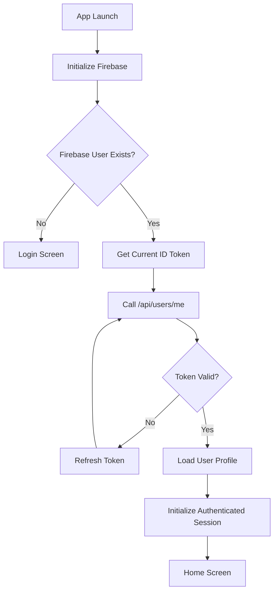
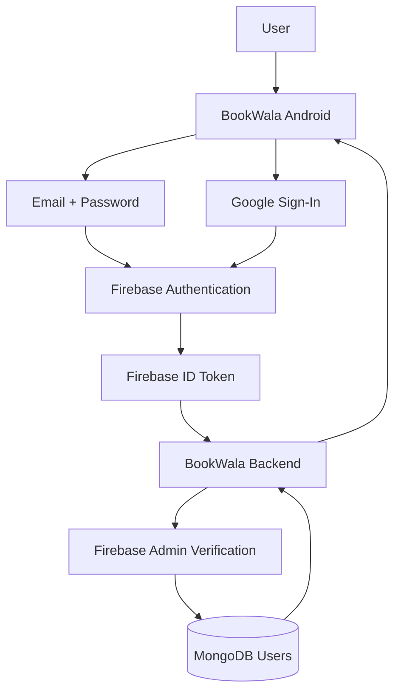
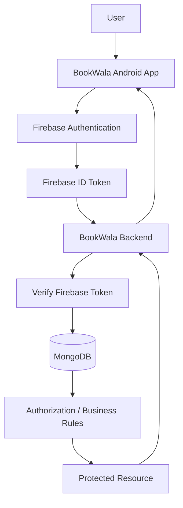

# BookWala — Authentication Flow

**Project Name:** BookWala  
**Android Package:** `com.buildstack.bookwala`  
**Android:** Kotlin + Jetpack Compose  
**Authentication Provider:** Firebase Authentication  
**Backend:** Node.js + Express.js  
**Database:** MongoDB  
**Real-Time:** WebSocket  
**Version:** 1.0

---

# 1. Purpose

This document defines the complete authentication architecture for BookWala.

Authentication must support:

- Email + password
- Google Sign-In
- Firebase Authentication
- Firebase ID tokens
- Backend token verification
- User profile synchronization
- REST API authentication
- WebSocket authentication
- Session restoration
- Logout
- Token refresh
- Unauthorized request handling

Firebase Authentication is responsible for proving the user's identity.

The BookWala backend is responsible for authorizing application operations.

---

# 2. Authentication Architecture



---

# 3. Identity Model

BookWala has two related identity layers.

## Firebase identity

Firebase manages:

```text
Authentication
Email
Password
Google account identity
Firebase UID
ID tokens
```

## BookWala application identity

MongoDB manages:

```text
User profile
Display name
Photo URL
Phone
Bio
Online state
Last seen
Book listings
Chat participation
```

---

# 4. Source of Truth

| Data | Source |
|---|---|
| Password | Firebase |
| Google authentication | Firebase |
| Firebase UID | Firebase |
| Authentication token | Firebase |
| User profile | MongoDB |
| User listings | MongoDB |
| Chat permissions | MongoDB |
| Online status | WebSocket + MongoDB |
| Last seen | WebSocket + MongoDB |

The backend must never store user passwords.

---

# 5. Supported Authentication Methods

MVP:

```text
Email + Password
Google Sign-In
```

Both methods ultimately produce a Firebase authenticated user.

---

# 6. Authentication Flow Overview

```text
User
 ↓
BookWala Android App
 ↓
Firebase Authentication
 ↓
Firebase User
 ↓
Firebase ID Token
 ↓
BookWala Backend
 ↓
Verify Token
 ↓
Find/Create MongoDB User
 ↓
Authenticated BookWala User
```

---

# 7. Email + Password Registration

The user provides:

```text
Email
Password
```

The Android application sends the registration request to Firebase Authentication.

BookWala backend does not receive the user's password.

---

# 8. Email Registration Flow



---

# 9. Registration Validation

The Android UI should validate:

```text
Email format
Password presence
Password confirmation
```

Firebase remains responsible for authentication-specific validation.

The backend independently validates the authenticated identity and profile information.

---

# 10. Password Security

BookWala must never:

- Store passwords in MongoDB.
- Log passwords.
- Send passwords to the BookWala backend.
- Include passwords in WebSocket messages.
- Include passwords in analytics/logging.

Firebase Authentication handles password storage and authentication.

---

# 11. Email + Password Login

Flow:

```text
User
 ↓
Email + Password
 ↓
Firebase Authentication
 ↓
Firebase User
 ↓
ID Token
 ↓
BookWala Backend
 ↓
Verify Token
 ↓
Load BookWala Profile
 ↓
Home
```

---

# 12. Login Sequence



---

# 13. Google Sign-In

Google authentication follows:

```text
User
 ↓
Google Sign-In
 ↓
Firebase Authentication
 ↓
Firebase User
 ↓
Firebase ID Token
 ↓
BookWala Backend
```

The Android application must use the official Firebase-supported Google authentication flow.

---

# 14. Google Login Flow



---

# 15. Firebase UID

The Firebase UID is the permanent identity bridge between Firebase and BookWala.

Example:

```text
Firebase UID
    ↓
MongoDB users.firebaseUid
```

The field must be unique.

---

# 16. User Synchronization

After successful Firebase authentication:

```text
Firebase User
      ↓
ID Token
      ↓
Backend Verification
      ↓
firebaseUid
      ↓
MongoDB User
```

If the BookWala profile does not exist:

```text
Create profile
```

If it exists:

```text
Load existing profile
```

---

# 17. User Profile Creation

The backend may create:

```json
{
  "firebaseUid": "FIREBASE_UID",
  "email": "user@example.com",
  "displayName": "John",
  "photoUrl": null,
  "phone": null,
  "bio": null,
  "isOnline": false,
  "lastSeenAt": null,
  "isActive": true
}
```

The backend controls:

```text
firebaseUid
email
createdAt
updatedAt
```

The client cannot arbitrarily assign another Firebase UID.

---

# 18. Protected REST Request

Every protected API request uses:

```http
Authorization: Bearer <FIREBASE_ID_TOKEN>
```

Example:

```text
Android
 ↓
API Request
 ↓
Authorization Header
 ↓
Firebase Admin SDK
 ↓
Verify Token
 ↓
Authenticated User
```

---

# 19. REST Authentication Middleware

The backend should have centralized authentication middleware.

Conceptual:

```text
authenticateFirebaseUser()
```

Responsibilities:

1. Read Authorization header.
2. Extract Bearer token.
3. Verify Firebase token.
4. Extract Firebase UID.
5. Find BookWala user.
6. Attach authenticated identity to request.
7. Continue.

---

# 20. Authenticated Request Context

After verification, the backend should have a trusted request identity.

Conceptually:

```javascript
req.user = {
  firebaseUid: "...",
  userId: "...",
  email: "..."
}
```

The exact structure may differ.

Controllers should use the server-derived identity instead of trusting user IDs supplied in request bodies.

---

# 21. Protected API Example

Request:

```http
GET /api/users/me
Authorization: Bearer <ID_TOKEN>
```

Backend:

```text
Receive request
 ↓
Authentication middleware
 ↓
Verify Firebase token
 ↓
Resolve BookWala user
 ↓
Controller
 ↓
Service
 ↓
MongoDB
 ↓
Response
```

---

# 22. Missing Authentication

If a protected endpoint receives no token:

```text
401 Unauthorized
```

Example:

```json
{
  "success": false,
  "error": {
    "code": "AUTHENTICATION_REQUIRED",
    "message": "Authentication is required."
  }
}
```

---

# 23. Invalid Token

If the token cannot be verified:

```text
401 Unauthorized
```

Example:

```json
{
  "success": false,
  "error": {
    "code": "INVALID_AUTH_TOKEN",
    "message": "Authentication token is invalid."
  }
}
```

Do not expose Firebase verification details.

---

# 24. Expired Token

If the Firebase ID token is expired:

```text
401 Unauthorized
```

Android should:

```text
Refresh Firebase token
 ↓
Retry request when appropriate
```

The application must not ask the user to log in again for every normal token refresh.

---

# 25. Token Refresh

Firebase manages token refresh.

Conceptually:

```text
Firebase User
      ↓
Current ID Token
      ↓
Token Near Expiration
      ↓
Firebase Refreshes Token
      ↓
Android Obtains Current Token
      ↓
API Request
```

The Android application should request a current Firebase token when making authenticated operations as appropriate.

---

# 26. Logout

Logout must clear the Firebase authentication session on Android.

Flow:

```text
User
 ↓
Tap Logout
 ↓
Firebase Sign Out
 ↓
Close WebSocket
 ↓
Clear application auth state
 ↓
Navigate to Login
```

---

# 27. Logout Sequence



---

# 28. WebSocket Authentication

WebSocket authentication uses the same Firebase identity.

```text
Firebase ID Token
      ↓
WebSocket Server
      ↓
Firebase Admin Verification
      ↓
Firebase UID
      ↓
BookWala User
      ↓
Authenticated Connection
```

---

# 29. WebSocket Authentication Flow



---

# 30. WebSocket Logout Behavior

When the user logs out:

```text
Close WebSocket
      ↓
Connection manager removes connection
      ↓
Check other active connections
      ↓
If none:
    User becomes offline
      ↓
Update lastSeenAt
```

---

# 31. Session Restoration

When the Android app starts:

```text
Open App
 ↓
Firebase checks current user
 ↓
User exists?
 ├── No → Login
 └── Yes
       ↓
Get current Firebase token
       ↓
Call /api/users/me
       ↓
Load profile
       ↓
Enter authenticated app
```

---

# 32. App Startup Flow



---

# 33. Authentication State

Android should have a centralized authentication state.

Example:

```text
Loading
Unauthenticated
Authenticated
Error
```

The exact implementation can use:

```text
StateFlow
ViewModel
Repository
```

according to the Android architecture.

---

# 34. Navigation Rules

Unauthenticated:

```text
Login
Register
```

Authenticated:

```text
Home
Marketplace
Create Listing
Book Details
Chats
Profile
AI Assistant
```

The user should not be able to navigate to protected application screens while unauthenticated.

---

# 35. Protected Screen Rule

Example:

```text
User opens Chat
      ↓
Authenticated?
      ↓
No → Login
Yes → Chat
```

The backend remains the final authorization authority.

---

# 36. Authentication vs Authorization

These are separate concepts.

## Authentication

Answers:

```text
Who are you?
```

Firebase provides this.

## Authorization

Answers:

```text
What are you allowed to do?
```

BookWala backend provides this.

Example:

```text
Firebase says:
"This is User A."

BookWala says:
"User A owns this listing."
```

---

# 37. Book Authorization

For:

```text
PUT /api/books/:bookId
```

the backend checks:

```text
Authenticated User
        ↓
Book sellerId
        ↓
Does userId == sellerId?
```

If no:

```text
403 Forbidden
```

---

# 38. Chat Authorization

For:

```text
GET /api/chats/:chatId/messages
```

the backend checks:

```text
Authenticated User
        ↓
Chat
        ↓
buyerId OR sellerId
```

If neither matches:

```text
403 Forbidden
```

---

# 39. AI Authorization

The AI endpoint:

```text
POST /api/ai/book-search
```

requires authentication.

Flow:

```text
Firebase User
 ↓
ID Token
 ↓
BookWala Backend
 ↓
Verify
 ↓
AI Service
```

The NVIDIA API key remains server-side.

---

# 40. Authentication Security Rules

The Android application must never contain:

```text
Firebase Admin private key
MongoDB connection string
NVIDIA API key
Cloudinary API secret
```

Firebase client configuration is not equivalent to a Firebase Admin secret and should still be configured according to Firebase's Android security guidance.

---

# 41. Firebase Admin SDK

The backend uses Firebase Admin SDK for server-side token verification.

Conceptually:

```text
Firebase Admin SDK
        ↓
verifyIdToken()
        ↓
Firebase UID
```

The Admin credentials remain exclusively on the backend.

---

# 42. Backend Environment Variables

Example:

```text
FIREBASE_PROJECT_ID
FIREBASE_CLIENT_EMAIL
FIREBASE_PRIVATE_KEY

MONGODB_URI

NVIDIA_API_KEY
NVIDIA_BASE_URL
NVIDIA_MODEL

CLOUDINARY_CLOUD_NAME
CLOUDINARY_API_KEY
CLOUDINARY_API_SECRET
```

Actual environment variable names can be adjusted during implementation.

Secrets must be configured through Render environment variables in production.

---

# 43. No Password API

BookWala backend should not expose:

```text
POST /api/auth/login
```

for Firebase email/password authentication if Firebase handles the authentication directly from Android.

Instead:

```text
Android
 ↓
Firebase Authentication
```

and then:

```text
Android
 ↓
BookWala API with ID token
```

This avoids unnecessarily moving passwords through the BookWala backend.

---

# 44. Authentication Architecture



---

# 45. Complete User Registration Flow

```text
User opens BookWala
        ↓
Register
        ↓
Select authentication method
        ↓
Firebase Authentication
        ↓
Firebase account created
        ↓
Firebase ID token
        ↓
BookWala backend
        ↓
Verify token
        ↓
Find user
        ↓
User doesn't exist
        ↓
Create MongoDB profile
        ↓
Return profile
        ↓
Authenticated Home
```

---

# 46. Complete Returning User Flow

```text
Open BookWala
 ↓
Firebase detects existing user
 ↓
Get current ID token
 ↓
Call backend
 ↓
Verify token
 ↓
Find MongoDB profile
 ↓
Load user
 ↓
Initialize WebSocket when needed
 ↓
Home
```

---

# 47. Account Deactivation

The MongoDB user contains:

```text
isActive
```

If:

```text
isActive = false
```

the backend can reject authenticated application operations even if the Firebase token itself is valid.

This allows BookWala to disable an application account without confusing Firebase authentication state.

---

# 48. Account Deactivation Flow

```text
Firebase Authentication
        ↓
Valid identity
        ↓
MongoDB user
        ↓
isActive?
 ├── true → Continue
 └── false → Reject application access
```

---

# 49. Authentication Error Handling

The Android application should distinguish:

```text
Invalid credentials
Network error
Firebase unavailable
Backend unavailable
Token expired
Account inactive
Unknown error
```

Errors should be shown as user-friendly messages.

Internal backend/Firebase error details must not be exposed directly.

---

# 50. Offline Authentication State

If the device temporarily loses network access, the application should not immediately treat the user as permanently logged out.

The application can maintain local authentication state while Firebase manages the authenticated session.

However:

```text
Protected backend operation
```

still requires successful communication with the backend.

---

# 51. Token Handling

Firebase ID tokens should be treated as sensitive credentials.

Do not:

- Print them to logs.
- Store them in plain debug logs.
- Send them to analytics.
- Include them in URLs.
- Put them in chat messages.

Use secure platform-appropriate Firebase mechanisms.

---

# 52. Authentication Testing

Every authentication implementation must test:

## Email

```text
Valid registration
Invalid email
Invalid password
Existing account
Correct login
Incorrect password
Logout
```

## Google

```text
Successful Google login
Cancelled login
Existing Google user
New Google user
Logout
```

## Backend

```text
Valid token
Missing token
Invalid token
Expired token
Inactive account
```

## WebSocket

```text
Valid authentication
Invalid token
Expired token
Missing token
Reconnect
Logout
```

---

# 53. Authentication Acceptance Criteria

The authentication system is complete when:

- Users can register using email/password.
- Users can log in using email/password.
- Users can authenticate using Google.
- Firebase remains responsible for authentication credentials.
- Backend verifies Firebase ID tokens.
- MongoDB profiles are automatically synchronized.
- Duplicate Firebase users cannot create duplicate BookWala profiles.
- Protected APIs reject unauthenticated requests.
- Resource authorization is enforced server-side.
- WebSocket connections require authentication.
- Logout closes the real-time session.
- Token refresh works.
- Inactive BookWala users cannot use protected application functionality.
- Secrets never enter the Android application.

---

# 54. Authentication + Authorization Master Flow



---

# 55. Final Security Principle

The BookWala authentication architecture follows:

```text
Firebase
    ↓
Proves identity

BookWala Backend
    ↓
Verifies identity

MongoDB
    ↓
Stores application profile

Backend Authorization
    ↓
Determines permissions

WebSocket
    ↓
Provides authenticated real-time communication

Android
    ↓
Displays the authenticated application
```

The Android client is never the authority for identity or permissions.

The Firebase token establishes **who the user is**.

The BookWala backend determines **what that user is allowed to do**.