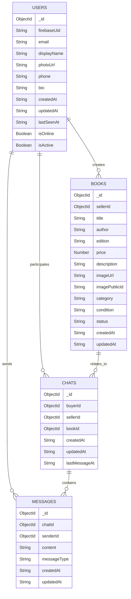
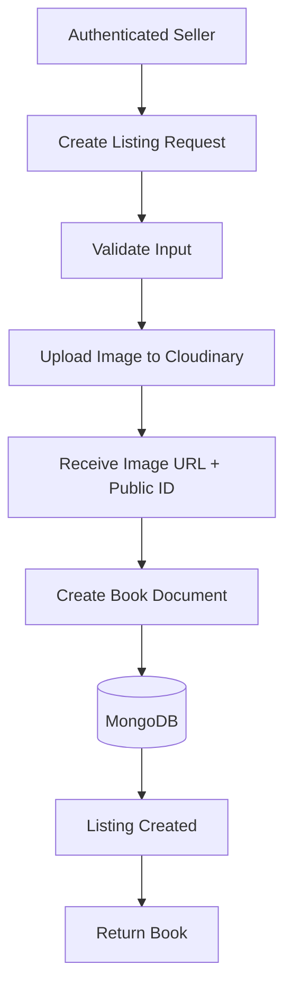
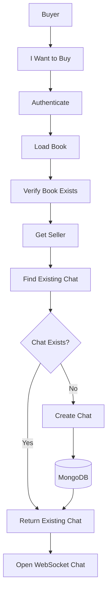
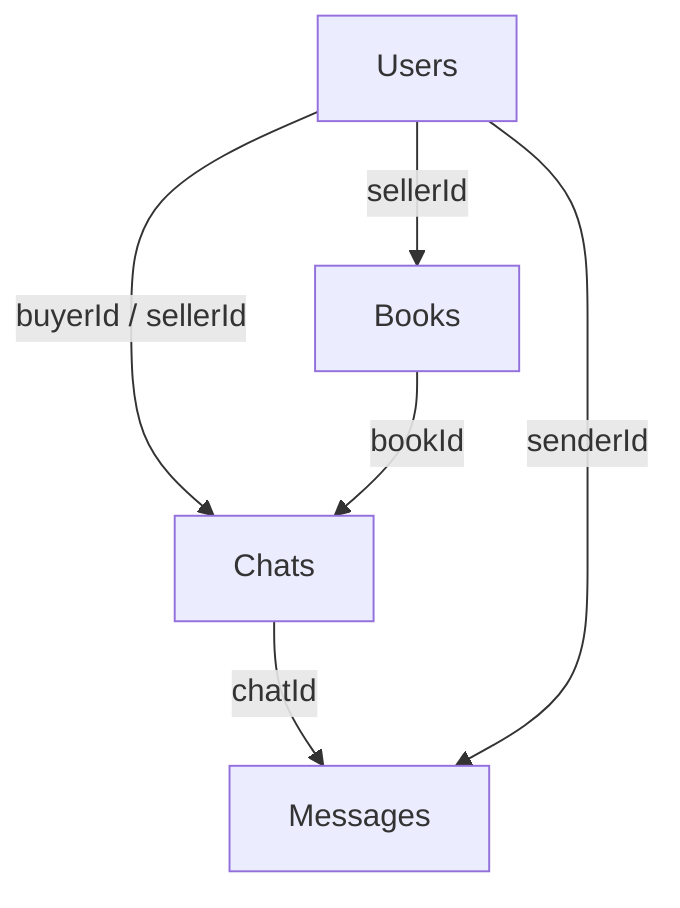

# BookWala — Database Schema

**Project Name:** BookWala  
**Android Package:** `com.buildstack.bookwala`  
**Database:** MongoDB  
**Version:** 1.0

---

# 1. Purpose

This document defines the MongoDB data model for BookWala.

The schema supports:

- User accounts
- User profiles
- Book listings
- Book images
- Book ownership
- Buyer-seller relationships
- Conversations
- Messages
- Online/offline presence
- AI book discovery
- Listing status
- Timestamps
- Data validation
- Indexing
- Authorization requirements

MongoDB is the primary application database.

Firebase Authentication remains the source of truth for authentication identity.

Cloudinary remains the source of truth for book images.

WebSocket connection state remains the source of truth for real-time presence.

---

# 2. Database Architecture



---

# 3. Collections

The MVP database contains these primary collections:

```text
users
books
chats
messages
```

Additional collections should only be introduced when there is a real product requirement.

---

# 4. Users Collection

Collection:

```text
users
```

The user document represents the BookWala application profile associated with a Firebase Authentication account.

---

## 4.1 User Schema

```javascript
{
  _id: ObjectId,

  firebaseUid: String,

  email: String,

  displayName: String,

  photoUrl: String | null,

  phone: String | null,

  bio: String | null,

  isOnline: Boolean,

  lastSeenAt: Date | null,

  isActive: Boolean,

  createdAt: Date,

  updatedAt: Date
}
```

---

# 5. User Fields

| Field | Type | Required | Description |
|---|---|---:|---|
| `_id` | ObjectId | Yes | MongoDB document ID |
| `firebaseUid` | String | Yes | Firebase Authentication UID |
| `email` | String | Yes | User email |
| `displayName` | String | Yes | Public display name |
| `photoUrl` | String | No | Profile image URL |
| `phone` | String | No | Optional phone number |
| `bio` | String | No | Optional user biography |
| `isOnline` | Boolean | Yes | Current presence state |
| `lastSeenAt` | Date | No | Last known online timestamp |
| `isActive` | Boolean | Yes | Account active/deactivated state |
| `createdAt` | Date | Yes | Account creation time |
| `updatedAt` | Date | Yes | Last profile update |

---

# 6. User Rules

### Firebase UID

`firebaseUid` must be unique.

A BookWala user must correspond to one Firebase authenticated identity.

### Email

Email should be normalized where appropriate.

### Online State

`isOnline` is controlled by the WebSocket/presence system.

It must not be manually controlled by the client.

### Last Seen

`lastSeenAt` should be updated when the user's authenticated WebSocket session transitions from connected to disconnected.

---

# 7. User Indexes

Recommended:

```javascript
db.users.createIndex(
  { firebaseUid: 1 },
  { unique: true }
)
```

```javascript
db.users.createIndex(
  { email: 1 }
)
```

---

# 8. Books Collection

Collection:

```text
books
```

The `books` collection contains marketplace listings.

A book document represents one seller's listing.

---

# 9. Book Schema

```javascript
{
  _id: ObjectId,

  sellerId: ObjectId,

  title: String,

  author: String,

  edition: String,

  price: Number,

  description: String,

  imageUrl: String,

  imagePublicId: String,

  category: String | null,

  condition: String | null,

  status: String,

  createdAt: Date,

  updatedAt: Date
}
```

---

# 10. Book Fields

| Field | Type | Required | Description |
|---|---|---:|---|
| `_id` | ObjectId | Yes | Book listing ID |
| `sellerId` | ObjectId | Yes | User who owns the listing |
| `title` | String | Yes | Book title |
| `author` | String | Yes | Author name |
| `edition` | String | Yes | Book edition |
| `price` | Number | Yes | Selling price |
| `description` | String | Yes | Seller-provided description |
| `imageUrl` | String | Yes | Cloudinary image URL |
| `imagePublicId` | String | Yes | Cloudinary asset identifier |
| `category` | String | No | Book category/genre |
| `condition` | String | No | Book condition |
| `status` | String | Yes | Listing availability |
| `createdAt` | Date | Yes | Listing creation date |
| `updatedAt` | Date | Yes | Last listing update |

---

# 11. Book Status

Allowed values:

```text
active
sold
removed
```

Default:

```text
active
```

Only active listings should appear in the normal marketplace.

---

# 12. Book Condition

Condition can use:

```text
new
like_new
good
acceptable
```

If condition is not included in the initial UI, it may remain optional in the database.

---

# 13. Book Ownership

Every listing must have:

```text
sellerId
```

The `sellerId` references:

```text
users._id
```

Authorization rule:

```text
Current User ID == Book sellerId
```

must be true before allowing:

- Update
- Delete

---

# 14. Book Image Storage

Book images are stored on Cloudinary.

MongoDB stores:

```text
imageUrl
imagePublicId
```

Example:

```javascript
{
  imageUrl: "https://...",
  imagePublicId: "bookwala/books/abc123"
}
```

The application must not store large image binaries directly in MongoDB.

---

# 15. Book Indexes

Recommended:

```javascript
db.books.createIndex(
  { sellerId: 1 }
)
```

```javascript
db.books.createIndex(
  { status: 1, createdAt: -1 }
)
```

For search:

```javascript
db.books.createIndex(
  {
    title: "text",
    author: "text",
    description: "text",
    category: "text"
  }
)
```

Additional indexes may be added based on real query patterns.

---

# 16. Chats Collection

Collection:

```text
chats
```

A chat represents a private buyer-seller conversation associated with a particular book listing.

---

# 17. Chat Schema

```javascript
{
  _id: ObjectId,

  buyerId: ObjectId,

  sellerId: ObjectId,

  bookId: ObjectId,

  lastMessageAt: Date | null,

  createdAt: Date,

  updatedAt: Date
}
```

---

# 18. Chat Fields

| Field | Type | Required | Description |
|---|---|---:|---|
| `_id` | ObjectId | Yes | Conversation ID |
| `buyerId` | ObjectId | Yes | Buyer |
| `sellerId` | ObjectId | Yes | Seller |
| `bookId` | ObjectId | Yes | Related listing |
| `lastMessageAt` | Date | No | Timestamp of latest message |
| `createdAt` | Date | Yes | Conversation creation |
| `updatedAt` | Date | Yes | Last conversation update |

---

# 19. Chat Uniqueness

For the MVP, a conversation should be unique for:

```text
buyerId
sellerId
bookId
```

This prevents duplicate conversations when a buyer repeatedly presses:

**I Want to Buy**

Recommended compound index:

```javascript
db.chats.createIndex(
  {
    buyerId: 1,
    sellerId: 1,
    bookId: 1
  },
  {
    unique: true
  }
)
```

---

# 20. Chat Authorization

A user can access a conversation only when:

```text
userId == buyerId
```

OR:

```text
userId == sellerId
```

No other user may access the conversation.

This must be enforced by the backend.

---

# 21. Messages Collection

Collection:

```text
messages
```

Messages contain the actual buyer-seller communication.

---

# 22. Message Schema

```javascript
{
  _id: ObjectId,

  chatId: ObjectId,

  senderId: ObjectId,

  content: String,

  messageType: String,

  createdAt: Date,

  updatedAt: Date
}
```

---

# 23. Message Fields

| Field | Type | Required | Description |
|---|---|---:|---|
| `_id` | ObjectId | Yes | Message ID |
| `chatId` | ObjectId | Yes | Conversation ID |
| `senderId` | ObjectId | Yes | User who sent message |
| `content` | String | Yes | Message content |
| `messageType` | String | Yes | Message type |
| `createdAt` | Date | Yes | Message creation time |
| `updatedAt` | Date | Yes | Last update |

---

# 24. Message Type

MVP:

```text
text
```

Future types may include:

```text
image
system
```

but they should not be implemented unless explicitly required.

---

# 25. Message Authorization

A message can only be sent when the authenticated user is a participant in the associated chat.

```text
Authenticated User
        ↓
Find Chat
        ↓
User == buyerId OR sellerId
        ↓
Allowed
```

Otherwise:

```text
403 Forbidden
```

---

# 26. Message Ordering

Messages must be ordered by:

```text
createdAt ASC
```

for conversation display.

Recommended index:

```javascript
db.messages.createIndex(
  {
    chatId: 1,
    createdAt: 1
  }
)
```

---

# 27. Message Pagination

Chat history should not load indefinitely.

The API should support pagination.

Example:

```text
GET /api/chats/:chatId/messages?limit=50&before=<timestamp>
```

The initial implementation may load the latest messages and allow older messages to be fetched progressively.

---

# 28. Relationships

## User → Books

One user can create many listings.

```text
users._id
     ↓
books.sellerId
```

---

## User → Chats

A user can participate in many conversations.

```text
users._id
     ↓
chats.buyerId
OR
chats.sellerId
```

---

## Book → Chats

A book can have conversations associated with it.

```text
books._id
     ↓
chats.bookId
```

---

## Chat → Messages

A chat can contain many messages.

```text
chats._id
     ↓
messages.chatId
```

---

# 29. Referential Integrity

MongoDB does not automatically enforce relational foreign keys.

Therefore the backend must validate references.

Before creating a chat:

```text
Validate buyer
Validate seller
Validate book
```

Before creating a message:

```text
Validate chat
Validate participant
```

Before creating/updating a book:

```text
Validate seller
```

---

# 30. Listing Creation Database Flow



---

# 31. Listing Update Flow

```text
Seller
 ↓
PUT /api/books/:id
 ↓
Authenticate
 ↓
Find Book
 ↓
Verify sellerId
 ↓
Validate Changes
 ↓
Update MongoDB
 ↓
Return Updated Book
```

---

# 32. Listing Delete Flow

```text
Seller
 ↓
DELETE /api/books/:id
 ↓
Authenticate
 ↓
Find Book
 ↓
Verify Ownership
 ↓
Delete / Mark Removed
 ↓
MongoDB
```

The implementation should prefer a safe listing lifecycle where appropriate rather than permanently deleting historical data without consideration.

---

# 33. Chat Creation Flow



---

# 34. AI Data Architecture

The AI does not require a separate AI database collection for the MVP.

The AI searches:

```text
books
```

using structured requirements derived from the user's natural-language request.

---

# 35. AI Search Data Flow

```text
User Query
    ↓
NVIDIA AI
    ↓
Structured Search Criteria
    ↓
Book Search Service
    ↓
MongoDB
    ↓
Matching Books
    ↓
AI Ranking / Explanation
    ↓
Android
```

---

# 36. AI Search Criteria

The backend may support:

```javascript
{
  query: String | null,
  title: String | null,
  author: String | null,
  category: String | null,
  edition: String | null,
  condition: String | null,
  maxPrice: Number | null,
  minPrice: Number | null
}
```

The exact fields returned by the AI must be validated before being used in database queries.

---

# 37. AI Security

The AI must never directly execute arbitrary database operations.

Incorrect architecture:

```text
NVIDIA AI
    ↓
Direct MongoDB Access
```

Correct architecture:

```text
NVIDIA AI
    ↓
Structured Requirements
    ↓
Backend Validation
    ↓
Controlled MongoDB Query
```

---

# 38. AI Result Integrity

AI responses must reference actual Book IDs returned by MongoDB.

The backend should validate every recommended `bookId`.

Conceptually:

```text
AI Recommendation
      ↓
Book ID
      ↓
Does Book Exist?
      ↓
Is Book Active?
      ↓
Return Listing
```

---

# 39. Data Validation

## User

Required:

```text
firebaseUid
email
displayName
```

## Book

Required:

```text
sellerId
title
author
edition
price
description
imageUrl
imagePublicId
status
```

## Chat

Required:

```text
buyerId
sellerId
bookId
```

## Message

Required:

```text
chatId
senderId
content
messageType
```

---

# 40. Price Validation

Price must:

- Be numeric.
- Be greater than zero.
- Use the application's supported currency.
- Be validated server-side.

Do not trust client-side validation alone.

---

# 41. Text Validation

Book fields should have reasonable maximum lengths.

Example:

```text
title
author
edition
description
```

The exact limits should be defined in the API validation layer.

The purpose is to prevent:

- Invalid payloads
- Excessive data
- Abuse
- Database pollution

---

# 42. Timestamps

All backend timestamps should use:

```text
UTC
```

MongoDB `Date` values should be treated consistently across backend and Android.

The Android UI converts timestamps into the user's local display format.

---

# 43. Soft Delete

For listings, the preferred lifecycle is:

```text
active
 ↓
sold / removed
```

rather than immediately destroying the document.

This provides better support for:

- Historical chat references
- Seller history
- Future analytics
- Data integrity

The exact permanent deletion policy can be implemented later.

---

# 44. Database Security Principle

The Android application must never connect directly to MongoDB.

Correct:

```text
Android
 ↓
Backend
 ↓
MongoDB
```

Incorrect:

```text
Android
 ↓
MongoDB
```

MongoDB credentials remain server-side.

---

# 45. Database Backup

Production MongoDB deployment should have an appropriate backup strategy.

The application should not depend on manual local database backups.

---

# 46. Schema Evolution

Schema changes must be handled deliberately.

Before changing a production schema:

```text
Identify Change
 ↓
Check Existing Data
 ↓
Update Model
 ↓
Update Backend
 ↓
Test Existing APIs
 ↓
Migration if Required
 ↓
Deploy
```

---

# 47. Final Database Architecture



---

# 48. Source of Truth

| Information | Source |
|---|---|
| Authentication identity | Firebase |
| User application profile | MongoDB |
| Book listings | MongoDB |
| Book image | Cloudinary |
| Chat history | MongoDB |
| Real-time connection | WebSocket |
| AI interpretation | NVIDIA API |
| AI marketplace results | MongoDB |
| Book availability | MongoDB |

---

# 49. Implementation Rule

The database must be implemented only through the backend service layer.

Android must never contain:

- MongoDB credentials
- MongoDB connection strings
- Direct MongoDB queries
- Cloudinary secret
- NVIDIA API key
- Firebase Admin private credentials

All privileged operations belong to the backend.

---

# 50. Final Collections

MVP collections:

```text
users
books
chats
messages
```

Do not create additional collections merely for architectural complexity.

Add collections only when a concrete feature requires them.