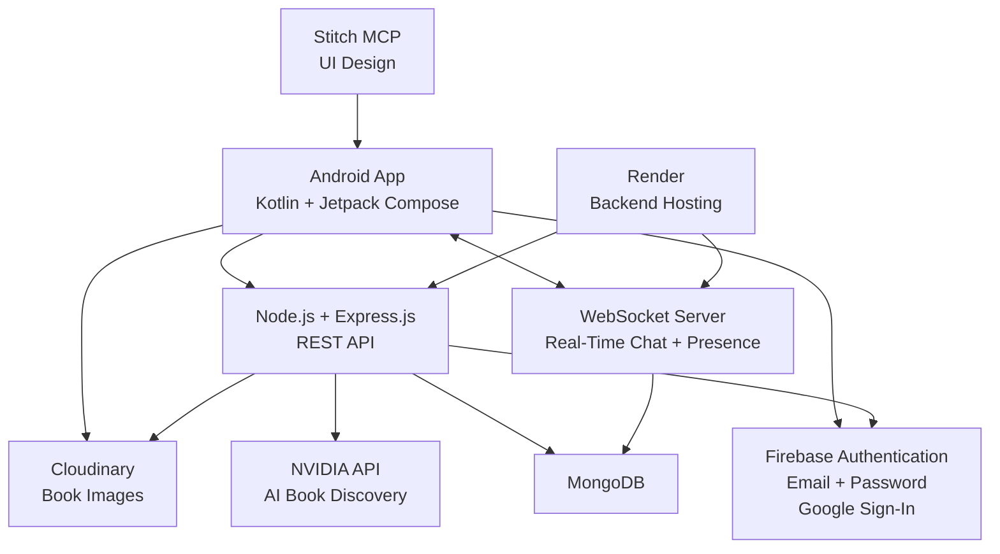

# BookWala — Technical Stack

**Project Name:** BookWala  
**Android Package:** `com.buildstack.bookwala`  
**Document:** Technical Stack Specification  
**Version:** 1.0

---

# 1. Technology Overview

BookWala is a production-oriented Android second-hand book marketplace.

The application consists of:

```text
Android Client
      ↓
Backend API
      ↓
MongoDB
```

with supporting services:

```text
Firebase Authentication
Cloudinary
WebSocket
NVIDIA AI API
Render
```

The complete technology architecture is:

```text
                         BOOKWALA
                            │
                 ┌──────────┴──────────┐
                 │                     │
            Android App           Backend Server
                 │                     │
      Kotlin + Jetpack Compose   Node.js + Express.js
                 │                     │
                 │              ┌──────┴──────┐
                 │              │             │
                 │          MongoDB       NVIDIA API
                 │
        ┌────────┼────────┐
        │        │        │
     Firebase WebSocket Cloudinary
       Auth      Chat       Images
```

---

# 2. Technology Stack Summary

| Layer | Technology |
|---|---|
| Project | BookWala |
| Android | Kotlin |
| UI | Jetpack Compose |
| Backend Runtime | Node.js |
| Backend Framework | Express.js |
| Authentication | Firebase Authentication |
| Authentication Methods | Email/Password + Google Sign-In |
| Database | MongoDB |
| Real-Time Communication | WebSocket |
| Image Storage | Cloudinary |
| AI | NVIDIA API / NVIDIA NIM |
| AI Model | Configurable NVIDIA model |
| Backend Hosting | Render |
| UI Design | Stitch MCP |
| Version Control | Git |
| API Style | REST |
| AI API Style | OpenAI-compatible NVIDIA NIM API |

---

# 3. Android Technology

## 3.1 Language

**Kotlin**

Kotlin is the primary Android development language.

All Android application code should be written in Kotlin unless a specific platform requirement requires otherwise.

---

# 4. Android UI

## 4.1 Jetpack Compose

The Android UI will be built using:

**Jetpack Compose**

Compose will be responsible for:

- Screens
- Components
- Navigation UI
- Forms
- Lists
- Cards
- Chat interface
- AI assistant interface
- Loading states
- Empty states
- Error states
- Responsive UI behavior

The UI should follow the approved Stitch design.

---

# 5. Android Architecture

The Android application should use a layered architecture.

Recommended structure:

```text
UI
 │
 ▼
ViewModel
 │
 ▼
Use Cases / Domain
 │
 ▼
Repository
 │
 ├── Remote API
 ├── WebSocket
 └── Firebase
```

A conceptual structure:

```text
Presentation
    ↓
Domain
    ↓
Data
```

The exact implementation may use Android architecture components appropriate to the project, but responsibilities must remain separated.

---

# 6. Android Package

The application package name is:

```text
com.buildstack.bookwala
```

This package name must remain unchanged unless explicitly approved.

---

# 7. Android Project Structure

The Android project should be organized logically.

A recommended structure:

```text
android/
│
├── app/
│
├── build.gradle.kts
├── settings.gradle.kts
└── gradle/
```

Inside the application module, a logical package organization may be:

```text
com.buildstack.bookwala
│
├── core/
│   ├── network/
│   ├── websocket/
│   ├── firebase/
│   ├── cloudinary/
│   ├── ui/
│   └── utils/
│
├── data/
│   ├── model/
│   ├── remote/
│   ├── repository/
│   └── datasource/
│
├── domain/
│   ├── model/
│   ├── repository/
│   └── usecase/
│
├── presentation/
│   ├── auth/
│   ├── marketplace/
│   ├── search/
│   ├── bookdetails/
│   ├── listings/
│   ├── chat/
│   ├── ai/
│   └── profile/
│
└── navigation/
```

The final structure can be adjusted as implementation progresses.

---

# 8. Backend

## 8.1 Node.js

Node.js will be used as the backend runtime.

The backend will handle:

- REST APIs
- Authentication verification
- Marketplace operations
- Book listings
- Search
- Filtering
- AI requests
- WebSocket server
- Authorization
- Business logic

---

# 9. Express.js

Express.js will provide the HTTP API layer.

Conceptual API structure:

```text
/api
│
├── /auth
├── /users
├── /books
├── /chats
├── /messages
└── /ai
```

The backend should not place all logic inside route handlers.

Recommended structure:

```text
Routes
  ↓
Controllers
  ↓
Services
  ↓
Repositories / Models
  ↓
MongoDB
```

---

# 10. Backend Project Structure

Recommended:

```text
backend/
│
├── src/
│   ├── config/
│   ├── controllers/
│   ├── middleware/
│   ├── models/
│   ├── routes/
│   ├── services/
│   ├── repositories/
│   ├── websocket/
│   ├── ai/
│   ├── utils/
│   └── app.js
│
├── tests/
├── package.json
├── .env
└── .gitignore
```

The exact language/module configuration may use the project's selected Node.js module system.

---

# 11. API Communication

The Android application communicates with the backend through REST APIs.

General flow:

```text
Jetpack Compose
      ↓
ViewModel
      ↓
Repository
      ↓
HTTP Client
      ↓
Express.js
      ↓
Service Layer
      ↓
MongoDB
```

The Android client should never directly connect to MongoDB.

---

# 12. REST API

REST APIs will be used for standard application operations.

Examples:

```text
GET    /api/books
GET    /api/books/:id
POST   /api/books
PUT    /api/books/:id
DELETE /api/books/:id
```

User-related:

```text
GET /api/users/me
GET /api/users/:id
```

Chat-related:

```text
GET /api/chats
GET /api/chats/:id
```

AI-related:

```text
POST /api/ai/book-search
```

The final endpoint structure will be defined in:

```text
API_SPECIFICATION.md
```

---

# 13. Authentication

Authentication will use:

**Firebase Authentication**

Supported methods:

```text
Email + Password
Google Sign-In
```

Authentication flow:

```text
Android
   ↓
Firebase Authentication
   ↓
Authenticated User
   ↓
Firebase ID Token
   ↓
Backend
   ↓
Verify Token
   ↓
Authorize Request
```

The backend must not trust an unverified client-provided user ID.

---

# 14. Firebase

Firebase is primarily responsible for authentication.

Required:

- Email/password authentication
- Google authentication
- User authentication state

Firebase configuration must never expose server-side secrets.

Android Firebase configuration should be handled using the official Android Firebase setup.

---

# 15. Firebase Realtime Services

Firebase real-time functionality may be used where required by the final messaging architecture.

However, the primary buyer-seller chat transport is:

**WebSocket**

The project must avoid unnecessarily duplicating the same responsibility across multiple real-time systems.

The final responsibility split must be documented in:

```text
WEBSOCKET_SPECIFICATION.md
```

---

# 16. MongoDB

MongoDB is the primary application database.

Initial entities:

```text
Users
Books
Chats
Messages
```

Potential additional entities can be introduced when required.

---

# 17. MongoDB Responsibility

MongoDB stores application data such as:

```text
User information
Book listings
Book metadata
Listing ownership
Chat metadata
Messages
Timestamps
Application state
```

Images should not be stored as large binary objects inside MongoDB.

Images are stored through Cloudinary, while MongoDB stores the relevant image URL/reference.

---

# 18. Database Access

The backend should be the only application layer directly communicating with MongoDB.

Architecture:

```text
Android
   ↓
Express API
   ↓
Service
   ↓
Repository / Model
   ↓
MongoDB
```

The Android application must never receive MongoDB credentials.

---

# 19. Cloudinary

Cloudinary will handle book images.

Required functionality:

- Image upload
- Image hosting
- Image URL generation
- Image transformation/optimization where appropriate

Book image flow:

```text
Android
   ↓
Select Image
   ↓
Upload
   ↓
Cloudinary
   ↓
Image URL
   ↓
Backend
   ↓
MongoDB
```

---

# 20. Image Storage Principle

MongoDB should store an image reference rather than the full image binary.

Example conceptual book record:

```text
Book
├── title
├── author
├── edition
├── price
├── description
├── sellerId
└── imageUrl
```

---

# 21. WebSocket

WebSocket will provide real-time buyer-seller communication.

Primary responsibilities:

```text
Real-Time Messaging
Online Status
Offline Status
Last Seen
Connection Management
Reconnection
```

---

# 22. WebSocket Architecture

```text
Android Client
      ↕
WebSocket Connection
      ↕
Node.js WebSocket Server
      ↕
Chat Service
      ↕
MongoDB
```

The WebSocket server must authenticate the connection before allowing access to protected conversations.

---

# 23. Chat Architecture

A chat should be associated with:

```text
Buyer
Seller
Book
Messages
```

Conceptually:

```text
Chat
├── buyerId
├── sellerId
├── bookId
├── createdAt
└── updatedAt
```

Messages:

```text
Message
├── chatId
├── senderId
├── content
├── createdAt
└── status
```

The final schema will be defined in:

```text
DATABASE_SCHEMA.md
```

---

# 24. WebSocket Presence

Presence will be derived from WebSocket connection state.

Conceptual flow:

```text
User Connects
     ↓
Authenticated
     ↓
Online
     ↓
Connection Lost
     ↓
Offline
     ↓
Last Seen Updated
```

The application must not display a user as online based only on stale application state.

---

# 25. Render

Render will host the backend application.

Deployment architecture:

```text
Android App
      ↓
Internet
      ↓
Render
      ↓
Node.js + Express
      ↓
MongoDB
```

The WebSocket service must also be supported by the deployed backend architecture.

---

# 26. Environment Variables

Secrets must not be committed to Git.

Backend environment variables may include:

```text
PORT
MONGODB_URI

FIREBASE_PROJECT_ID
FIREBASE_CLIENT_EMAIL
FIREBASE_PRIVATE_KEY

CLOUDINARY_CLOUD_NAME
CLOUDINARY_API_KEY
CLOUDINARY_API_SECRET

NVIDIA_API_KEY
NVIDIA_BASE_URL
NVIDIA_MODEL
```

Exact variable names can be finalized during implementation.

---

# 27. NVIDIA AI

BookWala's AI Agent will use the **NVIDIA API / NVIDIA NIM-compatible API**.

NVIDIA's NIM interface provides OpenAI-compatible inference endpoints, including `/v1/chat/completions`, and NVIDIA's hosted API Catalog provides cloud-hosted model endpoints for development/prototyping.

The NVIDIA integration should be isolated behind the BookWala backend.

The Android application must **not directly expose the NVIDIA API key**.

---

# 28. NVIDIA AI Architecture

The AI architecture is:

```text
Android
   ↓
BookWala Backend
   ↓
AI Service
   ↓
NVIDIA API
   ↓
AI Model
   ↓
Structured AI Response
   ↓
BookWala Backend
   ↓
Android
```

The NVIDIA API key remains server-side.

---

# 29. NVIDIA API Configuration

The NVIDIA AI configuration should be environment-driven.

Conceptually:

```text
NVIDIA_API_KEY
NVIDIA_BASE_URL
NVIDIA_MODEL
```

The base URL should be configurable so the project does not tightly couple application code to a single NVIDIA deployment configuration.

For NVIDIA NIM-compatible deployments, the API follows an OpenAI-compatible `/v1` interface.

---

# 30. NVIDIA Model Selection

The AI model must be configurable.

Do not hard-code a model name throughout the application.

Use:

```text
NVIDIA_MODEL
```

as the configuration point.

This allows the model to be changed without redesigning the AI architecture.

The initially approved NVIDIA model should be recorded in the project environment configuration and AI specification once selected.

---

# 31. AI Agent Responsibilities

The BookWala AI Agent is primarily a:

**Marketplace Book Discovery Agent**

Its responsibilities are:

```text
Understand User Request
        ↓
Extract Book Requirements
        ↓
Search BookWala Marketplace
        ↓
Identify Matching Listings
        ↓
Rank / Explain Matches
        ↓
Return Actual Book Listings
```

---

# 32. AI Agent Does Not Own Marketplace Data

The AI model is not the source of truth for:

- Book availability
- Price
- Seller
- Edition
- Listing ID
- Product URL

The marketplace database is the source of truth.

Therefore:

```text
AI
 ↓
Intent / Requirement Understanding
 ↓
Backend Search
 ↓
MongoDB
 ↓
Actual Listings
```

---

# 33. AI Agent Search

Example:

```text
User:

"I need a second-hand Java book for beginners
under ₹500."
```

The AI may extract:

```text
subject: Java
level: beginner
maxPrice: 500
condition: second-hand
```

The backend then searches actual BookWala listings.

---

# 34. AI Response Principle

The AI should return references to real listings.

Conceptual result:

```text
{
  "recommendations": [
    {
      "bookId": "...",
      "reason": "...",
      "matchScore": 0.92
    }
  ]
}
```

The Android application then retrieves/displays the actual marketplace data.

This prevents the AI from inventing:

- Prices
- Sellers
- Listings
- Availability

---

# 35. AI Direct Link Flow

```text
AI Recommendation
       ↓
Book ID
       ↓
Android Navigation
       ↓
Book Details
       ↓
I Want to Buy
       ↓
Chat
```

The AI should not construct arbitrary marketplace URLs.

The backend/application should provide the canonical book reference.

---

# 36. NVIDIA AI Request Flow

Conceptual:

```text
POST /api/ai/book-search
        ↓
Validate User
        ↓
Receive User Query
        ↓
AI Service
        ↓
NVIDIA API
        ↓
Extract Structured Requirements
        ↓
Marketplace Search
        ↓
MongoDB
        ↓
Matching Listings
        ↓
AI Ranking / Explanation
        ↓
Return Results
```

---

# 37. AI Streaming

Streaming may be used for the AI assistant where it improves user experience.

The NVIDIA NIM API supports streaming for inference endpoints.

However, streaming is not mandatory for the first MVP if a standard request/response flow provides a better implementation path.

The implementation should prioritize reliability.

---

# 38. AI Error Handling

If NVIDIA API fails:

```text
User Query
    ↓
NVIDIA Request
    ↓
Failure
    ↓
Backend Handles Error
    ↓
User-Friendly Response
```

The system must not fabricate AI results as a fallback.

---

# 39. AI Security

The NVIDIA API key must:

- Exist only on the backend.
- Be stored as an environment variable.
- Never be committed to Git.
- Never be sent to the Android application.
- Never be included in logs.

The Android client communicates with:

```text
BookWala Backend
```

not directly with the NVIDIA API.

---

# 40. Stitch MCP

Stitch MCP will be used for UI design.

Design flow:

```text
Requirements
     ↓
Stitch MCP
     ↓
UI Design
     ↓
Review
     ↓
Approval
     ↓
Jetpack Compose
```

The approved Stitch design is the UI source of truth.

---

# 41. UI Implementation

The Android team/agent must implement the approved Stitch designs using Jetpack Compose.

Important UI areas:

```text
Splash
Authentication
Marketplace
Search
Book Details
Create Listing
My Listings
Chat
AI Assistant
AI Results
Profile
Settings
```

---

# 42. Git

Git will be used for version control.

Development should use meaningful commits.

Examples:

```text
feat: implement Firebase authentication
feat: add marketplace browsing
feat: implement book listing creation
feat: integrate Cloudinary image uploads
feat: add book search
feat: implement websocket chat
feat: add online presence
feat: integrate NVIDIA book assistant
fix: handle failed listing image uploads
fix: prevent unauthorized listing updates
refactor: separate marketplace repository layer
```

---

# 43. Development Workflow

Every phase must follow:

```text
PLAN
 ↓
BUILD
 ↓
TEST
 ↓
FIX
 ↓
GRADLE BUILD
 ↓
REVIEW
 ↓
APPROVE
 ↓
COMMIT
 ↓
NEXT PHASE
```

---

# 44. Testing Stack

Testing should cover both Android and backend.

## Android

Test:

- Compilation
- Gradle build
- Navigation
- UI states
- ViewModels
- Repository behavior
- Authentication
- Listing flows
- Chat
- AI UI

## Backend

Test:

- API endpoints
- Validation
- Authentication
- Authorization
- MongoDB operations
- Cloudinary integration
- AI service
- WebSocket behavior

---

# 45. Android Build Validation

After Android implementation:

```text
Clean / Compile
      ↓
Run Tests
      ↓
Gradle Build
      ↓
Verify No Blocking Errors
```

A broken Gradle build must be fixed before the phase is considered complete.

---

# 46. Production Environment

The production architecture is:

```text
                         INTERNET
                            │
                            ▼
                     BOOKWALA ANDROID
                            │
             ┌──────────────┼──────────────┐
             │              │              │
             ▼              ▼              ▼
        Firebase       Render Backend   Cloudinary
          Auth              │              │
                           │              │
                    ┌──────┴──────┐       │
                    │             │       │
                    ▼             ▼       │
                 MongoDB      NVIDIA API  │
                    │             │       │
                    └──────┬──────┘       │
                           │              │
                           └──────────────┘
```

---

# 47. Responsibility Matrix

| Technology | Responsibility |
|---|---|
| Kotlin | Android application language |
| Jetpack Compose | Android UI |
| Firebase Auth | User authentication |
| Node.js | Backend runtime |
| Express.js | REST API |
| MongoDB | Application database |
| WebSocket | Real-time chat/presence |
| Cloudinary | Book image storage |
| NVIDIA API | AI book discovery |
| Render | Backend hosting |
| Stitch MCP | UI design |
| Git | Version control |

---

# 48. Data Ownership

The following components are authoritative for their respective data:

| Data | Source of Truth |
|---|---|
| Authentication identity | Firebase Authentication |
| User application profile | MongoDB |
| Book listings | MongoDB |
| Book images | Cloudinary |
| Chat/application data | MongoDB |
| Real-time connection state | WebSocket server |
| AI understanding | NVIDIA AI |
| Book availability | MongoDB |
| Book price | MongoDB |
| Seller information | MongoDB |

---

# 49. Security Architecture

The security boundary is:

```text
Android
   │
   │ Authenticated Request
   ▼
Backend
   │
   ├── Authorization
   ├── Validation
   ├── Business Rules
   │
   ├── MongoDB
   ├── Cloudinary
   └── NVIDIA API
```

The Android client is considered untrusted.

All important authorization decisions must be enforced server-side.

---

# 50. Secrets Management

Never commit:

```text
NVIDIA API Key
MongoDB URI
Firebase Admin Credentials
Cloudinary API Secret
Private Keys
Production Credentials
```

Use:

```text
Environment Variables
```

for server-side secrets.

---

# 51. Network Security

Production communication should use secure HTTPS/WSS connections.

Conceptually:

```text
HTTPS
REST API

WSS
WebSocket
```

Do not use insecure production HTTP/WebSocket connections.

---

# 52. Scalability Principles

The initial MVP should remain simple, but the architecture should avoid decisions that make future scaling unnecessarily difficult.

Important principles:

- Stateless REST API where practical.
- Modular backend services.
- Efficient MongoDB queries.
- Pagination for large marketplace lists.
- Efficient image handling.
- Controlled WebSocket connections.
- Server-side AI key management.
- Clear separation of concerns.

---

# 53. Performance Principles

Android:

```text
Efficient Compose UI
Efficient state updates
Lazy lists
Image optimization
Background network operations
```

Backend:

```text
Indexed database queries
Pagination
Validation
Connection management
Efficient API responses
```

AI:

```text
Small structured prompts
Relevant marketplace context
Avoid unnecessary AI requests
Return structured results
```

---

# 54. Dependency Principle

Dependencies should be added only when they solve a real project requirement.

Before adding a new dependency:

```text
Identify Need
 ↓
Check Existing Capability
 ↓
Evaluate Dependency
 ↓
Add Only If Justified
```

Avoid unnecessary libraries that increase maintenance complexity.

---

# 55. Technology Change Policy

The following core technologies are fixed for the MVP:

```text
Kotlin
Jetpack Compose
Node.js
Express.js
Firebase Authentication
MongoDB
WebSocket
Cloudinary
NVIDIA API
Render
```

Do not replace them without explicit approval.

If a technical limitation requires a change:

```text
Identify Problem
 ↓
Explain Impact
 ↓
Propose Alternative
 ↓
Ask for Approval
 ↓
Implement
```

---

# 56. Recommended System Architecture

The final recommended architecture is:



---

# 57. Final Technology Flow

```text
                         BOOKWALA
                            │
                            ▼
                  KOTLIN + JETPACK COMPOSE
                            │
            ┌───────────────┼────────────────┐
            │               │                │
            ▼               ▼                ▼
       Firebase Auth    REST API         WebSocket
            │               │                │
            │               ▼                ▼
            │         Node + Express    Real-Time Chat
            │               │
            │        ┌──────┼──────┐
            │        │      │      │
            │        ▼      ▼      ▼
            │     MongoDB Cloudinary NVIDIA
            │                       API
            │                        │
            │                        ▼
            │                  AI Book Agent
            │
            ▼
      User Authentication
```

---

# 58. Source-of-Truth Documents

The technical stack should work together with the following project documents:

```text
docs/
│
├── PROJECT_REQUIREMENTS.md
├── APP_FLOW.md
├── TECH_STACK.md
├── DATABASE_SCHEMA.md
├── API_SPECIFICATION.md
├── WEBSOCKET_SPECIFICATION.md
├── AUTHENTICATION_FLOW.md
├── AI_AGENT_SPECIFICATION.md
├── UI_DESIGN_SYSTEM.md
└── DEVELOPMENT_PLAN.md
```

Responsibilities:

```text
PROJECT_REQUIREMENTS.md
        ↓
What the product must do

APP_FLOW.md
        ↓
How the user moves through the application

TECH_STACK.md
        ↓
What technologies build the application

DATABASE_SCHEMA.md
        ↓
How application data is stored

API_SPECIFICATION.md
        ↓
How Android communicates with backend

WEBSOCKET_SPECIFICATION.md
        ↓
How real-time communication works

AUTHENTICATION_FLOW.md
        ↓
How identity and access work

AI_AGENT_SPECIFICATION.md
        ↓
How NVIDIA-powered book discovery works

UI_DESIGN_SYSTEM.md
        ↓
How the approved Stitch design is implemented

DEVELOPMENT_PLAN.md
        ↓
How the project is built phase-by-phase
```

---

# 59. Final Technical Objective

BookWala should be implemented as:

```text
Production-oriented Android Marketplace
                │
                ├── Kotlin
                ├── Jetpack Compose
                │
                ├── Firebase Authentication
                │
                ├── Node.js
                ├── Express.js
                │
                ├── MongoDB
                │
                ├── WebSocket
                │
                ├── Cloudinary
                │
                ├── NVIDIA API
                │
                └── Render
```

The architecture must prioritize:

```text
Security
Reliability
Maintainability
Performance
Clear Separation of Concerns
Real-Time Communication
Accurate Marketplace Data
Controlled AI Integration
Production-Quality UI
```

The NVIDIA AI integration must remain behind the BookWala backend so that the Android application never exposes the NVIDIA API key. NVIDIA's current NIM interface supports OpenAI-compatible inference APIs, making a backend abstraction around the NVIDIA endpoint appropriate for the project.