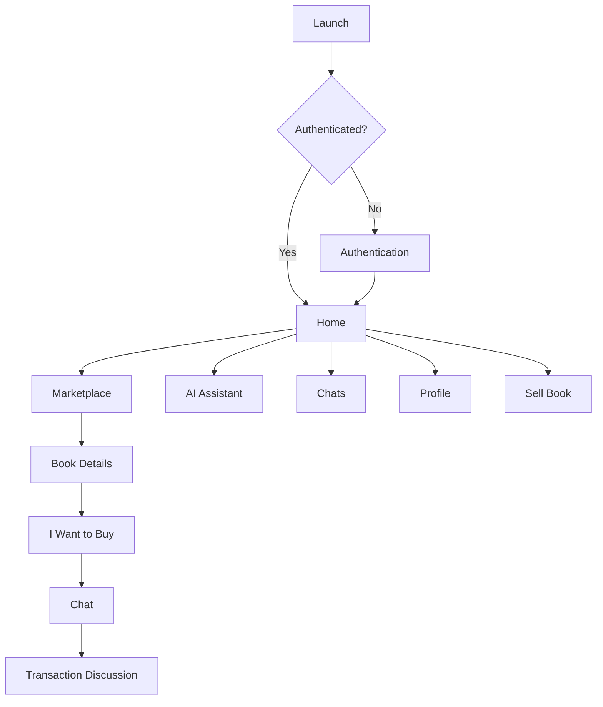
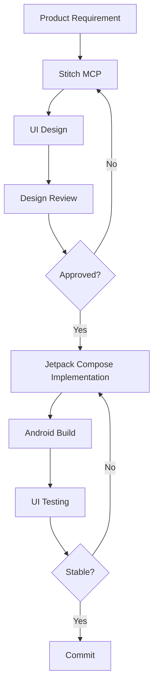

# BookWala — UI Design System

**Project Name:** BookWala  
**Android Package:** `com.buildstack.bookwala`  
**Platform:** Android  
**UI Framework:** Kotlin + Jetpack Compose  
**Design Source:** Stitch MCP  
**Design Philosophy:** Modern marketplace, student-focused, trustworthy, clean, production-grade  
**Version:** 1.0

---

# 1. Design Objective

BookWala should feel like a **real second-hand book marketplace**, not a demo application.

The design must communicate:

- Trust
- Simplicity
- Discoverability
- Affordability
- Community
- Real marketplace activity
- Easy communication between buyer and seller

The interface should be optimized for students who frequently browse many book listings.

---

# 2. Design Principles

## 2.1 Marketplace First

Books are the primary visual content.

The UI should prioritize:

```text
Book image
Title
Author
Edition
Price
Condition
```

---

## 2.2 Trust

Users should feel comfortable contacting sellers.

Important UI elements:

```text
Seller name
Seller profile
Online/offline status
Last seen
Book condition
Clear price
```

---

## 2.3 Minimal Friction

The main user journey should be:

```text
Discover
 ↓
View Book
 ↓
I Want to Buy
 ↓
Chat
```

Avoid unnecessary steps.

---

## 2.4 Student-Friendly

The design should work well for:

```text
Students
College users
School students
Competitive exam learners
Casual readers
```

---

# 3. Visual Direction

Recommended visual direction:

```text
Modern
Clean
Warm
Editorial
Marketplace-focused
Minimal
Confident
```

Avoid:

```text
Overly futuristic UI
Excessive gradients
Excessive glassmorphism
Heavy shadows
Neon-heavy interfaces
Generic dashboard layouts
```

---

# 4. Stitch MCP Requirement

All major BookWala UI screens should first be designed using **Stitch MCP**.

Process:

```text
Requirements
 ↓
Stitch Design
 ↓
Review
 ↓
Approve
 ↓
Implement in Jetpack Compose
 ↓
Test
 ↓
Polish
```

The Compose implementation must reproduce the approved Stitch design rather than creating an unrelated UI.

---

# 5. Design System Structure

```text
UI Design System
 ├── Color
 ├── Typography
 ├── Spacing
 ├── Shapes
 ├── Elevation
 ├── Icons
 ├── Components
 ├── Cards
 ├── Navigation
 ├── Forms
 ├── Feedback
 ├── Chat
 └── AI Assistant
```

---

# 6. Theme Architecture

Recommended Compose structure:

```text
ui/
├── theme/
│   ├── Color.kt
│   ├── Type.kt
│   ├── Shape.kt
│   └── Theme.kt
```

All screens should use centralized theme definitions.

Do not hardcode colors throughout individual composables.

---

# 7. Color System

The exact final color values should be established during the Stitch design phase.

The system should define semantic colors rather than scattering raw hex values.

Required tokens:

```text
Primary
OnPrimary
PrimaryContainer
OnPrimaryContainer

Secondary
OnSecondary
SecondaryContainer
OnSecondaryContainer

Background
OnBackground

Surface
OnSurface
SurfaceVariant
OnSurfaceVariant

Outline
OutlineVariant

Error
OnError
ErrorContainer
OnErrorContainer

Success
Warning
Info
```

---

# 8. Color Usage

### Primary

Use for:

```text
Primary CTA
Selected navigation state
Important actions
Buttons
```

### Surface

Use for:

```text
Cards
Bottom sheets
Dialogs
Input containers
```

### Error

Use for:

```text
Validation
Failed actions
Danger states
```

### Success

Use for:

```text
Successful listing
Successful update
Confirmation states
```

---

# 9. Dark Mode

BookWala should support a production-ready theme architecture that can accommodate:

```text
Light theme
Dark theme
```

Dark mode should not simply invert colors.

All components must use semantic theme tokens.

---

# 10. Typography

Use a clear hierarchy.

Required text styles:

```text
Display
Headline
Title
Body
Label
Caption
```

Recommended hierarchy:

```text
Screen Title
Section Title
Book Title
Price
Metadata
Description
Supporting text
```

---

# 11. Typography Rules

Book titles should have strong hierarchy.

Example:

```text
Physics for Class 12
₹450
HC Verma · 2025 Edition
```

The price should be visually prominent but should not overpower the book title.

---

# 12. Spacing System

Use a consistent spacing scale.

Recommended base:

```text
4dp
8dp
12dp
16dp
20dp
24dp
32dp
40dp
48dp
```

Avoid arbitrary spacing values unless required by the Stitch design.

---

# 13. Screen Margins

Primary screen content should generally use:

```text
16dp
```

horizontal padding.

Some editorial sections may use:

```text
20dp
24dp
```

when visually appropriate.

---

# 14. Corner Radius

Use a consistent radius system.

Example semantic tokens:

```text
Small
Medium
Large
ExtraLarge
Full
```

Suggested usage:

```text
Input → Medium
Button → Medium
Book Card → Large
Bottom Sheet → ExtraLarge
Avatar → Full
Chip → Full
```

Final values must follow the Stitch design.

---

# 15. Elevation

Use subtle elevation.

Cards should not look heavily raised.

Prefer:

```text
Surface + subtle border
```

over:

```text
Large shadow
```

---

# 16. Iconography

Use a consistent icon set.

Icons must communicate clearly.

Examples:

```text
Search
Add
Home
Bookmark
Chat
Profile
Arrow
Close
Filter
Edit
Delete
Image
Camera
Send
More
```

Do not mix unrelated icon styles.

---

# 17. Navigation Architecture

Primary navigation should expose the major user journeys.

Recommended:

```text
Home
Marketplace
Sell
Chats
Profile
```

The AI assistant can be accessible from:

```text
Home
Marketplace
```

and optionally through a floating or dedicated action depending on the Stitch design.

---

# 18. App Navigation Flow



---

# 19. Authentication Screens

Required:

```text
Splash
Login
Register
Google Sign-In
Forgot Password
```

The authentication experience should be visually simple.

---

# 20. Login Screen

Required elements:

```text
BookWala branding
Email input
Password input
Forgot password
Login button
Continue with Google
Register link
```

The primary action must be obvious.

---

# 21. Home Screen

The Home screen should focus on discovery.

Suggested structure:

```text
Header
Greeting
AI Search
Marketplace categories
Featured / recent books
Recommended listings
```

Example:

```text
Good morning 👋

What book are you looking for?

[ Ask BookWala AI... ]

Popular Categories

[Engineering] [Science] [Programming]

Recently Listed

Book cards...
```

---

# 22. Marketplace Screen

Primary functions:

```text
Search
Filter
Sort
Browse books
```

Possible controls:

```text
Search bar
Category filter
Price filter
Condition filter
Author
Edition
Sort
```

---

# 23. Search Bar

The search bar should be prominent.

Placeholder:

```text
Search books, authors, subjects...
```

The search experience should remain separate from the AI assistant while allowing users to move into AI-powered search.

---

# 24. Book Card

The Book Card is one of the most important components.

Required:

```text
Book image
Title
Author
Edition
Price
Condition
```

Optional:

```text
Location
Seller
Favorite
```

Example structure:

```text
┌─────────────────────────────┐
│                             │
│        BOOK IMAGE           │
│                             │
├─────────────────────────────┤
│ Physics for Class 12        │
│ HC Verma                    │
│ 2025 Edition                │
│                             │
│ Used                         │
│ ₹450                        │
└─────────────────────────────┘
```

---

# 25. Book Card Interaction

Tap:

```text
Book Card
 ↓
Book Details
```

Favorite:

```text
Heart icon
 ↓
Save / Unsave
```

Do not overload the card with too many actions.

---

# 26. Book Details Screen

Required:

```text
Book image
Book title
Author
Edition
Price
Condition
Description
Seller information
```

Primary CTA:

```text
I Want to Buy
```

---

# 27. Book Details Layout

Suggested:

```text
Top App Bar
 ↓
Large Book Image
 ↓
Title
 ↓
Author + Edition
 ↓
Price
 ↓
Condition
 ↓
Description
 ↓
Seller Card
 ↓
I Want to Buy
```

---

# 28. Seller Card

Show:

```text
Seller avatar
Seller name
Online / offline
Last seen when applicable
```

Avoid exposing unnecessary personal information.

---

# 29. Sell Book Screen

The listing creation screen should be optimized for speed.

Required fields:

```text
Book image
Book name
Author
Edition
Price
Additional description
```

---

# 30. Image Upload UI

The image section should support:

```text
Camera
Gallery
```

The UI should clearly indicate that the book image helps buyers identify the listing.

---

# 31. Listing Form

Example:

```text
Add Book

[ Book Image ]

Book Name
[________________]

Author
[________________]

Edition
[________________]

Price
[ ₹ _____________ ]

Description
[________________]
[________________]

[ Publish Book ]
```

---

# 32. Form Validation

Validation should be visually clear.

Example:

```text
Book name is required.
Price must be greater than zero.
Please add a book image.
```

Do not rely only on color to communicate validation errors.

---

# 33. Listing Success

After successful listing:

```text
Book listed successfully
```

Then:

```text
View Listing
```

and optionally:

```text
Back to Marketplace
```

---

# 34. Chat UI

Chat is a core BookWala feature.

Required:

```text
Seller / buyer name
Online/offline status
Last seen
Message list
Text input
Send button
```

---

# 35. Chat Layout

```text
┌─────────────────────────────┐
│ ← Seller Name        ●      │
│   Online                    │
├─────────────────────────────┤
│                             │
│      Seller message         │
│                             │
│ Buyer message               │
│                             │
│      Seller message         │
│                             │
├─────────────────────────────┤
│ Type a message...       ➤   │
└─────────────────────────────┘
```

---

# 36. Message Bubbles

Incoming and outgoing messages must be visually distinct.

Use:

```text
Alignment
Surface
Shape
Typography
```

rather than excessive colors.

---

# 37. Message States

Support:

```text
Sending
Sent
Failed
```

A failed message should allow retry.

---

# 38. Online / Offline

Show:

```text
Online
```

when a valid active WebSocket connection exists.

Otherwise:

```text
Last seen recently
```

or a suitable last-seen representation.

Do not display fake online states.

---

# 39. Chat Empty State

If there are no messages:

```text
Start a conversation

Ask the seller about the book,
condition, price, or availability.
```

---

# 40. AI Assistant UI

The AI Assistant should feel integrated into BookWala.

It should not look like a generic ChatGPT clone.

Primary purpose:

```text
Find books
```

---

# 41. AI Assistant Entry

Possible Home UI:

```text
What are you looking for?

[ Ask BookWala AI... ]
```

Example prompts:

```text
"Find physics books under ₹500"
"Find beginner Python books"
"Show me engineering books"
```

---

# 42. AI Assistant Screen

Suggested layout:

```text
Top App Bar
BookWala AI

Conversation

AI message

User message

AI book results

[Book Card]
[Book Card]

Input
[ Ask anything about books... ]
```

---

# 43. AI Book Result Card

AI results should use the same visual language as marketplace book cards.

Do not create a completely different product-card design.

Include:

```text
Book image
Title
Author
Edition
Price
Why it matches
View Book
```

---

# 44. AI Result Explanation

Example:

```text
Matches your request:
✓ Python
✓ Beginner friendly
✓ Under ₹500
```

This makes AI recommendations understandable.

---

# 45. AI Loading State

Use a subtle loading state.

Example:

```text
Finding books...
```

Avoid exaggerated animations.

---

# 46. AI Empty State

If no results:

```text
No matching books found.

Try increasing your budget or
searching for a broader subject.
```

---

# 47. Profile Screen

Required:

```text
Profile photo
Name
Email
Listings
Saved books
Settings
Logout
```

Optional:

```text
Books sold
Books bought
```

---

# 48. My Listings

Users should be able to manage books they listed.

Listing states:

```text
Active
Sold
Archived
```

---

# 49. Listing Management

Owner actions:

```text
Edit
Mark as sold
Delete
```

Only the owner may perform these actions.

---

# 50. Saved Books

Users may save interesting listings.

The saved-books UI should show:

```text
Book image
Title
Price
Author
```

Tap:

```text
Book Details
```

---

# 51. Empty States

Every major screen needs an intentional empty state.

Examples:

### No Listings

```text
No books listed yet.
Be the first to sell a book.
```

### No Saved Books

```text
No saved books yet.
Save books you want to check later.
```

### No Chats

```text
No conversations yet.
Start by contacting a seller.
```

---

# 52. Error States

Errors should be actionable.

Bad:

```text
Error 500
```

Better:

```text
Something went wrong.

Please try again.
[Retry]
```

---

# 53. Loading States

Use skeletons or appropriate loading indicators for:

```text
Marketplace
Book Details
Profile
Chat history
AI results
```

Avoid blank screens while data loads.

---

# 54. Network Error

Example:

```text
You're offline.

Check your internet connection
and try again.

[Retry]
```

---

# 55. Accessibility

The application should support:

```text
Content descriptions
Readable contrast
Touch targets
Dynamic text scaling
Screen readers
Meaningful button labels
```

Do not use color alone to communicate status.

---

# 56. Touch Targets

Interactive controls should have sufficiently large touch areas.

Avoid tiny:

```text
Icon-only controls
```

unless their touch target remains accessible.

---

# 57. Responsive Layout

The initial target is Android phones.

However, Compose layouts should avoid hardcoding widths that break on larger screens.

Design for:

```text
Small phone
Standard phone
Large phone
Tablet where practical
```

---

# 58. Image Handling

Book images are hosted through Cloudinary.

Android should:

```text
Load optimized image
Show placeholder
Show loading state
Handle failure
```

Do not load unnecessarily huge original images.

---

# 59. Image Placeholder

Book cards should have a consistent placeholder when:

```text
Image unavailable
Image loading
```

The placeholder should remain visually consistent with the design system.

---

# 60. Component Library

The project should create reusable Compose components.

Recommended:

```text
BookCard
BookImage
PrimaryButton
SecondaryButton
SearchBar
FilterChip
PriceText
UserAvatar
SellerCard
ChatBubble
MessageInput
AIResultCard
EmptyState
ErrorState
LoadingState
```

---

# 61. Component Naming

Use semantic names.

Good:

```text
BookCard()
PrimaryButton()
SellerCard()
```

Avoid:

```text
BlueBox()
RoundedThing()
CustomCard2()
```

---

# 62. Button Hierarchy

### Primary

Used for:

```text
Publish Book
I Want to Buy
View Book
Login
```

### Secondary

Used for:

```text
Cancel
Filter
Alternative actions
```

### Destructive

Used for:

```text
Delete listing
```

---

# 63. Search / Filter Components

Filters should be easy to understand.

Possible chips:

```text
Price
Genre
Condition
Edition
Author
```

Applied filters should be visible.

---

# 64. Bottom Navigation

If bottom navigation is used, maintain a small number of primary destinations.

Recommended:

```text
Home
Market
Sell
Chats
Profile
```

The selected state must be obvious.

---

# 65. Top App Bars

Each screen should have a clear title.

Use:

```text
Back
Title
Contextual actions
```

Avoid unnecessary navigation complexity.

---

# 66. Dialogs

Dialogs should be reserved for important decisions.

Examples:

```text
Delete listing?
Mark book as sold?
Logout?
```

Do not use dialogs for ordinary navigation.

---

# 67. Bottom Sheets

Bottom sheets are appropriate for:

```text
Filters
Sort
Image selection
Additional actions
```

---

# 68. Toast / Snackbar

Use Snackbar for short-lived feedback:

```text
Book saved
Listing published
Message failed
```

Important errors should use a persistent or actionable UI rather than disappearing immediately.

---

# 69. Animation

Animations should be subtle and purposeful.

Use for:

```text
Screen transitions
List updates
Favorite action
Loading
Chat message appearance
```

Avoid:

```text
Continuous decorative animations
```

which distract from marketplace content.

---

# 70. UI Architecture

Recommended Compose architecture:

```text
presentation/
├── navigation/
├── screens/
│   ├── auth/
│   ├── home/
│   ├── marketplace/
│   ├── book/
│   ├── sell/
│   ├── chat/
│   ├── ai/
│   └── profile/
├── components/
└── theme/
```

---

# 71. UI State

Each screen should model:

```text
Loading
Success
Empty
Error
```

Example:

```text
sealed interface MarketplaceUiState {
    data object Loading : MarketplaceUiState
    data class Success(...) : MarketplaceUiState
    data object Empty : MarketplaceUiState
    data class Error(...) : MarketplaceUiState
}
```

The exact implementation may differ.

---

# 72. Unidirectional Data Flow

Recommended:

```text
User Action
 ↓
ViewModel
 ↓
Use Case / Repository
 ↓
Data Source
 ↓
State
 ↓
Compose UI
```

Avoid putting business logic directly into composables.

---

# 73. Design Tokens

The UI should centralize:

```text
Colors
Typography
Spacing
Shapes
Dimensions
Elevation
```

Example conceptual API:

```kotlin
BookWalaTheme {
    ...
}
```

---

# 74. Design-to-Code Workflow

The implementation workflow must be:



---

# 75. Stitch Implementation Rules

When implementing a Stitch design:

- Preserve layout hierarchy.
- Preserve spacing.
- Preserve typography hierarchy.
- Preserve component relationships.
- Preserve visual intent.
- Replace placeholder content with real application data.
- Make components reusable.
- Do not introduce random UI patterns.

---

# 76. Production Quality Rules

BookWala must not contain:

```text
Lorem ipsum
Placeholder avatars
Fake book prices
Fake seller names
Demo-only buttons
Dead navigation
Unimplemented primary actions
Hardcoded marketplace data
```

Unless explicitly used during development/testing.

---

# 77. UI Testing

Every major screen must be tested.

### Authentication

```text
Login
Register
Google Sign-In
Logout
```

### Marketplace

```text
Search
Filter
Book card
Book details
```

### Selling

```text
Image upload
Form validation
Publish
Edit
Delete
```

### Chat

```text
Open chat
Send message
Receive message
Online status
Offline status
Last seen
Reconnect
```

### AI

```text
Search
Results
No results
Error
Book navigation
```

---

# 78. UI Acceptance Criteria

The UI system is considered complete when:

- All major screens follow one visual language.
- Stitch-approved designs are implemented in Compose.
- No screen looks like an unrelated template.
- Marketplace content is the visual priority.
- Book cards are consistent throughout the app.
- Buttons have clear hierarchy.
- Loading, empty, and error states exist.
- Chat feels like a real messaging interface.
- AI feels integrated into BookWala.
- Accessibility fundamentals are supported.
- Light/dark theme architecture is supported.
- Components are reusable.
- Spacing and typography are consistent.
- No unnecessary visual clutter exists.
- The application looks production-ready rather than like a demo.

---

# 79. Complete UI Screen Map

```text
BookWala
│
├── Splash
│
├── Authentication
│   ├── Login
│   ├── Register
│   └── Forgot Password
│
└── Main App
    │
    ├── Home
    │   ├── AI Search
    │   ├── Categories
    │   └── Recent Books
    │
    ├── Marketplace
    │   ├── Search
    │   ├── Filters
    │   └── Book Details
    │
    ├── Sell
    │   ├── Create Listing
    │   └── Edit Listing
    │
    ├── Chats
    │   └── Chat
    │
    ├── AI Assistant
    │   └── AI Book Results
    │
    └── Profile
        ├── My Listings
        ├── Saved Books
        └── Settings
```

---

# 80. Final Design Philosophy

BookWala should feel like:

```text
A real student marketplace
+
A clean book discovery experience
+
A trusted buyer-seller communication platform
+
An intelligent book search assistant
```

The UI should remain:

```text
Simple
Clear
Fast
Trustworthy
Modern
Consistent
Production-ready
```

The design system exists to make every future feature feel like part of the same BookWala product rather than a collection of separately designed screens.