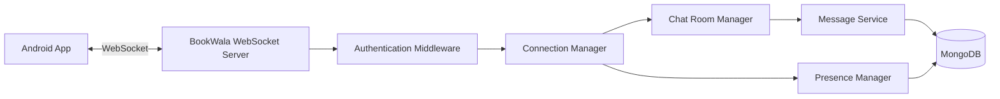
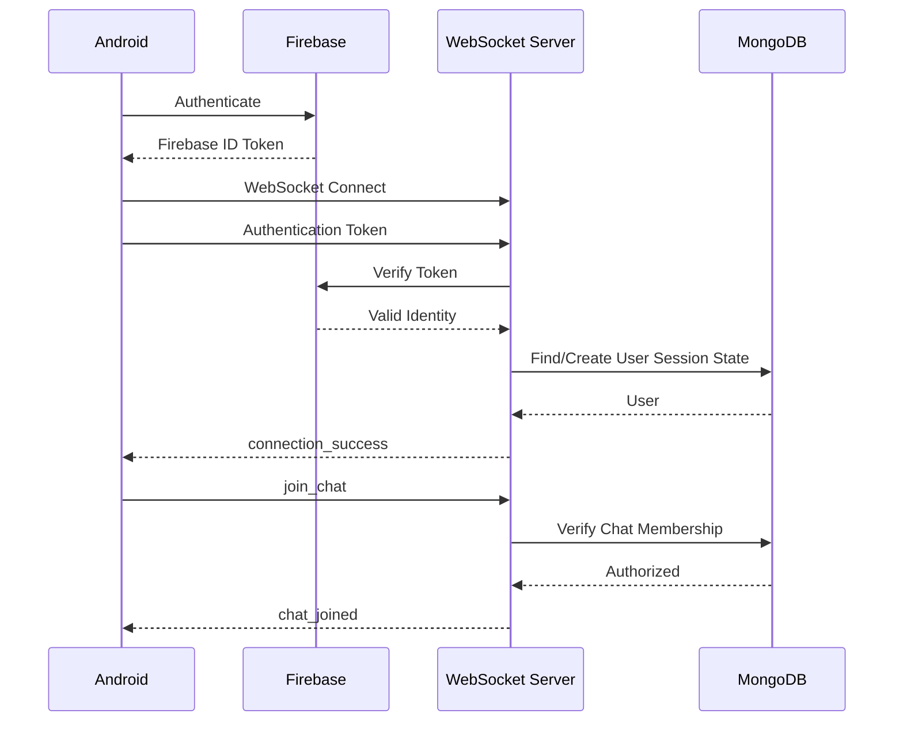
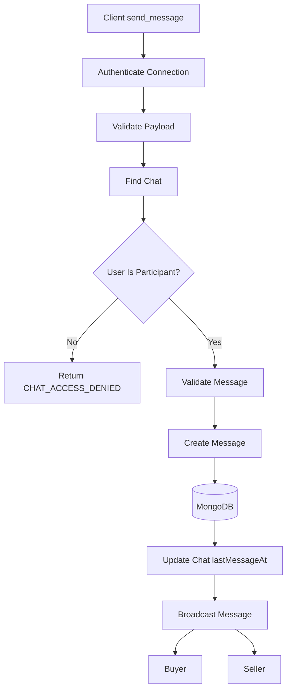
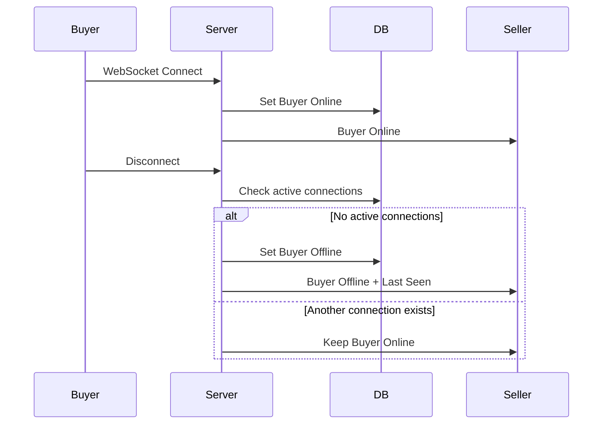
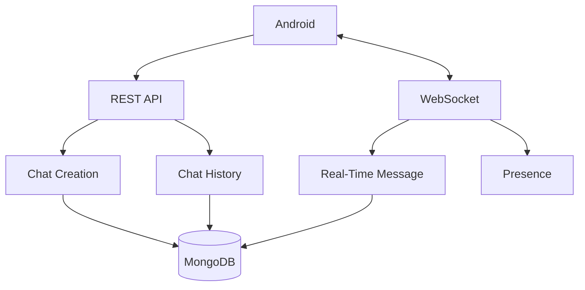
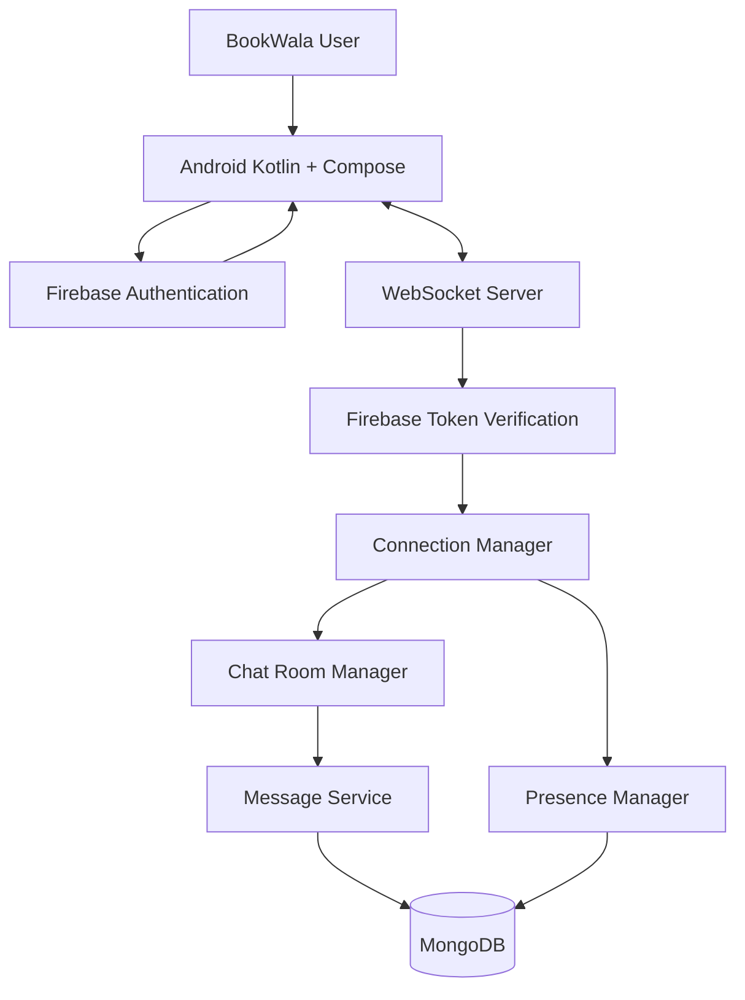

# BookWala — WebSocket Specification

**Project Name:** BookWala  
**Android Package:** `com.buildstack.bookwala`  
**Backend:** Node.js + Express.js  
**Real-Time Transport:** WebSocket  
**Authentication:** Firebase Authentication  
**Database:** MongoDB  
**Version:** 1.0

---

# 1. Purpose

This document defines the real-time communication architecture for BookWala.

WebSocket is responsible for:

- Real-time buyer-seller messaging
- Message delivery
- Chat room membership
- Online/offline presence
- Last seen
- Connection lifecycle
- Reconnection
- WebSocket authentication
- Error handling
- Message persistence
- Multi-device connection handling

REST APIs remain responsible for:

- Creating/finding chats
- Loading chat history
- Marketplace operations
- User profile operations
- Book listings
- AI functionality

WebSocket is not a replacement for the REST API.

---

# 2. Real-Time Architecture



---

# 3. WebSocket Responsibility

## WebSocket handles

```text
Real-time messages
Online status
Offline status
Last seen
Chat room membership
Message delivery
Connection state
```

## REST API handles

```text
User authentication
User profile
Book listings
Book search
Chat creation
Chat history
AI book search
Listing management
```

---

# 4. WebSocket Endpoint

Development:

```text
ws://localhost:<PORT>/ws
```

Production:

```text
wss://<bookwala-backend-domain>/ws
```

Use:

```text
wss
```

in production.

Unencrypted `ws` must not be used for production traffic.

---

# 5. WebSocket Authentication

A WebSocket connection must be authenticated before accessing private BookWala conversations.

Authentication uses a Firebase ID token.

The Android application obtains the Firebase ID token after login and supplies it during the WebSocket authentication process.

Architecture:

```text
Android
   ↓
Firebase Authentication
   ↓
Firebase ID Token
   ↓
WebSocket Connection
   ↓
BookWala Backend
   ↓
Firebase Token Verification
   ↓
Authenticated WebSocket
```

---

# 6. Important Security Rule

The backend must never trust:

```text
userId
senderId
sellerId
buyerId
```

sent by the Android client as proof of identity.

The backend derives the authenticated user from the verified Firebase token.

For example:

```text
Firebase Token
      ↓
Firebase UID
      ↓
MongoDB User
      ↓
BookWala User ID
```

---

# 7. WebSocket Connection Lifecycle



---

# 8. Connection States

The client should support:

```text
CONNECTING
CONNECTED
DISCONNECTED
RECONNECTING
FAILED
```

Recommended Android representation:

```kotlin
sealed interface WebSocketState {
    data object Connecting : WebSocketState
    data object Connected : WebSocketState
    data object Disconnected : WebSocketState
    data object Reconnecting : WebSocketState
    data class Error(val message: String) : WebSocketState
}
```

The exact implementation can vary.

---

# 9. Authentication Event

After opening the WebSocket connection, the client must authenticate.

Conceptual event:

```json
{
  "type": "authenticate",
  "token": "<FIREBASE_ID_TOKEN>"
}
```

The backend:

1. Receives token.
2. Verifies token with Firebase Admin SDK.
3. Resolves the Firebase UID.
4. Finds or creates the BookWala user profile where appropriate.
5. Associates the WebSocket connection with the authenticated user.
6. Marks the user online.

---

# 10. Authentication Success

Server:

```json
{
  "type": "authentication_success",
  "data": {
    "userId": "USER_ID"
  }
}
```

The client can then use authenticated WebSocket functionality.

---

# 11. Authentication Failure

Server:

```json
{
  "type": "error",
  "data": {
    "code": "AUTHENTICATION_FAILED",
    "message": "WebSocket authentication failed."
  }
}
```

The server should close the connection after authentication failure.

Recommended close behavior:

```text
Authentication failure
        ↓
Send error
        ↓
Close connection
```

---

# 12. Connection Registration

After authentication, the server maintains an in-memory connection registry.

Conceptually:

```text
userId
   ↓
active WebSocket connections
```

Example:

```text
USER_123
 ├── connection_001
 └── connection_002
```

This allows the same user to potentially have multiple active sessions.

---

# 13. Connection Manager

The backend should have a dedicated connection manager.

Responsibilities:

- Register connection
- Remove connection
- Find user connections
- Broadcast presence
- Deliver messages
- Detect disconnects
- Manage multiple connections

Conceptual structure:

```text
ConnectionManager
 ├── addConnection()
 ├── removeConnection()
 ├── getUserConnections()
 ├── sendToUser()
 ├── sendToChat()
 └── broadcastPresence()
```

---

# 14. Chat Room Model

Each conversation has a logical WebSocket room.

Example:

```text
chat:CHAT_ID
```

Only the buyer and seller belonging to the chat may join that room.

---

# 15. Join Chat

Client:

```json
{
  "type": "join_chat",
  "chatId": "CHAT_ID"
}
```

Backend:

```text
Receive request
      ↓
Authenticate user
      ↓
Find chat
      ↓
Check buyerId / sellerId
      ↓
Allow or reject
```

---

# 16. Join Chat Success

Server:

```json
{
  "type": "chat_joined",
  "data": {
    "chatId": "CHAT_ID"
  }
}
```

---

# 17. Join Chat Failure

Server:

```json
{
  "type": "error",
  "data": {
    "code": "CHAT_ACCESS_DENIED",
    "message": "You are not a participant in this conversation."
  }
}
```

The server must not reveal private chat information to unauthorized users.

---

# 18. Leave Chat

Client:

```json
{
  "type": "leave_chat",
  "chatId": "CHAT_ID"
}
```

Server removes the connection from the logical chat room.

Leaving a room does not delete the conversation.

---

# 19. Sending a Message

Client:

```json
{
  "type": "send_message",
  "chatId": "CHAT_ID",
  "content": "Is the book still available?"
}
```

The client must not send:

```text
senderId
sellerId
buyerId
```

as authoritative identity fields.

The server obtains the sender from the authenticated WebSocket session.

---

# 20. Message Processing



---

# 21. Message Validation

The backend must validate:

```text
chatId
content
message type
authentication
chat membership
```

Message content must:

- Exist
- Be a string
- Not be empty
- Stay within the configured maximum length

The exact maximum length should be defined in the backend validation layer.

---

# 22. Message Persistence

Messages must be saved to MongoDB before being treated as successfully delivered.

Preferred sequence:

```text
Client
 ↓
WebSocket
 ↓
Validate
 ↓
MongoDB
 ↓
Broadcast
```

This prevents a message from appearing successfully in the UI while not being persisted.

---

# 23. Message Event

Server broadcasts:

```json
{
  "type": "message",
  "data": {
    "id": "MESSAGE_ID",
    "chatId": "CHAT_ID",
    "senderId": "USER_ID",
    "content": "Is the book still available?",
    "messageType": "text",
    "createdAt": "2026-09-07T10:30:00.000Z"
  }
}
```

---

# 24. Message Delivery

If both participants are online:

```text
Buyer
 ↓
Server
 ↓
MongoDB
 ↓
Seller
```

The sender can also receive the canonical stored message.

This ensures both clients use the same:

```text
messageId
timestamp
chatId
senderId
```

---

# 25. Offline User

If the recipient is offline:

```text
Sender
 ↓
Server
 ↓
MongoDB
 ↓
Recipient reconnects
 ↓
REST message history
```

The server does not need to maintain an independent permanent message queue for the MVP.

MongoDB is the source of truth for chat history.

---

# 26. Reconnection

The Android application must automatically attempt to reconnect after an unexpected disconnection.

Conceptual flow:

```text
Connected
   ↓
Connection Lost
   ↓
Disconnected
   ↓
Wait
   ↓
Reconnect
   ↓
Authenticate
   ↓
Restore Required Chat State
   ↓
Connected
```

---

# 27. Reconnection Backoff

The client should use exponential backoff.

Example:

```text
1 second
2 seconds
4 seconds
8 seconds
16 seconds
30 seconds maximum
```

The exact implementation may use a capped exponential backoff.

Avoid infinite rapid reconnection loops.

---

# 28. Firebase Token Refresh

Firebase ID tokens can expire.

The Android application must obtain a current Firebase token when necessary.

If the WebSocket server determines that the authentication token is no longer valid:

```text
Token invalid
 ↓
Authentication error
 ↓
Client refreshes Firebase token
 ↓
Reconnect
 ↓
Authenticate again
```

---

# 29. Online Presence

Presence represents whether a user currently has an active authenticated WebSocket connection.

```text
online
offline
```

Presence should not be based on:

```text
App screen visibility
```

alone.

The backend connection state is authoritative.

---

# 30. User Goes Online

```text
WebSocket authenticated
        ↓
Register connection
        ↓
User becomes online
        ↓
Update presence state
        ↓
Notify relevant users
```

Server:

```json
{
  "type": "presence",
  "data": {
    "userId": "USER_ID",
    "status": "online",
    "lastSeenAt": null
  }
}
```

---

# 31. User Goes Offline

A user becomes offline when their last active authenticated WebSocket connection is closed.

Important:

```text
Connection A closes
Connection B still active
        ↓
User remains online
```

Only when:

```text
All user connections closed
```

does the user become offline.

---

# 32. Last Seen

When the user becomes offline:

```text
lastSeenAt = current UTC timestamp
```

Example:

```json
{
  "type": "presence",
  "data": {
    "userId": "USER_ID",
    "status": "offline",
    "lastSeenAt": "2026-09-07T10:40:00.000Z"
  }
}
```

---

# 33. Presence Persistence

Recommended user document fields:

```text
isOnline
lastSeenAt
```

These are stored in MongoDB as defined in `DATABASE_SCHEMA.md`.

---

# 34. Presence Broadcast Scope

Presence updates should not be broadcast globally to every user.

They should be sent only to users who need the information.

For the MVP, relevant users are primarily:

```text
Users participating in the same chat
```

This reduces unnecessary real-time traffic.

---

# 35. Presence Flow



---

# 36. Typing Indicator

Typing indicators are optional for MVP.

If implemented:

Client:

```json
{
  "type": "typing",
  "chatId": "CHAT_ID",
  "isTyping": true
}
```

Server forwards:

```json
{
  "type": "typing",
  "data": {
    "chatId": "CHAT_ID",
    "userId": "USER_ID",
    "isTyping": true
  }
}
```

Typing events should not be persisted in MongoDB.

---

# 37. Message Ordering

Messages should use server-generated timestamps.

Do not trust timestamps supplied by Android.

The database message's:

```text
createdAt
```

is authoritative.

Messages are displayed:

```text
createdAt ASC
```

---

# 38. Duplicate Message Protection

The client may accidentally send a message twice because of:

- Network retries
- Reconnection
- UI events
- User taps

The implementation should consider client-generated temporary message IDs or idempotency identifiers if duplicate prevention becomes necessary.

For MVP, the simplest implementation may rely on the Android UI preventing repeated sends, but the backend should remain safe against duplicate submissions.

---

# 39. WebSocket Event Envelope

All WebSocket messages should use a consistent envelope.

General format:

```json
{
  "type": "EVENT_NAME",
  "data": {}
}
```

Errors:

```json
{
  "type": "error",
  "data": {
    "code": "ERROR_CODE",
    "message": "Human-readable message"
  }
}
```

---

# 40. Client-to-Server Events

MVP:

```text
authenticate
join_chat
leave_chat
send_message
```

Optional:

```text
typing
```

---

# 41. Server-to-Client Events

MVP:

```text
authentication_success
chat_joined
message
presence
error
```

---

# 42. Event Reference

| Event | Direction | Purpose |
|---|---|---|
| `authenticate` | Client → Server | Authenticate WebSocket |
| `authentication_success` | Server → Client | Authentication completed |
| `join_chat` | Client → Server | Join conversation |
| `chat_joined` | Server → Client | Chat joined |
| `leave_chat` | Client → Server | Leave conversation |
| `send_message` | Client → Server | Send message |
| `message` | Server → Client | Deliver stored message |
| `presence` | Server → Client | Online/offline update |
| `typing` | Client → Server | Optional typing state |
| `error` | Server → Client | Error |

---

# 43. Invalid Event

If an unknown event is received:

```json
{
  "type": "error",
  "data": {
    "code": "UNKNOWN_EVENT",
    "message": "Unknown WebSocket event."
  }
}
```

The server should not crash.

---

# 44. Malformed Payload

Example:

```json
{
  "type": "send_message"
}
```

Server:

```json
{
  "type": "error",
  "data": {
    "code": "INVALID_PAYLOAD",
    "message": "Invalid message payload."
  }
}
```

---

# 45. Rate Limiting

WebSocket message sending should be rate-limited.

This protects against:

- Spam
- Accidental message loops
- Malicious clients
- Resource exhaustion

The exact threshold should be configurable.

---

# 46. Message Size

The backend must enforce a maximum WebSocket payload size.

This prevents oversized payloads from consuming excessive memory.

The client should also enforce reasonable UI-side limits.

---

# 47. Chat Authorization

Every chat-related event must verify membership.

```text
Authenticated User
        ↓
Chat
        ↓
buyerId == userId
       OR
sellerId == userId
```

Only then:

```text
Join
Send
Receive
```

is permitted.

---

# 48. Book Access Does Not Equal Chat Access

A user being able to view a public book listing does not automatically give access to another user's conversations.

Example:

```text
Book is public
        ↓
Anyone can view listing
```

but:

```text
Chat is private
        ↓
Only buyer + seller
```

---

# 49. WebSocket and REST Relationship



---

# 50. Chat Opening Flow

```text
User opens book
      ↓
Clicks "I Want to Buy"
      ↓
POST /api/chats
      ↓
Backend returns chatId
      ↓
Android opens chat screen
      ↓
WebSocket connects/authenticates
      ↓
join_chat(chatId)
      ↓
Load existing messages
      ↓
Real-time chat active
```

---

# 51. Chat Loading Strategy

When opening a conversation:

```text
1. Obtain/create chat
2. Load recent history through REST
3. Connect/authenticate WebSocket if not already connected
4. Join chat room
5. Listen for new messages
6. Update UI
```

This ensures chat history is available even if the WebSocket connection is temporarily unavailable.

---

# 52. WebSocket Failure Strategy

If WebSocket fails:

```text
Chat UI remains usable
        ↓
Show connection state
        ↓
Attempt reconnect
```

The application should not crash.

Existing REST functionality must remain available.

---

# 53. Message Sending During Disconnect

If the connection is unavailable, the UI should not falsely display a message as delivered.

Possible UI states:

```text
Sending
Sent
Failed
```

For MVP, failed messages may provide a retry action.

---

# 54. Server Time

The server controls authoritative message timestamps.

Do not rely on:

```text
Android device time
```

for message ordering.

All persisted timestamps should use UTC.

---

# 55. WebSocket Logging

The backend may log:

```text
Connection established
Authentication success/failure
Connection closed
Chat joined
Message persisted
WebSocket error
```

Never log:

```text
Firebase ID tokens
API keys
Passwords
Cloudinary secrets
Full private message contents unnecessarily
```

---

# 56. Connection Cleanup

On disconnect:

```text
Remove connection
 ↓
Remove from chat rooms
 ↓
Check remaining user connections
 ↓
If none:
    Mark user offline
    Update lastSeenAt
    Broadcast presence
```

---

# 57. Server Restart Behavior

WebSocket connections are not persistent across server restarts.

After deployment/restart:

```text
Server restarts
 ↓
Existing connections close
 ↓
Android detects disconnect
 ↓
Android reconnects
 ↓
Firebase token authentication
 ↓
Chat state restored
```

MongoDB remains the persistent source of message history.

---

# 58. Scalability Consideration

For the initial MVP with a single Render backend instance:

```text
Android
 ↓
Single WebSocket Server
 ↓
MongoDB
```

is sufficient.

If the application later runs multiple backend instances:

```text
Android
 ↓
Load Balancer
 ├── Server A
 ├── Server B
 └── Server C
```

then a shared real-time state/pub-sub architecture may be required.

Possible future technologies include Redis Pub/Sub.

Do not introduce Redis solely for MVP complexity unless deployment requirements require it.

---

# 59. WebSocket Testing

Every WebSocket implementation must test:

### Authentication

```text
Valid token
Invalid token
Expired token
Missing token
```

### Chat authorization

```text
Buyer joins
Seller joins
Unauthorized user attempts join
```

### Messages

```text
Valid message
Empty message
Oversized message
Unauthorized message
```

### Presence

```text
Connect
Disconnect
Reconnect
Multiple connections
```

### Reliability

```text
Network interruption
Server restart
Reconnect
Duplicate events
```

---

# 60. Acceptance Criteria

WebSocket implementation is considered stable when:

- Firebase-authenticated users can connect.
- Unauthorized connections are rejected.
- Buyers can join their own conversations.
- Sellers can join their own conversations.
- Unauthorized users cannot access conversations.
- Messages are persisted in MongoDB.
- Messages are delivered in real time.
- Offline users can see messages after reconnecting/loading history.
- Online/offline state works.
- Last seen is updated correctly.
- Multiple connections do not incorrectly mark users offline.
- Reconnection works.
- WebSocket failures do not crash the Android app.
- No credentials or secrets are exposed to Android.

---

# 61. Final WebSocket Architecture



---

# 62. Core Principle

```text
Firebase
    ↓
Identity

WebSocket
    ↓
Real-Time Transport

MongoDB
    ↓
Persistent Chat History

REST API
    ↓
Chat Creation + History

Android
    ↓
User Interface
```

The WebSocket server is responsible for real-time communication, while MongoDB remains the persistent source of truth.